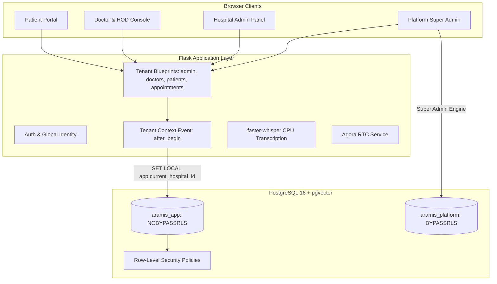

# Aramis AI Healthcare Solutions (Aramis Health)

**Aramis AI Healthcare Solutions** ("Aramis Health") is an intelligent, multi-tenant clinical operating system designed for **Pakistan-oriented multi-hospital networks and healthcare facilities**. It provides a single global user identity with granular hospital memberships, a 4-level staff reporting hierarchy, strict PostgreSQL Row-Level Security (RLS), appointment booking, **payment verification**, **live consultation chat**, **video consultation (Agora RTC)**, **clinical voice transcription (faster-whisper)**, **digital prescriptions**, **medical records**, **Q&A**, **blogs**, and planned shared AI integrations (DocAssist voice receptionist, Med-Care scribe, OR scheduling, Knowledge Assistant).

---

## 1. Platform Overview & Core Concepts

| Concept | Architecture & Implementation |
| :--- | :--- |
| **Global Identity & Memberships** | A user has one global account (`User`). Roles and permissions come from `HospitalMembership` (`hospital_id`, `role`, `department_id`, `reports_to_membership_id`, `status`). A clinician or staff member can belong to multiple hospitals with different roles. |
| **Global Patients** | Patient accounts are global and can discover and book consultations at any active hospital. Clinical consultations, prescriptions, and medical records are strictly scoped to the treating hospital tenant. |
| **Hospital Staff Hierarchy** | 4-tier organizational reporting hierarchy within each hospital tenant: `hospital_admin` &rarr; `hod` (Head of Department) &rarr; `doctor` &rarr; `department_staff` / `finance_manager`. |
| **PostgreSQL Row-Level Security (RLS)** | Multi-tenant isolation is enforced at the database kernel level across 15 tenant-scoped tables using non-superuser database roles (`aramis_app` with `NOBYPASSRLS`). The active tenant context is injected per-transaction via `app.current_hospital_id`. |
| **Dual-Consent Voice Transcription** | In-consultation voice transcription powered by local `faster-whisper` (`small` model on CPU, int8 quantization) supporting English and Urdu with explicit dual-consent UI (patient and doctor). Audio files are never retained on disk. |
| **Appointment & Payment Lifecycle** | Book &rarr; pay (Safepay Sandbox card or manual bank slip) &rarr; payment verification &rarr; doctor approval &rarr; consultation (chat & Agora video) &rarr; digital prescription issued &rarr; review. |

---

## 2. Tech Stack & Architecture

- **Backend Framework:** Python 3.11, Flask 3.x (Application Factory, Blueprints)
- **Database & Isolation:** PostgreSQL 16 + pgvector, Alembic (`flask db upgrade`), PostgreSQL Row-Level Security (RLS)
  - `aramis_app`: Application runtime user (`NOBYPASSRLS`, strict tenant isolation)
  - `aramis_platform`: Platform Super Admin user (`BYPASSRLS`, cross-tenant governance)
  - `postgres`: Superuser / migration owner for Alembic migrations and role provisioning
- **ORM & Migrations:** SQLAlchemy 2.x, Flask-Migrate (Alembic)
- **Video Consultations:** Agora RTC SDK (token authentication, webRTC audio/video)
- **Clinical Transcription:** `faster-whisper` (`small` model, int8 quantization, CPU execution)
- **Payment Gateway:** Safepay Sandbox API (PKR major units currency handling)
- **Frontend & UI:** Jinja2 server-rendered templates, Bootstrap 5.3, Font Awesome 6, custom CSS (`app/static/css/main.css`)
- **Realtime Services:** Flask-SocketIO (threading mode)



---

## 3. Prerequisites

Before setting up the project, ensure you have installed:

- **Python 3.11** (`python --version` must be 3.11.x)
- **Docker & Docker Compose** (for PostgreSQL 16 container with `pgvector`)
- **Git**
- **Google Chrome** or **Microsoft Edge** (for Playwright / CDP browser verification)

---

## 4. Step-by-Step Setup Guide

### 4.1 Clone and Prepare Environment

```bash
git clone <company-repo-url>
cd "Quick Care FYP"

# Create virtual environment
python -m venv venv

# Activate virtual environment
# Windows (PowerShell):
.\venv\Scripts\Activate.ps1
# Windows (CMD):
.\venv\Scripts\activate.bat
# Linux / macOS:
source venv/bin/activate

# Upgrade pip and install dependencies
pip install --upgrade pip
pip install -r requirements.txt
pip install -r requirements-dev.txt
```

### 4.2 Start PostgreSQL 16 Container

Ensure Docker Desktop is running. Start the PostgreSQL container:

```bash
docker run -d `
  --name quickcare_postgres `
  -e POSTGRES_USER=postgres `
  -e POSTGRES_PASSWORD=postgres `
  -e POSTGRES_DB=quickcare_dev `
  -p 5432:5432 `
  pgvector/pgvector:pg16
```

*(Alternatively, use `docker-compose up -d` with `docker-compose.yml`.)*

### 4.3 Configure Environment Variables

Copy `.env.example` to `.env`:

```bash
copy .env.example .env     # Windows
cp .env.example .env       # Linux / macOS
```

Review `.env` and configure your local passwords and test keys. By default, the app is configured for local Docker on `127.0.0.1:5432`.

### 4.4 Provision Database Roles & RLS Security

Provision the non-superuser application roles (`aramis_app` and `aramis_platform`) and grant required table and sequence privileges:

```bash
python scripts/provision_db_roles.py
```

### 4.5 Run Database Migrations

Apply the complete schema via Alembic:

```bash
flask db upgrade
```

### 4.6 Seed Demo Data

Populate the database with demo hospitals, organizational hierarchy, staff members, doctors, departments, and sample clinical workflows:

```bash
python scripts/seed_demo.py
```

**What the demo seed creates:**
- **Platform Super Admin:** `superadmin@aramis.health` (Cross-hospital oversight)
- **Hospital 1 (Aramis Central Hospital):**
  - Hospital Admin: `admin@aramis.health`
  - Cardiology HOD: `dr.kamran@aramis.health`
  - Cardiology Staff Doctor: `dr.fatima@aramis.health`
  - Department Staff: `staff.cardio@aramis.health`
  - Finance Manager: `finance@aramis.health`
- **Hospital 2 (Aramis Specialist Clinic):**
  - Hospital Admin: `admin.clinic@aramis.health`
  - Multi-hospital Doctor: `dr.kamran@aramis.health` (HOD at Central, Consultant at Specialist)
- **Global Patients:** `patient1@aramis.health`, `patient2@aramis.health`

### 4.7 Run the Application

```bash
python run.py
```

Open your browser at `http://127.0.0.1:5000`.

---

## 5. Running the Test Suite

The test suite validates multi-tenant isolation, PostgreSQL RLS fail-closed policies, role hierarchies, password complexity, clinical workflows, and Safepay sandbox handling.

> [!IMPORTANT]
> The PostgreSQL container must be running, and database roles must be provisioned (`python scripts/provision_db_roles.py`) before running the tests.

Execute pytest with verbose logging:

```bash
pytest -v
```

All 110 tests should pass cleanly without regressions.

---

## 6. Branch and PR Workflow

To ensure code quality, tenant isolation, and security integrity across the engineering team, follow this workflow:

1. **Branch Naming:**
   - Feature branches: `feature/<feature-name>` (e.g., `feature/voice-receptionist`, `feature/or-scheduler`)
   - Bugfix branches: `fix/<bug-description>` (e.g., `fix/safepay-webhook-signature`)
   - Performance & refactor branches: `refactor/<scope>`
2. **Local Verification Checklist Before Opening PR:**
   - [ ] Database migrations created via `flask db migrate -m "<description>"` if schema changed (never edit applied migrations).
   - [ ] Verify schema parity: `python scripts/verify_schema_parity.py`.
   - [ ] Run full test suite: `pytest -v` (must achieve 100% pass rate).
   - [ ] Zero secrets committed (run secret scan pattern check).
3. **Pull Request & Code Review:**
   - Open a PR against `main`.
   - Require at least one peer code review approval.
   - PR must include automated test coverage for new endpoints or business rules.
   - Merge via squash or rebase merge to keep Git history clean.
