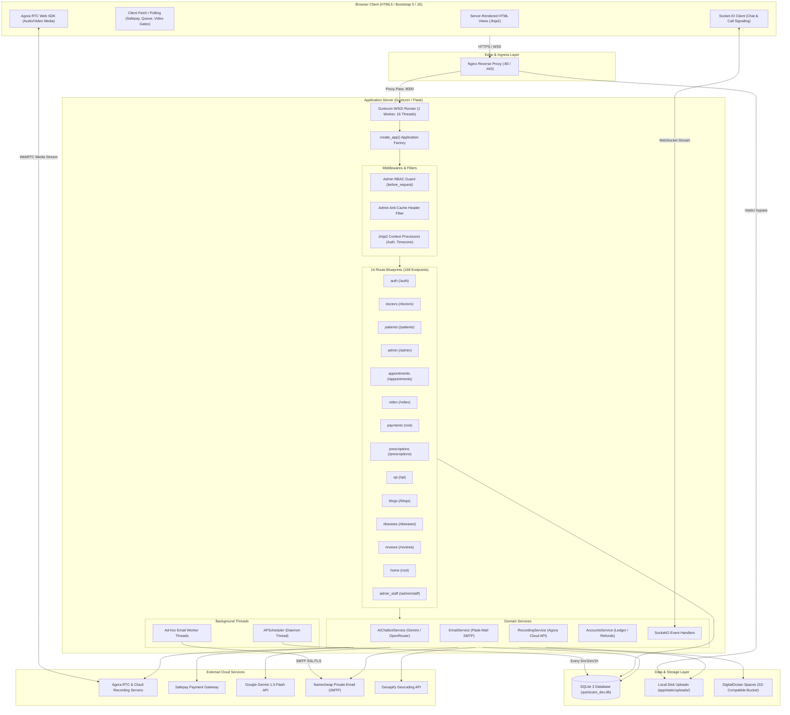

# 03 — COMPLETE ARCHITECTURE ANALYSIS

**Project Name:** Quick Care Connect & AI Healthcare Assistance  
**Audit Date:** November 1, 2026  
**Auditor:** Principal Software Architect  

---

## 1. Architectural Style & System Topology

Quick Care Connect is structured as a **Modular Monolith** built on the Flask web framework. Rather than a decoupled SPA + REST API, it uses **Server-Side Rendering (SSR)** via Jinja2 with hybrid client-side AJAX/REST endpoints and WebSockets for real-time interactions.



---

## 2. Blueprint Routing Topology & Responsibilities

The application factory in `app/__init__.py` registers 14 blueprints. URL prefixes and domain boundaries are structured as follows:

| Blueprint Name | Module Path | URL Prefix | Route Count | Primary Functional Scope |
| :--- | :--- | :--- | :--- | :--- |
| `home_bp` | `app/routes/home.py` | `/` (root) | 12 | Marketing landing page, about, terms, privacy, FAQ, public doctor directory, geocoding proxy. |
| `auth_bp` | `app/routes/auth.py` | `/auth` | 7 | Authentication lifecycle: login, unified doctor/patient registration, password reset tokens, logout. |
| `doctors_bp` | `app/routes/doctors.py` | `/doctors` | 27 | Doctor portal: dashboard, practice settings, time-slot hospital timetable, earnings ledger, payout requests, appeals. |
| `patients_bp` | `app/routes/patients.py` | `/patients` | 19 | Patient portal: profile, doctor booking funnel, manual payment screenshot uploads, document vault, refund requests. |
| `admin_bp` | `app/routes/admin.py` | `/admin` | 49 | Super-admin and staff admin moderation: doctor verifications, payment approvals, financial accounts, recordings, content moderation. |
| `admin_staff` | `app/routes/admin_staff.py` | `/admin` (shares `admin_bp`) | 4 | Sub-admin staff management: role assignments, panel grant matrix, staff deactivation. |
| `appointments_bp` | `app/routes/appointments.py`| `/appointments` | 18 | Slot availability APIs, booking validation, appointment state transitions, chat HTTP endpoints. |
| `blogs_bp` | `app/routes/blogs.py` | `/blogs` | 2 | Public medical blog feed, slug resolution, contributor rankings. |
| `qa_bp` | `app/routes/qa.py` | `/qa` | 7 | Public medical Q&A forum, AI chatbot endpoint (`/ai-chat`), thread replies, bookmarking, helpfulness voting. |
| `diseases_bp` | `app/routes/diseases.py` | `/diseases` | 3 | Public disease and symptoms directory, category browsing, doctor recommendation funnel. |
| `video_bp` | `app/routes/video.py` | `/video` | 7 | Agora RTC token generation, virtual waiting room queue status, call start/end, prescription gate validation, no-show detection. |
| `prescriptions_bp` | `app/routes/prescriptions.py` | `/prescriptions` | 3 | Clinical prescription creator, web viewer, and automated PDF download. |
| `payments_bp` | `app/routes/payments.py` | `/` (root) | 5 | Safepay checkout redirect, polling status API, return interstitial, and webhook processor. |
| `reviews_bp` | `app/routes/reviews.py` | `/reviews` | 2 | Post-consultation rating submission with fraud heuristics and review status checking. |

---

## 3. Session & Authentication Architecture

Authentication is managed via client-side encrypted cookie sessions provided natively by Flask.

```mermaid
sequenceDiagram
    participant User as Client Browser
    participant AuthBP as auth_bp (/auth/login)
    participant DB as SQLite (users table)
    participant Session as Flask Cookie Session

    User->>AuthBP: POST /auth/login (email, password)
    AuthBP->>DB: Query User by normalized email (func.lower)
    DB-->>AuthBP: User record (password_hash, role, is_active)
    AuthBP->>AuthBP: werkzeug.security.check_password_hash()
    alt Credentials Valid & is_active == True
        AuthBP->>DB: Update user.is_online = True; db.session.commit()
        AuthBP->>Session: session.clear()
        AuthBP->>Session: session['user_id'] = user.id
        AuthBP->>Session: session['user_role'] = user.role
        AuthBP->>Session: session['user_name'] = user.name
        AuthBP->>Session: session.permanent = True (1-year cookie)
        AuthBP-->>User: Set-Cookie: quickcare_session_simple; Redirect to Role Dashboard
    else Invalid Credentials
        AuthBP-->>User: Flash error; Redirect /auth/login
    end
```

### Session Configuration Parameters (`config.py`):
- `SESSION_COOKIE_NAME`: `'quickcare_session_simple'`
- `SESSION_COOKIE_HTTPONLY`: `True` (Protects against client-side JavaScript access)
- `SESSION_COOKIE_SAMESITE`: `'Lax'`
- `SESSION_COOKIE_SECURE`: `False` in base `Config` (Set to `True` in `ProductionConfig` only when `SESSION_COOKIE_SECURE=true` is set in `.env`)
- `PERMANENT_SESSION_LIFETIME`: `timedelta(days=365)` (1 Year Persistent Session)
- **Critical Architectural Flaw:** `WTF_CSRF_ENABLED = False` is hardcoded across the application. Form submissions and AJAX POST requests carry no CSRF verification tokens.

---

## 4. End-to-End Traced User Journeys

### 4.1 Consultation Lifecycle & Escrow Payment Gate
The core business workflow enforces payment verification prior to doctor notification and slot locking.

```mermaid
sequenceDiagram
    autonumber
    participant P as Patient
    participant App as Platform Core
    participant A as Admin
    participant D as Doctor
    participant SIO as Socket.IO Chat
    participant Agora as Agora RTC

    P->>App: Books 30-min slot (physical or video)
    App->>App: Creates Appointment (status='pending', payment_status='pending')
    App->>App: Sets 30-minute payment deadline; Slot is NOT locked for others
    
    alt Manual Screenshot Path (Easypaisa / JazzCash / Bank)
        P->>App: Uploads payment receipt image
        App->>App: appointment.payment_status = 'submitted'
        A->>App: Admin reviews receipt in Payment Approvals
        A->>App: Admin clicks "Approve Payment"
        App->>App: Checks slot conflict; if free, appointment.payment_status = 'approved'
        App->>D: Email notification sent to Doctor
    else Safepay Card Checkout Path
        P->>App: Initiates Safepay Checkout
        App->>App: Creates Tracker Token & redirects to Safepay
        P->>App: Completes payment; Safepay return/webhook verifies Tracker
        App->>App: appointment.payment_status = 'approved'
        App->>D: Email notification sent to Doctor
    end

    D->>App: Doctor reviews booking & clicks "Approve Appointment"
    App->>App: appointment.status = 'approved'
    App->>P: Email notification sent to Patient
    
    par Consultation Phase
        P->>SIO: Chat unlocked (payment_status == 'approved' & status == 'approved')
        D->>SIO: Doctor joins appointment chat room
    and Video Consultation Phase
        D->>App: Doctor clicks "Start Consultation" (video_bp.start_video_call)
        App->>App: appointment.is_call_active = True
        P->>Agora: Patient enters waiting room & joins channel
        App->>App: Mutual video attendance recorded (mutual_call_start)
        App->>App: If call exceeds 3 minutes, prescription_unlocked = True
        D->>App: Doctor creates Prescription (gated by prescription_unlocked)
    end

    P->>App: Patient marks appointment complete
    D->>App: Doctor marks appointment complete
    App->>App: appointment.status = 'completed_pending_review' (24-hour review window)
    App->>App: After 24h or review submitted -> Doctor balance credited (80%), Platform commission (20%)
```

---

## 5. Architectural Bottlenecks & Design Vulnerabilities

### 5.1 SQLite Concurrency & Horizontal Scaling Blocker
In `deploy/gunicorn.conf.py`:
```python
workers = 1
worker_class = 'gthread'
threads = 16
# SQLite: never use more than 1 worker
```
Because SQLite relies on file-level locks (`database is locked` on concurrent writes), the deployment is strictly restricted to **exactly 1 worker process**. Horizontal scaling across multiple worker processes, containers, or servers is fundamentally impossible without migrating to a client-server RDBMS (PostgreSQL or MySQL).

### 5.2 JSON Chat Storage Bottleneck (`MedicalHistory.chat_logs`)
In `app/services/socketio_events.py` and `app/routes/appointments.py`:
- Chat messages are stored inside a single JSON text column: `medical_histories.chat_logs`.
- Every incoming message triggers:
  1. Full deserialization of the JSON list into Python.
  2. Appending the message object.
  3. Re-serializing the entire conversation history back into JSON.
  4. Explicitly calling `flag_modified(medical_history, 'chat_logs')` and writing the entire array back to SQLite.
- As a consultation chat grows, message latency degrades quadratically, database I/O spikes, and concurrent messages risk race-condition data overwrites.

### 5.3 Duplicated Appointment Business Logic
Critical appointment workflows are duplicated across independent route modules:
- Booking: `appointments.py:book_appointment` (Lines 38-190) is duplicated in `patients.py:book_appointment` (Lines 564-780).
- Approval: `appointments.py:approve_appointment` (Lines 192-245) is duplicated in `doctors.py:approve_appointment` (Lines 668-711).
- Rejection: `appointments.py:reject_appointment` (Lines 247-288) is duplicated in `doctors.py:reject_appointment` (Lines 713-745).
- Completion: `appointments.py:complete_appointment` is duplicated in `doctors.py:complete_appointment`.

Any bug fix or business rule update applied to one route module leaves the other route vulnerable to inconsistent state transitions.

### 5.4 Redundant App Factory Invocation inside Background Scheduler
In `app/utils/cleanup_expired_payments.py`:
```python
def cleanup_expired_payments():
    app = create_app()
    with app.app_context():
        # ...
```
When `APScheduler` invokes `cleanup_expired_payments()` every 10 minutes, it calls `create_app()` again from scratch! This executes `db.create_all()`, runs 5 migration checks, initializes `Mail`, and instantiates redundant extensions within the background thread.

### 5.5 Sensitive Static Asset Exposure via Nginx
In `deploy/nginx-quickcare.conf`:
```nginx
location /static/ {
    alias /var/www/quickcare/app/static/;
    expires 7d;
}
```
User-uploaded government identity cards (CNICs), medical degree scans, private medical diagnostic documents, and payment screenshots are stored in `app/static/uploads/`. Nginx serves this path directly without authentication, completely bypassing Flask middleware. Anyone with the URL can access private patient records and government credentials.

