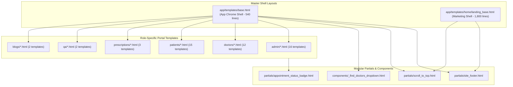
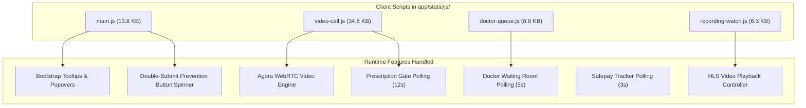

# 05 — FRONTEND & CLIENT-SIDE AUDIT

**Project Name:** Quick Care Connect & AI Healthcare Assistance  
**Audit Date:** November 1, 2026  
**Auditor:** Senior Full-Stack Engineer & UI/UX Auditor  

---

## 1. Frontend Architecture & Templating Hierarchy

The user interface of Quick Care Connect is rendered server-side using **Jinja2** templates layered with **Bootstrap 5.3.0**, custom scoped CSS stylesheets, and vanilla JavaScript controllers.



---

## 2. HTML Syntax & DOM Structural Defects

### FE-DEF-01: Unclosed `<div class="container">` in Master Layout `base.html`
- **Location:** [`app/templates/base.html`](app/templates/base.html#L412-L503)
- **Lines Affected:** Lines 412–503.
- **Evidence:**
  ```html
  412: <nav class="navbar navbar-expand-lg navbar-light navbar-sleek fixed-top">
  413:     <div class="container">               <!-- [OPENED: container div] -->
  414:         <a class="navbar-brand ...">...</a>
  418:         <button class="navbar-toggler" ...>...</button>
  422:         <div class="collapse navbar-collapse" id="navbarNav">  <!-- [OPENED: collapse div] -->
  ...
  500:             </ul>
  501:         </div>                             <!-- [CLOSED: collapse navbar-collapse div] -->
  502: </nav>                                     <!-- [ERROR: </nav> closes while line 413 container div remains open] -->
  ```
- **Technical Impact:**  
  The primary container `div` opened on line 413 is never closed before the closing `</nav>` tag on line 502. In modern HTML5 browsers, the DOM parser attempts auto-correction, which causes all subsequent page content (`<main class="main-content">`, flash alert banners, page breadcrumbs, and footer elements) to be nested into the navigation element or misaligned on mobile viewports.
- **Remediation:** Insert `</div>` immediately preceding line 502 (`</nav>`).

---

## 3. Stylesheet Architecture & Glassmorphic CSS Audit

The project features a medical emerald theme (`#10b981`, `#059669`) with extensive glassmorphism (frosted glass blur, semi-transparent white backgrounds, and layered box-shadows).

### Stylesheet Modules:
| File | Path | Size | Key Scope & Style Intent |
| :--- | :--- | :--- | :--- |
| `main.css` | `app/static/css/main.css` | 52.8 KB | Global theme, typography, buttons, tables, form styling, glassy card utilities (`.glass-card`). |
| `video-call.css` | `app/static/css/video-call.css`| 12.5 KB | Video grid layout, floating controls bar, camera/mic toggle animations, waiting room overlay. |
| `doctor-queue.css`| `app/static/css/doctor-queue.css`| 9.1 KB | Waiting room dashboard cards, patient status chips, countdown timers. |
| `footer.css` | `app/static/css/footer.css` | 6.9 KB | Footer styling, social links, newsletter input styling. |
| `recording-watch.css`| `app/static/css/recording-watch.css`| 6.3 KB | Fullscreen video player layout, playback rate controls, metadata sidebar. |
| `info-pages.css` | `app/static/css/info-pages.css` | 4.5 KB | About page, terms, privacy, FAQ accordion layouts. |

### CSS Architectural Antipatterns Identified:
1. **Aggressive `!important` Overrides in `base.html`:**  
   In `app/templates/base.html` lines 25–405, **380 lines of CSS** are directly embedded into the template `<head>`. Crucially, classes like `.panel`, `.pane`, `.well`, `.box`, and `.modal-content` declare `background: rgba(...) !important;` and `backdrop-filter: blur(30px) !important;`. This breaks standard CSS specificity and prevents child templates from adjusting background opacity or card borders.
2. **Duplicated CSS in Landing Page:**  
   `app/templates/home/landing_base.html` contains over 1,000 lines of inline CSS in `<style>` tags rather than utilizing compiled external stylesheets. This prevents browser caching across page navigations.
3. **Cache Busting Strategy:**  
   Static asset versioning is partially implemented via `?v={{ static_asset(...) }}` using `STATIC_ASSET_VERSION = '20260614'`, but several link tags still use hardcoded query strings (e.g., `main.css?v=3.2`, `footer.css?v=4`), causing stale caching issues in production browser caches.

---

## 4. JavaScript Modules & Client-Side Execution Analysis



### 4.1 Detailed Script Audit:

#### 1. `video-call.js` (34.8 KB, ~1,000 lines)
- **Functionality:**  
  Initializes the Agora Web RTC client (`AgoraRTC.createClient({ mode: 'rtc', codec: 'vp8' })`). Manages local camera/microphone devices, handles Agora channel join (`client.join(appId, channel, token, uid)`), handles track publication, renders remote video containers on `user-published` events, and manages local mute/unmute buttons.
- **Waiting Room State Machine:**  
  Controls the patient waiting room state. When doctor is absent, displays a waiting overlay. Once the doctor clicks "Start Consultation", the state updates and video tiles reveal.
- **Polling Loop (Prescription Gate):**  
  Every 12 seconds, executes `fetch('/video/check-unlock/' + appointmentId)`. When mutual consultation exceeds 3 minutes, client enables the "Issue Prescription" button.
- **Memory Management:**  
  Properly cleans up tracks (`track.stop()`, `track.close()`) on call termination, mitigating WebRTC media memory leaks.

#### 2. `doctor-queue.js` (8.8 KB)
- **Functionality:**  
  Powers the doctor's live waiting room dashboard.
- **Polling Loop:**  
  Executes an HTTP GET every 5 seconds to `/video/queue-status/<appointment_id>`.
- **Inefficiency:**  
  Since Flask-SocketIO is already integrated into the platform, using an HTTP polling interval of 5 seconds creates unnecessary HTTP request overhead on Gunicorn. This should be refactored to Socket.IO push events (`patient_joined_room`, `patient_left_room`).

#### 3. `main.js` (13.8 KB)
- **Functionality:**  
  Bootstrap components initialization, auto-closing alerts after 5 seconds, submit button double-click prevention (`submitBtn.disabled = true`), and smooth scrolling.

---

## 5. Client-Side Polling Loops vs. Real-Time Sockets

A major architectural inconsistency exists between the use of WebSockets (Socket.IO) and HTTP Polling:

| Functional Area | Current Mechanism | Frequency / Trigger | Performance & Scaling Impact | Recommended Pattern |
| :--- | :--- | :--- | :--- | :--- |
| **Doctor Virtual Queue** | HTTP Polling (`fetch`) | Every 5 seconds | High request load on single-worker Gunicorn server. | Socket.IO event push (`queue_updated`). |
| **Prescription Unlock Gate** | HTTP Polling (`fetch`) | Every 12 seconds | Moderate DB read overhead; delayed UI unlock. | Socket.IO event push (`prescription_unlocked`). |
| **Safepay Return Status** | HTTP Polling (`fetch`) | Every 3 seconds | Temporary spike during checkout popup. | Safepay webhook push to Socket.IO. |
| **Consultation Chat** | Socket.IO WebSockets | Event-driven (`new_message`)| Low latency, efficient transport. | Keep existing pattern. |
| **Video Call Signaling** | Socket.IO WebSockets | Event-driven (`start_call`) | Real-time signaling between peers. | Keep existing pattern. |

---

## 6. External CDN Dependencies & Offline Failure Modes

The application relies on multiple external CDNs without local fallbacks:
- `https://cdn.jsdelivr.net/npm/bootstrap@5.3.0/dist/css/bootstrap.min.css`
- `https://cdn.jsdelivr.net/npm/bootstrap@5.3.0/dist/js/bootstrap.bundle.min.js`
- `https://cdnjs.cloudflare.com/ajax/libs/font-awesome/6.4.0/css/all.min.css`
- `https://fonts.googleapis.com/css2?family=Inter:wght@300;400;500;600;700&display=swap`

### Risks:
1. **Subresource Integrity (SRI) Missing:**  
   Bootstrap and FontAwesome script and link tags omit `integrity="..."` and `crossorigin="anonymous"` attributes. If the CDN edge is compromised or poisoned, malicious scripts could be injected into clinical dashboards.
2. **Intranet / Restricted Network Degradation:**  
   In clinics with strict outbound firewalls or offline testing environments, failure to reach external CDNs causes complete styling failure and unstyled raw HTML rendering.

