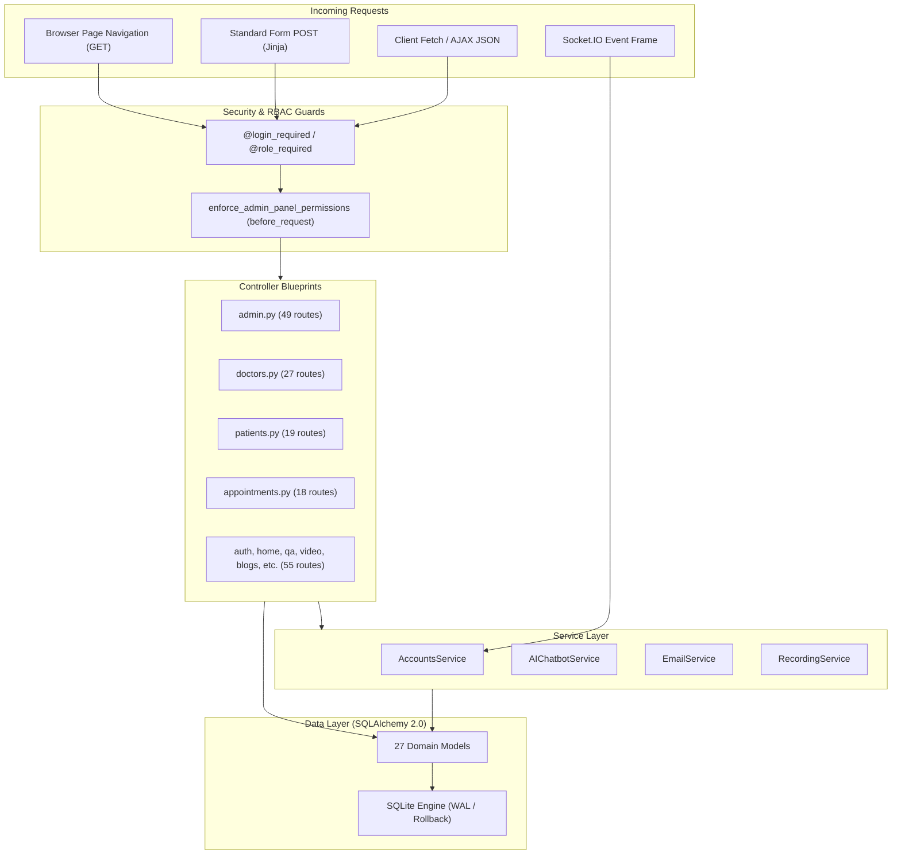

# 06 — BACKEND & API AUDIT

**Project Name:** Quick Care Connect & AI Healthcare Assistance  
**Audit Date:** November 1, 2026  
**Auditor:** Senior Full-Stack Engineer & API Architect  

---

## 1. Controller Architecture & Blueprint Design

The backend consists of **14 Blueprints** containing **168 controller functions**. Controllers follow a hybrid pattern: server-side HTML rendering (`render_template`), JSON API endpoints (`jsonify`), and WebSockets (`flask_socketio`).



---

## 2. API Contracts & Endpoint Classification

Across the 168 endpoints, endpoints are divided into three architectural categories:

| Endpoint Category | Count | Contract Pattern | Example Routes |
| :--- | :--- | :--- | :--- |
| **Server-Rendered HTML** | 104 | Returns full HTML via `render_template`; uses flash messages for feedback; redirects on POST. | `GET /patients/dashboard`<br>`GET /doctors/profile`<br>`GET /admin/doctors` |
| **Client-Side AJAX / JSON** | 56 | Consumes and produces `application/json`; returns `{ success: bool, ... }` or `{ error: str }`. | `GET /video/token/<id>`<br>`GET /video/queue-status/<id>`<br>`POST /appointments/api/send-message`<br>`POST /qa/ai-chat` |
| **Binary Stream / File Assets** | 8 | Streams binary data with specific MIME headers (`application/pdf`, `video/mp2t`, `application/zip`). | `GET /prescriptions/download/<id>`<br>`GET /admin/recordings/<id>/download`<br>`GET /admin/recordings/<id>/seg/<file>` |

---

## 3. Request Validation & Input Handling

Validation practices vary significantly across the codebase:

### 3.1 Strong Validation (WTForms)
Used in primary forms (`app/forms/__init__.py`):
- `LoginForm`: Enforces email format and password presence.
- `UnifiedRegistrationForm`: Enforces 13-digit Pakistani CNIC (`^\d{13}$`), phone number formats (`^\+?92\d{10}$` or `^0\d{10}$`), and PMC codes.
- `BlogForm`: Validates title, excerpt, and categories.

### 3.2 Fragile / Manual Validation (`request.form.get` & `request.get_json`)
Several high-stakes financial and clinical endpoints bypass WTForms, relying on manual dict parsing:
- `POST /appointments/api/send-message`: Manually checks `message_text = (data.get('message') or '').strip()`. Missing structural schema validation (e.g., Pydantic or Marshmallow).
- `POST /prescriptions/create/<appointment_id>`: Uses raw array parsing:
  ```python
  medicine_names = request.form.getlist('medicine_name[]')
  medicine_dosages = request.form.getlist('medicine_dosage[]')
  medicine_frequencies = request.form.getlist('medicine_frequency[]')
  ```
  If array lengths diverge due to client-side manipulation, indexes throw unhandled `IndexError` exceptions.
- `POST /reviews/submit`: Manually validates rating integer range `1 <= rating <= 5` and minimum comment length (`len(comment) >= 5`).

---

## 4. Error Handling & Exception Resilience

A critical code quality pattern observed throughout backend controllers is the **swallowing of exceptions and generic print logging**:

```python
# Characteristic Antipattern Found Across Multiple Routes:
try:
    db.session.commit()
    # notification / secondary logic
except Exception as e:
    db.session.rollback()
    print(f'Error occurred: {e}')
    flash('An error occurred.', 'error')
```

### Specific Findings:
1. **Silent Schema Patch Failures in `app/__init__.py`:**  
   Lines 45–71 execute 5 migration routines inside `try...except Exception: pass`. If a column migration fails due to lock timeout or database corruption, it is silently suppressed, and the application starts with a desynchronized schema.
2. **Missing Rollbacks on Partial Failure:**  
   In `appointments.py:api_send_message` (lines 838–844), if `appointment.doctor_sent_chat` commit fails, the error is caught, rolled back, but the earlier chat log commit on line 832 is not reverted, leaving database transactions in an inconsistent state.
3. **Use of Standard `print()` Instead of `current_app.logger`:**  
   Over 120 occurrences of `print(...)` exist in controllers and services. In production under Gunicorn with `accesslog` and `errorlog` configured, standard output lines bypass structured log formatting, timestamps, and log rotation.

---

## 5. Authentication Decorators & Authorization Audit

The application defines 6 access-control decorators in `app/utils/auth.py` and `app/utils/admin_permissions.py`:

| Decorator | Source File | Enforcement Mechanism | Failure Mode |
| :--- | :--- | :--- | :--- |
| `@login_required` | `app/utils/auth.py:6` | Checks `'user_id' in session`. | Flashes warning, stores `session['next_url']`, redirects to `auth.login`. |
| `@role_required` | `app/utils/auth.py:18` | Queries `User.query.get(session['user_id'])`, checks `user.role == required_role`. | Flashes error, redirects to `home.index`. |
| `@doctor_required` | `app/utils/auth.py:36` | Checks `user.role == 'doctor'`. Allows pending doctors to see pending dashboard. | Redirects unauthorized users to `home.index`. |
| `@patient_required`| `app/utils/auth.py:53` | Checks `user.role == 'patient'`. Clears session if user deleted from DB. | Redirects unauthorized users to `home.index`. |
| `@admin_required` | `app/utils/auth.py:78` | Checks `user.role == 'admin'` and `user.is_active`. Supports AJAX JSON response (401/403). | Returns JSON 401/403 for AJAX; redirects to login for browser navigations. |
| `@super_admin_required`| `app/utils/admin_permissions.py:295`| Checks `user.admin_profile.admin_level == 'super'`. | Restricts staff sub-admin creation and panel grant editing to super-admin. |

### Critical Authorization Findings:

#### 1. Missing Access Guards on Prescription Routes (CRITICAL)
- **Files:** `app/routes/prescriptions.py` Lines 96 and 127
- **Evidence:**
  ```python
  @prescriptions_bp.route('/view/<int:prescription_id>')
  def view_prescription(prescription_id):
      prescription = Prescription.query.get_or_404(prescription_id)
      user = get_current_user()      # Returns None if user is unauthenticated!
      appointment = prescription.appointment
      
      has_access = False
      if user.role == 'doctor' ...   # CRASH: AttributeError: 'NoneType' object has no attribute 'role'
  ```
- **Defect:** Both `/prescriptions/view/<id>` and `/prescriptions/download/<id>` lack `@login_required`. When visited by an unauthenticated user or search engine crawler, the server encounters a 500 Internal Server Error due to referencing `.role` on `None`.

#### 2. Granular Admin RBAC Integration (`register_admin_rbac`)
- **File:** `app/utils/admin_permissions.py:320`
- Registered on `admin_bp` via `admin_bp.before_request`.
- Successfully guards all 49 administrative sub-routes against a static lookup table `ENDPOINT_PERMISSIONS`. If a staff administrator has only the `accountant` role, any attempt to access `admin.approve_doctor` returns an HTTP 403 Forbidden.

---

## 6. Service Layer In-Depth Audit

### 6.1 `AIChatbotService` (`app/services/ai_chatbot_service.py`) — 1,064 lines
- **Role Awareness:** Tailors LLM system prompts depending on user role (`Patient`, `Doctor`, `Admin`, `Guest`).
  - *Guest:* General healthcare guidance, disclaimer that AI is not a doctor.
  - *Patient:* Injects patient's medical history conditions, vitals, allergies, and ongoing symptoms.
  - *Doctor:* Context includes doctor's active patient list (patient names masked).
  - *Admin:* Aggregate platform statistics (active consultations, revenue summaries).
- **Safety Guardrails:**  
  Hardcoded keyword blacklist (`BLOCKED_TOPICS`: weapons, self-harm, fraud, explosives, violence). Automatically intercepts blocked queries without making outbound LLM calls.
- **Provider Fallback:**  
  Calls Google Gemini 1.5 Flash (`gemini-1.5-flash`) via REST API. If HTTP status is not 200 (quota exhausted or API key error), falls back seamlessly to OpenRouter API (`openrouter/free`).
- **Defect:** Rate limiting is enforced using client session cookie timestamps (`session['qa_ai_chat_timestamps']`). Dropping the cookie header bypasses rate limits entirely.

### 6.2 `EmailService` (`app/services/email_service.py`) — 776 lines
- **Mechanism:** Implements 15 transactional email functions (welcome patient, welcome doctor, appointment booked, payment approved, doctor approved, appointment rejected, payout processed, etc.).
- **Concurrency Defect:** Dispatches emails using unmanaged `threading.Thread(target=send_async_email, args=[app, msg]).start()`. Under high traffic (e.g. batch appointment expiry or concurrent bookings), unconstrained thread creation risks OS thread exhaustion.
- **Maintainability Defect:** HTML email templates are constructed using Python f-strings embedded directly in code rather than external Jinja2 email templates.

### 6.3 `RecordingService` (`app/services/recording_service.py`) — 350 lines
- **Mechanism:** Client for Agora Cloud Recording REST API.
- Implements two-phase start:
  1. `acquire()`: Obtains Agora resource ID for the channel.
  2. `start()`: Launches composite recording bot into the RTC channel and streams video chunks to DigitalOcean Spaces via S3 storage vendor code 11.
  3. `stop()`: Halts recording, extracts duration, and updates `VideoCallRecording` record.

### 6.4 `SocketIO` Events (`app/services/socketio_events.py`) — 450 lines
- **Events Handled:**
  - `connect` / `disconnect`
  - `join_appointment_room`: Validates appointment access and payment approval before allowing a user to join.
  - `leave_appointment_room`
  - `send_message`: Saves message to `medical_histories.chat_logs` JSON array and broadcasts to room.
  - `start_call` / `end_call`: Synchronizes call status and triggers Agora recording.

---

## 7. Timezone Handling & Inconsistency Audit

The application operates in **Pakistan Standard Time (PKT, UTC+5)**:
- `app/utils/timezone.py` defines `PAKISTAN_TZ = pytz.timezone('Asia/Karachi')`, `get_pakistan_now()`, and `pkt_now_naive()`.
- However, across route modules and background jobs, three incompatible datetime functions are mixed arbitrarily:
  1. `datetime.utcnow()`: Deprecated in Python 3.12; returns UTC time. Used in `auth.py`, `admin.py`, `blogs.py`, `qa.py`.
  2. `datetime.now()`: Returns system local time of the host OS. Used in `patients.py:cancel_appointment` and `check_expired_appointments.py`.
  3. `pkt_now_naive()` / `get_pakistan_now()`: Returns true Pakistan Standard Time.
- **Critical Risk:** If deployed on a cloud server configured in UTC or Singapore time (UTC+8), comparing `datetime.now()` or `datetime.utcnow()` with stored appointment PKT values introduces a **5-hour discrepancy** into appointment expiry, cancellation windows, and no-show penalties.

