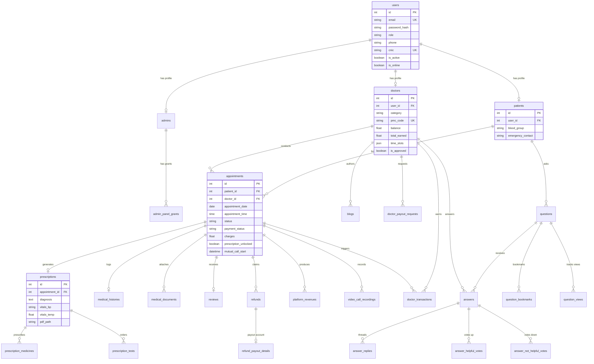

# 07 — DATABASE & DATA PERSISTENCE AUDIT

**Project Name:** Quick Care Connect & AI Healthcare Assistance  
**Audit Date:** November 1, 2026  
**Auditor:** Database Architect & Performance Engineer  

---

## 1. Database Engine & Physical Inspection

- **Database Engine:** SQLite 3 (C-based embedded relational database).
- **Active Physical Database File:** `instance/quickcare_dev.db` (393,216 bytes / 384 KB).
- **Physical Inspection:** Verified via read-only cursor inspection (`inspect_db.py`).
- **Table Count:** **29 tables** present in database schema.

### Table Inventory & Verified Row Counts:
| Table Name | Associated SQLAlchemy Model | Row Count | Primary Domain Purpose |
| :--- | :--- | :--- | :--- |
| `users` | `User` (`app/models.py:6`) | 13 | Core credentials, emails, phones, CNIC, roles, online status. |
| `doctors` | `Doctor` (`app/models.py:41`) | 8 | Doctor clinical profiles, PMC codes, specializations, balance, ratings. |
| `patients` | `Patient` (`app/models.py:150`) | 4 | Patient profiles, blood groups, allergies, emergency contacts. |
| `admins` | `Admin` (`app/models.py:198`) | 1 | Administrator accounts (super vs staff admin levels). |
| `admin_panel_grants` | `AdminPanelGrant` (`app/models.py:223`) | 0 | Granular panel permissions assigned to sub-admin staff. |
| `appointments` | `Appointment` (`app/models.py:242`) | 20 | Consultations, slots, payment statuses, video call states, gates. |
| `medical_histories` | `MedicalHistory` (`app/models.py:342`)| 17 | Diagnoses, prescription summaries, embedded chat logs. |
| `medical_documents` | `MedicalDocument` (`app/models.py:562`)| 2 | Patient-uploaded lab reports, radiology images, external PDFs. |
| `prescriptions` | `Prescription` (`app/models.py:648`) | 13 | Clinical prescriptions generated during consultations. |
| `prescription_medicines` | `PrescriptionMedicine` (`app/models.py:685`)| 26 | Individual medications, dosages, frequencies, and durations. |
| `prescription_tests` | `PrescriptionTest` (`app/models.py:707`)| 13 | Recommended diagnostic lab tests attached to prescriptions. |
| `questions` | `Question` (`app/models.py:373`) | 19 | Patient-posted medical questions in public Q&A forum. |
| `question_bookmarks`| `QuestionBookmark` (`app/models.py:480`)| 11 | Questions saved by patients for reference. |
| `question_views` | `QuestionView` (`app/models.py:409`) | 0 | Unique view tracking per user per question. |
| `answers` | `Answer` (`app/models.py:424`) | 18 | Clinical doctor replies to community questions. |
| `answer_replies` | `AnswerReply` (`app/models.py:460`) | 1 | Follow-up conversation threads beneath specific answers. |
| `answer_helpful_votes` | `AnswerHelpfulVote` (`app/models.py:496`)| 17 | Positive feedback votes recorded by patients. |
| `answer_not_helpful_votes`| `AnswerNotHelpfulVote` (`app/models.py:512`)| 9 | Negative feedback votes recorded by patients. |
| `blogs` | `Blog` (`app/models.py:527`) | 11 | Doctor-written health articles and moderation statuses. |
| `diseases` | `Disease` (`app/models.py:617`) | 6 | Disease encyclopedia records, causes, symptoms, and severity. |
| `reviews` | `Review` (`app/models.py:727`) | 12 | Star ratings, tags, written feedback, and anti-fraud metadata. |
| `doctor_transactions`| `DoctorTransaction` (`app/models.py:123`)| 14 | Ledger of earnings, platform commission deductions, and withdrawals. |
| `doctor_payout_requests` | `DoctorPayoutRequest` (`app/models.py:816`)| 3 | Doctor withdrawal requests and disbursement proofs. |
| `refunds` | `Refund` (`app/models.py:771`) | 3 | Refund records for cancellations, no-shows, and dropped calls. |
| `refund_payout_details` | `RefundPayoutDetail` (`app/models.py:787`)| 0 | Patient bank account / mobile wallet details for refund processing. |
| `platform_revenues` | `PlatformRevenue` (`app/models.py:760`)| 12 | Audit entries for 20% platform commission retained. |
| `video_call_recordings` | `VideoCallRecording` (`app/models.py:838`)| 0 | Agora cloud recording session records and playback URLs. |
| `platform_feedback` | Non-model legacy table | 0 | Unused legacy feedback table. |
| `sqlite_sequence` | Internal SQLite table | 1 | Auto-increment sequence tracker. |

---

## 2. Entity-Relationship Diagram (ERD)



---

## 3. Schema Architecture & Model Design Audit

### 3.1 Inheritance & Identity Modeling
- The system employs a **Base User + Separate Role Profile** pattern:
  `User` holds core authentication attributes (`email`, `password_hash`, `role`, `cnic`).
  `Doctor`, `Patient`, and `Admin` models link 1-to-1 via `user_id` foreign keys with `unique=True` constraints.
- This is a clean, normalized design that cleanly separates clinical credentials from patient health profiles.

### 3.2 JSON Column Overuse & De-normalization Risks
Several key entities store structured relational data inside SQLite `JSON` / `TEXT` columns:
1. **`MedicalHistory.chat_logs` (`db.Column(db.JSON, default=list)`):**  
   Every message sent during a consultation is appended to a JSON array. In a 100-message consultation, storing all messages in a single row prevents indexing individual messages, searching message contents via SQL, or paginating chat history efficiently.
2. **`Doctor.time_slots` (`db.Column(db.JSON, default={})`):**  
   Stores weekly hospital schedules as nested JSON:
   `{"monday": [{"start": "09:00", "end": "12:00", "hospital": "..."}]}`.
   Because slots are stored inside a JSON blob, the database cannot perform native SQL indexing on doctor availability; availability queries must load the JSON into Python memory and iterate in Python loops.
3. **`Review.tags` and `Review.flag_reasons`:** Stored as JSON string arrays.

---

## 4. Migration Architecture & Schema Drift

### Findings:
1. **Alembic Inactive Despite `Flask-Migrate` Dependency:**  
   `requirements.txt` includes `Flask-Migrate==4.0.5`, and `app/__init__.py` calls `migrate.init_app(flask_app, db)`. However, there is **no `migrations/versions/` directory**, and the SQLite database contains **no `alembic_version` tracking table**.
2. **Procedural Startup Migrations:**  
   Schema updates are performed procedurally in `app/__init__.py` using 5 ad-hoc migration scripts:
   - `ensure_accounts_schema()`
   - `ensure_qa_schema()`
   - `ensure_review_flow_schema()`
   - `ensure_review_fraud_schema()`
   - `ensure_admin_rbac_schema()`
3. **Fragile `PRAGMA table_info` Pattern:**  
   Each startup migration inspects column names via `PRAGMA table_info(<table>)` and executes raw `conn.execute(text("ALTER TABLE ... ADD COLUMN ..."))`.
   In SQLite, `ALTER TABLE` locks the database file. If two processes boot simultaneously, a `database is locked` error occurs. Furthermore, these calls are wrapped in `try...except Exception: pass`, which silently ignores fatal database migration errors.

---

## 5. Indexing & Query Performance Analysis

Unlike PostgreSQL or MySQL, **SQLite does NOT automatically create indexes on Foreign Key columns**!

### Critical Missing Indexes:
| Table | Unindexed Foreign Key / Filter Column | Query Pattern Affected | Risk / Performance Impact |
| :--- | :--- | :--- | :--- |
| `appointments` | `patient_id` | `Appointment.query.filter_by(patient_id=...)` | Full table scan on every patient dashboard load. |
| `appointments` | `doctor_id` | `Appointment.query.filter_by(doctor_id=...)` | Full table scan on every doctor dashboard load. |
| `appointments` | `payment_status`, `status` | Admin Payment Approvals & Expiry Scheduler | Scans all appointments every 5–10 minutes. |
| `appointments` | `appointment_date`, `appointment_time` | `find_reserved_appointment` (Slot conflict check) | Scans all appointments during every booking attempt. |
| `medical_histories` | `appointment_id` | `MedicalHistory.query.filter_by(appointment_id=...)`| Full table scan on every chat message sent. |
| `medical_histories` | `patient_id`, `doctor_id` | Doctor/Patient clinical history retrieval | Full table scan across all patient medical records. |
| `prescriptions` | `appointment_id` | `Prescription.query.filter_by(appointment_id=...)` | Table scan when verifying if prescription exists. |
| `blogs` | `status`, `published_at` | `Blog.query.filter(status='published', ...)` | Table scan on public blog homepage. |

### In-Memory Doctor Table Scan in `diseases.py`:
In [`app/routes/diseases.py`](app/routes/diseases.py#L68-L73):
```python
all_approved = Doctor.query.filter_by(is_approved=True, is_verified=True).all()
for d in all_approved:
    if normalize_category(d.category).lower() == disease_cat.lower():
        related_doctors.append(d)
    if len(related_doctors) >= 3:
        break
```
**Defect:** Every time any user views a disease information page (`/diseases/<id>`), the backend fetches **all approved doctors in the entire database** and filters their specialty in a Python `for` loop, rather than executing a parameterized SQL `WHERE category = :cat` query!

---

## 6. Concurrency & Locking Risks (SQLite Single-Writer Limit)

SQLite uses coarse database-level locking:
1. **Readers & Writers Conflict:** While a write transaction is open (e.g., booking an appointment, approving a payment, or appending a chat log), all other write transactions are blocked.
2. **Default Timeout:** SQLite's default busy timeout in Python is 5 seconds. Under concurrent user traffic (multiple patients booking slots, sending messages, or admin approvals), threads will crash with:
   `sqlite3.OperationalError: database is locked`.
3. **Write-Ahead Logging (WAL):**  
   The project has not explicitly enabled `PRAGMA journal_mode=WAL;`. Without WAL mode, readers block writers and writers block readers. Enabling WAL mode is an immediate non-destructive performance improvement for SQLite.
4. **PostgreSQL Migration Requirement:**  
   For production scalability, multi-worker Gunicorn deployments, and reliable concurrent transactions, migrating from SQLite to **PostgreSQL** is an urgent architectural necessity.

