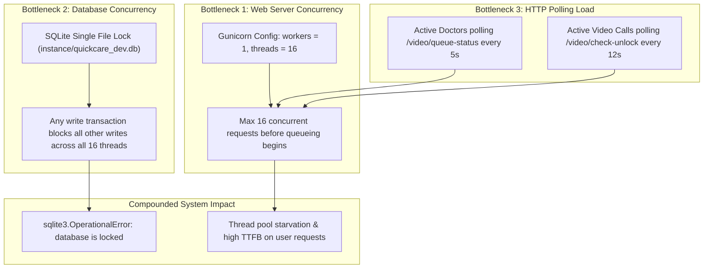

# 09 — PERFORMANCE & RELIABILITY AUDIT

**Project Name:** Quick Care Connect & AI Healthcare Assistance  
**Audit Date:** November 1, 2026  
**Auditor:** Principal Performance Engineer & Systems Architect  

---

## 1. System Scalability & Concurrency Ceiling

The application's architecture contains a **hard concurrency bottleneck** dictated by the underlying persistence engine and WSGI configuration.



---

## 2. Server-Side Bottlenecks & Inefficiencies

### 2.1 Single-Worker Process Bottleneck
- **Location:** [`deploy/gunicorn.conf.py`](deploy/gunicorn.conf.py#L8-L18)
- **Configuration:**
  ```python
  workers = 1
  worker_class = 'gthread'
  threads = 16
  timeout = 120
  # SQLite: never use more than 1 worker
  ```
- **Analysis:**  
  Because SQLite does not safely support multi-process concurrent writes without risking database corruption or locking crashes, the production deployment is forced to run with **exactly 1 worker process**.
- **Impact:**  
  The entire platform is bounded by 16 Python threads within a single operating system process. Because CPython utilizes the Global Interpreter Lock (GIL) for CPU-bound tasks (JSON parsing, password hashing, template rendering), true multi-core parallel processing is unavailable.

### 2.2 Synchronous Video Chunk Buffering in WSGI Process
- **Location:** [`app/routes/admin.py`](app/routes/admin.py#L926-L950): `recording_hls_segment`
- **Evidence:**
  ```python
  object_key = f'{playlist_base_prefix(rec.file_path)}{filename.split("/")[-1]}'
  raw = fetch_spaces_object(object_key)
  resp = Response(raw, mimetype='video/mp2t')
  ```
- **Analysis:**  
  When an administrator reviews a consultation recording, video playback streams MPEG-TS (`.ts`) video chunks through the Flask application. Each segment (often 2–5 MB in size) is downloaded synchronously from DigitalOcean Spaces into Flask RAM and then streamed to the browser via one of the 16 Gunicorn threads.
- **Impact:**  
  Streaming a 30-minute consultation consumes dozens of sequential requests that monopolize Gunicorn worker threads and cause severe memory spikes.
- **Remediation:**  
  Configure DigitalOcean Spaces CORS headers to allow browser video players to stream `.ts` chunks directly from Spaces, or utilize Nginx reverse proxy caching.

### 2.3 Redundant Application Instantiation in Background Tasks
- **Location:** [`app/utils/cleanup_expired_payments.py`](app/utils/cleanup_expired_payments.py#L27)
- **Evidence:**
  ```python
  def cleanup_expired_payments():
      app = create_app()
      with app.app_context():
          ...
  ```
- **Analysis:**  
  `APScheduler` executes `cleanup_expired_payments` every 10 minutes. Inside the task, it calls `create_app()` from scratch.
- **Impact:**  
  Every 10 minutes, the application re-executes `db.create_all()`, runs 5 migration checks, initializes `Mail`, and registers all 14 blueprints. This consumes CPU cycles, creates redundant SQLite connections, and bloats resident memory.
- **Remediation:**  
  Pass the existing `flask_app` reference into scheduled tasks using `app.app_context()` rather than instantiating a new application factory.

---

## 3. Database Bottlenecks & Query Antipatterns

### 3.1 Linear JSON Chat History Serialization
- **Location:** [`app/services/socketio_events.py`](app/services/socketio_events.py#L256-L272)
- **Mechanism:**  
  All consultation chat messages are stored in `medical_histories.chat_logs` as a single serialized JSON array.
- **Performance Degradation Curve:**
  ```
  Message 1   -> Read 0 KB JSON   -> Append -> Write 1 KB JSON
  Message 50  -> Read 50 KB JSON  -> Append -> Write 51 KB JSON
  Message 200 -> Read 200 KB JSON -> Append -> Write 201 KB JSON
  ```
  On message 200, the server reads 200 KB from SQLite, deserializes the JSON string, appends 1 object, serializes 201 KB, and writes the entire string back to disk. Under concurrent messaging, this produces quadratic write inflation.

### 3.2 Full Table Scan in Disease Doctor Funnel
- **Location:** [`app/routes/diseases.py`](app/routes/diseases.py#L68-L73)
- **Evidence:**
  ```python
  all_approved = Doctor.query.filter_by(is_approved=True, is_verified=True).all()
  for d in all_approved:
      if normalize_category(d.category).lower() == disease_cat.lower():
          related_doctors.append(d)
      if len(related_doctors) >= 3:
          break
  ```
- **Analysis:**  
  Every time a user visits a disease detail page (`/diseases/<id>`), the controller queries **all approved doctors in the entire database**, instantiates their SQLAlchemy objects, and iterates through them in Python.
- **Impact:**  
  As the doctor registry expands to hundreds or thousands of practitioners, this query will cause catastrophic page load degradation.
- **Remediation:**  
  Query directly in SQL:
  ```python
  Doctor.query.filter_by(is_approved=True, is_verified=True, category=disease_cat).limit(3).all()
  ```

---

## 4. Frontend & Network Performance

### 4.1 Heavy Unoptimized Static Assets on Landing Page
- **Location:** `app/static/landing_page/`
- **Inspection Findings:**  
  The landing page directory contains **7 local MP4 video files** (`1.mp4` through `7.mp4`) totaling **25.5 MB**:
  - `1.mp4`: 4.5 MB
  - `2.mp4`: 2.4 MB
  - `3.mp4`: 2.8 MB
  - `4.mp4`: 5.4 MB
  - `5.mp4`: 2.7 MB
  - `6.mp4`: 4.5 MB
  - `7.mp4`: 3.2 MB
  - `hero_doctor.png`: **5.2 MB**
- **Impact:**  
  On mobile devices or low-bandwidth Pakistani mobile connections (3G/4G), loading multi-megabyte uncompressed video clips and unoptimized 5.2 MB PNG hero images causes 10+ second initial page load delays and excessive data consumption.
- **Remediation:**  
  Compress `hero_doctor.png` using WebP/AVIF (typically reducing 5.2 MB to < 200 KB). Host video clips on an external CDN or video streaming platform (e.g. Cloudflare Stream or YouTube embed).

### 4.2 Excessive HTTP Polling Intervals
Active clients generate frequent polling requests to Gunicorn:
1. **Waiting Room Status:** Doctor queue polls `/video/queue-status/<id>` every 5 seconds.
2. **Prescription Gate:** Video call polls `/video/check-unlock/<id>` every 12 seconds.
3. **Safepay Status:** Payment return popup polls `/api/payment-status/<id>` every 3 seconds.

With 20 concurrent consultations and 10 doctors managing their waiting rooms, clients fire **~300 HTTP requests per minute** to a server running only 1 worker with 16 threads.

---

## 5. Reliability, Timeouts & Error Recovery

| Subsystem | Failure Scenario | Current Behavior | Risk Level | Recommended Hardening |
| :--- | :--- | :--- | :--- | :--- |
| **Email Delivery** | Namecheap SMTP timeout / authentication error | Logged to console with `print(e)`; thread terminates silently. | **HIGH** | Add retry mechanism, dead-letter logging, or transactional email API with webhook confirmations. |
| **Safepay API** | Sandbox API unreachable or 5xx server error | Catches `Exception`, flashes error, redirects to appointment view. | **MEDIUM** | Circuit-breaker pattern; graceful fallback to manual payment screenshot upload. |
| **Agora Cloud API** | Agora API unreachable during call termination | Catches exception inside `try...except: pass` in SocketIO handler. | **LOW** | Record error in `VideoCallRecording.error_message`; alert admin. |
| **APScheduler** | Job throws unhandled exception | Job fails for that cycle; scheduler continues next interval. | **LOW** | Add alerting / Sentry telemetry for background job failures. |

