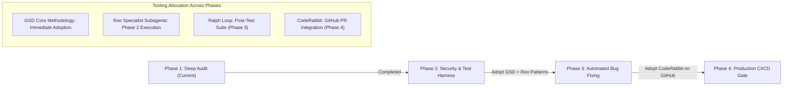

# 12 — EXTERNAL ENGINEERING TOOL EVALUATION & INTEGRATION PLAN

**Project Name:** Quick Care Connect & AI Healthcare Assistance  
**Audit Date:** November 1, 2026  
**Auditor:** Technical Project Lead & DevOps Architect  

---

## 1. Overview & Evaluation Framework

In accordance with Section 7 of the Audit Protocol, five external engineering tools and agentic workflows were evaluated to determine how they can enhance the maintenance, refactoring, quality gates, and iterative bug-fixing of Quick Care Connect.

### Tool Evaluation Summary:
| Tool / Framework | Primary Capability | Current Status | Compatibility with Antigravity | Recommendation for Phase 2 |
| :--- | :--- | :--- | :--- | :--- |
| **GSD Core** | Structured planning & phased verification | Not Installed | **High** (Conceptual & Workflow alignment) | **Adopt Methodology** for Phase 2 bug-fix execution. |
| **Roo Code** | Specialist-agent personas (Architect, Code, Debug) | Not Installed | **High** (Persona alignment via Subagents) | **Adopt Persona Patterns** using Antigravity subagents. |
| **Ralph Loop** | PRD-driven autonomous iterative bug fixing | Not Installed | **Medium** (High conceptual value; requires test harness) | **Adopt for isolated tasks** after test suite is established. |
| **CodeRabbit** | Automated PR review & security diff analysis | Not Installed | **High** (GitHub App integration) | **Recommended for PR Quality Gates** with HIPAA/privacy compliance. |
| **Archify** | Source-backed visual architecture mapping | Not Installed | **Medium** (CLI / AST tool) | **Use Local Mermaid Alternative** (generated in audit). |

---

## 2. In-Depth Tool Evaluations

### 2.1 GSD Core (`open-gsd/gsd-core`)
- **Repository:** [https://github.com/open-gsd/gsd-core](https://github.com/open-gsd/gsd-core)
- **Concept:** Structured execution framework focusing on:
  1. Deep Codebase Discovery (read-only baseline).
  2. Plan Formulation with explicit verification criteria.
  3. Phased Execution with non-overlapping diffs.
  4. Final Verification and automated sanity checks.
- **Compatibility:** **100% Compatible**. The methodology maps directly onto Google Antigravity's native task loops and pair-programming workflow.
- **Prerequisites:** None. Can be applied immediately as a development protocol.
- **Security Considerations:** Purely process-driven; zero external network access or telemetry required.
- **Value Added for Quick Care:**  
  Prevents chaotic "fix-as-you-go" modifications on an existing, live system. Guarantees that every bug fix (such as CSRF re-enabling or upload path migration) has an explicit pre-change baseline and post-change test plan.

---

### 2.2 Roo Code (`roocode.com`)
- **Reference:** [https://roocode.com/](https://roocode.com/)
- **Concept:** Multi-mode autonomous agent specializing into four distinct operational roles:
  1. *Architect:* System mapping, design decision interviews, dependency modeling.
  2. *Code:* Clean implementation adhering to existing style guides.
  3. *Debug:* Root cause analysis, stack trace reproduction, regression hunting.
  4. *Orchestrator:* Multi-step workflow delegation.
- **Compatibility:**  
  Roo Code runs as an independent VS Code extension. However, **its specialist persona patterns can be implemented natively inside Antigravity** using the `define_subagent` and `invoke_subagent` capabilities.
- **Prerequisites:** Antigravity Subagent definitions.
- **Security Considerations:** When using native Antigravity subagents, data remains local within the active workspace.
- **Value Added for Quick Care:**  
  Assigning distinct specialist subagents (e.g., Security Subagent for CSRF/XSS, Database Subagent for PostgreSQL migration, QA Subagent for test generation) prevents context clutter and reduces hallucination risks during large refactors.

---

### 2.3 Ralph Loop (`snarktank/ralph`)
- **Repository:** [https://github.com/snarktank/ralph](https://github.com/snarktank/ralph)
- **Concept:** PRD-driven, test-guided iterative execution loop that takes a single defect or feature, runs tests, inspects failures, modifies code, and iterates until all test assertions pass.
- **Compatibility:**  
  Medium. Running an autonomous execution loop requires an established automated test suite (`pytest`) with high test reliability.
- **Prerequisites:**  
  A working test harness (`pytest`, in-memory database fixtures). Because Quick Care currently has **0.0% test coverage**, running an autonomous loop today would operate blind without feedback signals.
- **Security Considerations:** Autonomous code-modification loops must be bounded by Git branch isolation and read-only database locks.
- **Value Added for Quick Care:**  
  Once Phase 2 establishes a unit test suite, Ralph Loop patterns will enable rapid, automated fixing of isolated controller bugs (such as timezone calculation normalization).

---

### 2.4 CodeRabbit (`coderabbit.ai`)
- **Reference:** [https://coderabbit.ai/](https://coderabbit.ai/)
- **Concept:** AI-driven pull-request reviewer that inspects code diffs, highlights security vulnerabilities, detects breaking API changes, and enforces code standards before merges.
- **Compatibility:**  
  Seamlessly integrates into GitHub repositories as a GitHub App (`https://github.com/zohaibahmad447/FYP-Project.git`).
- **Prerequisites:**  
  GitHub repository admin access and explicit organizational authorization.
- **Security & Privacy Considerations (CRITICAL FOR HEALTHCARE):**  
  CodeRabbit transmits code diffs to external LLM cloud services. In a healthcare application handling patient data, team members must verify that:
  - Repository code does not contain hardcoded credentials (e.g. `AGORA_APP_CERTIFICATE` must be removed first).
  - CodeRabbit's data retention policies comply with university and institutional data governance (no model training on private code).
- **Value Added for Quick Care:**  
  Acts as an automated quality gate preventing accidental security regressions (e.g., disabling CSRF or omitting `@login_required` decorators) during team pull requests.

---

### 2.5 Archify (`tt-a1i/archify`)
- **Repository:** [https://github.com/tt-a1i/archify](https://github.com/tt-a1i/archify)
- **Concept:** Codebase visualizer that generates interactive architectural diagrams and component dependency graphs directly from source code ASTs.
- **Compatibility:** Compatible as a CLI utility.
- **Prerequisites:** Python AST parser or Node CLI installation.
- **Security Considerations:** Local execution; zero network transmission.
- **Value Added for Quick Care:**  
  Visualizing the 168 endpoints and 27 models. However, because our audit has already generated complete, verified Mermaid diagrams (system topology, data flow, ERD, and sequence diagrams) directly within `01-PROJECT-OVERVIEW.md`, `03-ARCHITECTURE.md`, and `07-DATABASE-AUDIT.md`, installing an external tool like Archify is optional and redundant.

---

## 3. Tool Adoption Roadmap

### Immediate Action Plan:
1. **Adopt GSD Core Protocol:** Structure all Phase 2 bug-fixing tasks into strict Plan -> Review -> Execute -> Verify phases.
2. **Deploy Specialist Personas:** When fixing issues, deploy dedicated Antigravity subagents for Security remediation, API unification, and Pytest test generation.
3. **Decline Third-Party Installs during Phase 1:** Preserve the workspace state without downloading external packages until authorized.

