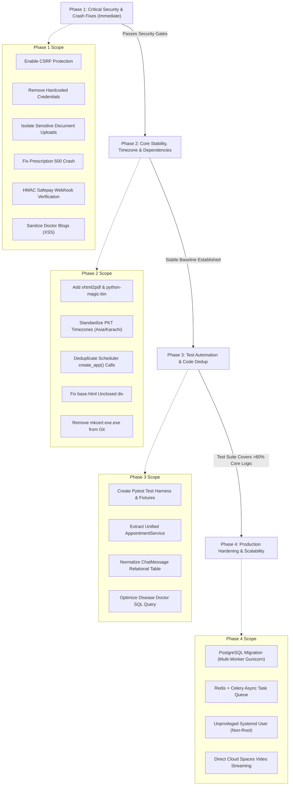

# 13 — ACTIONABLE MODERNIZATION & FIX ROADMAP

**Project Name:** Quick Care Connect & AI Healthcare Assistance  
**Audit Date:** November 1, 2026  
**Auditor:** Principal Software Architect & Technical Project Lead  

---

## 1. Roadmap Strategy & Phasing Philosophy

To safely remediate issues on this **existing, potentially business-critical system**, all remediation work must be executed in strict, non-destructive phases.

---

## 2. Phase Breakdown & Execution Specifications

### Phase 1: Immediate Critical Security & Crash Fixes
*Objective: Eliminate active attack vectors, unauthorized file access, and crash triggers.*

| Task ID | Task Description | Target Files | Acceptance Criteria | Est. Effort |
| :--- | :--- | :--- | :--- | :--- |
| **P1-01** | **Re-enable CSRF Protection** | `config.py`, `app/__init__.py`, templates, JS files | `WTF_CSRF_ENABLED = True`. All POST forms and AJAX requests pass valid CSRF tokens. Cross-origin POSTs fail with 400. | 1.5 Days |
| **P1-02** | **Revoke & Purge Hardcoded Secrets** | `config.py` | Agora credentials removed from code literals. App reads strictly from `.env` and errors if missing. | 0.5 Day |
| **P1-03** | **Secure Document Storage Vault** | `app/utils/file_upload.py`, `app/routes/patients.py`, `nginx` | CNICs, degrees, and lab reports moved to `storage/private_uploads/`. Access requires authentication and ownership validation via Flask view. | 1.5 Days |
| **P1-04** | **Fix Prescription View & Download Crash** | `app/routes/prescriptions.py` | Add `@login_required` to `/view/<id>` and `/download/<id>`. Unauthenticated requests redirect cleanly to `/auth/login` (no 500). | 0.25 Day |
| **P1-05** | **Verify Safepay Webhook HMAC** | `app/routes/payments.py` | Verify `X-SFPY-SIGNATURE` using HMAC SHA256 against `SAFEPAY_SECRET_KEY`. Unsigned requests return 401. | 0.5 Day |
| **P1-06** | **Sanitize Doctor Blogs (Stored XSS)**| `app/routes/doctors.py`, `requirements.txt` | Add `nh3` or `bleach`. Sanitize blog content before database write, preserving safe formatting tags while stripping script/event handlers. | 0.75 Day |

---

### Phase 2: Core Stability, Timezone & Dependency Normalization
*Objective: Fix runtime dependencies, resolve timezone calculation bugs, and repair UI markup.*

| Task ID | Task Description | Target Files | Acceptance Criteria | Est. Effort |
| :--- | :--- | :--- | :--- | :--- |
| **P2-01** | **Update Dependency Manifest** | `requirements.txt` | Add `xhtml2pdf>=0.2.16`, `python-magic-bin` (Windows conditional), and purge unused `eventlet`. Clean `pip install -r requirements.txt` succeeds without errors. | 0.5 Day |
| **P2-02** | **Unify Timezone Logic to PKT** | `app/routes/patients.py`, `app/jobs/check_expired_appointments.py`, `app/utils/timezone.py` | Replace raw `datetime.now()` and deprecated `datetime.utcnow()` with `pkt_now_naive()` across all booking, cancellation, and expiry checks. | 1.0 Day |
| **P2-03** | **Deduplicate App Factory in Scheduler**| `app/utils/cleanup_expired_payments.py`, `app/scheduler.py` | Remove `app = create_app()` inside `cleanup_expired_payments()`. Pass active application context. | 0.25 Day |
| **P2-04** | **Repair Unclosed HTML `div`** | `app/templates/base.html` | Close line 413 container `div` before `</nav>` tag on line 502. Page layout passes W3C markup validation. | 0.25 Day |
| **P2-05** | **Remove Tracked Binary from Git** | `Quick Care FYP/mkcert.exe.exe`, `.gitignore` | Execute `git rm --cached mkcert.exe.exe`. Add `*.exe` to `.gitignore`. | 0.25 Day |

---

### Phase 3: Architectural Decoupling & Test Automation
*Objective: Eliminate massive code duplication, optimize queries, and build safety harness.*

| Task ID | Task Description | Target Files | Acceptance Criteria | Est. Effort |
| :--- | :--- | :--- | :--- | :--- |
| **P3-01** | **Build Pytest Test Suite & Fixtures** | `tests/conftest.py`, `tests/test_*.py` | Create automated unit & integration tests covering auth, booking, payment approval, and consultation gates. Target >75% coverage. | 3.0 Days |
| **P3-02** | **Extract Unified AppointmentService** | `app/services/appointment_service.py`, `appointments.py`, `doctors.py`, `patients.py` | Centralize `book_appointment`, `approve_appointment`, `reject_appointment`, and `complete_appointment` into a single tested domain service. Eliminate duplicate code across blueprints. | 2.0 Days |
| **P3-03** | **Normalize Chat Data Model** | `app/models.py`, `app/services/socketio_events.py` | Migrate from `medical_histories.chat_logs` JSON string to a dedicated relational `chat_messages` table. Add Alembic migration script. | 1.5 Days |
| **P3-04** | **Optimize Disease Doctor Query** | `app/routes/diseases.py` | Replace in-memory doctor table scan with parameterized SQL `WHERE category = :cat LIMIT 3` query. | 0.5 Day |

---

### Phase 4: Production Hardening & Scalability
*Objective: Prepare platform for high-concurrency production traffic and clinical deployment.*

| Task ID | Task Description | Target Files | Acceptance Criteria | Est. Effort |
| :--- | :--- | :--- | :--- | :--- |
| **P4-01** | **PostgreSQL Migration Path** | `config.py`, `deploy/gunicorn.conf.py` | Validate schema against PostgreSQL. Enable multi-worker Gunicorn (`workers = 4`) for multi-core scaling. | 2.0 Days |
| **P4-02** | **Task Queue Integration (Celery/Redis)**| `app/services/email_service.py`, `app/scheduler.py` | Migrate async emails and periodic cleanup jobs from native threads to Celery with Redis broker. | 2.5 Days |
| **P4-03** | **Unprivileged Systemd Execution** | `deploy/quickcare.service` | Configure service to run under `www-data` or `quickcare` service account. Verify file permissions. | 0.5 Day |
| **P4-04** | **Direct Cloud Video Streaming** | `app/routes/admin.py`, DigitalOcean Spaces | Configure Spaces CORS to allow direct browser HLS streaming, relieving Gunicorn of video chunk proxying. | 1.0 Day |

---

## 3. Immediate Recommended Next Action

The single most impactful next action is:
**Implement Phase 1 Security & Crash Fixes.**

### Scope:
1. Re-enable CSRF protection and update templates/AJAX calls.
2. Purge hardcoded Agora secrets from `config.py`.
3. Add `@login_required` to `/prescriptions/view/<id>` and `/prescriptions/download/<id>`.
4. Implement HMAC signature check on `/safepay/webhook`.
5. Sanitize blog content with `bleach`/`nh3`.

### Prerequisites:
User explicit authorization to modify application code on a dedicated Git branch (e.g., `fix/phase-1-security-remediation`).

