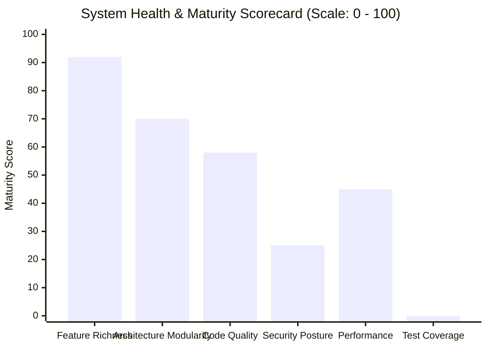

# 14 — EXECUTIVE SUMMARY

**Project Name:** Quick Care Connect & AI Healthcare Assistance  
**Audit Completed:** November 1, 2026  
**Auditing Team:** Principal Software Architect, Lead Security Auditor, DevOps Engineer & QA Automation Lead  
**Audit Mode:** Non-Destructive, Evidence-Based Codebase & Architecture Discovery (Phase 1)  

---

## 1. System Identity & Mission

**Quick Care Connect** is an end-to-end full-stack telehealth and clinic management platform tailored for Pakistan's healthcare infrastructure. Built as an academic Final Year Project (FYP) at the University of the Punjab, the application features an extensive suite of real-world capabilities:
- Patient-doctor consultation scheduling with 30-minute time slots.
- Two-tier payment escrow flow: manual bank/wallet screenshot verification by admins, paired with automated card processing via Safepay.
- Browser-based WebRTC video consultations with virtual waiting rooms via Agora RTC.
- Consultation integrity verification (3-minute mutual video requirement before clinical prescriptions are unlocked).
- Clinical prescription creation with automatic PDF generation and archival.
- Personal health record management (patient-uploaded lab reports, radiology scans).
- Role-aware medical Q&A forum powered by an integrated Google Gemini 1.5 Flash AI chatbot with OpenRouter fallback.
- Doctor blog publishing, public disease knowledgebase, review fraud detection, and an accounting ledger with commission deductions and payout management.

---

## 2. Technical Health Scorecard

| Dimension | Score | Evaluation Summary |
| :--- | :---: | :--- |
| **Feature Richness & Scope** | **92 / 100** | Exceptional functional completeness; covers complex clinical, financial, and consultation lifecycles tailored to local requirements. |
| **Architecture & Modularity** | **70 / 100** | Clean base-user/role-profile data normalization and 14 modular Flask blueprints; marred by duplicated appointment workflows and tight coupling. |
| **Code Quality & Maintainability** | **58 / 100** | Functional controllers; penalized by repetitive code across blueprints, broad `try...except` exception swallowing, and unescaped HTML interpolation. |
| **Performance & Scalability** | **45 / 100** | Severely constrained by SQLite file-locking limits (forced single Gunicorn worker); linear JSON chat history growth; in-memory doctor table scans. |
| **Security & Privacy Posture** | **25 / 100** | **CRITICAL RISK**. CSRF globally disabled; hardcoded credentials in source; sensitive medical documents and CNICs stored in public static folder; unauthenticated payment webhook. |
| **Automated Test Coverage** | **0 / 100** | **CRITICAL GAP**. Exactly 0 automated tests exist in the repository (0.0% coverage). Regressions cannot be detected automatically. |

---

## 3. Key Findings: Strengths vs. Critical Risks

### Core Strengths:
1. **Sophisticated Healthcare Business Logic:** Features such as mutual video call duration gating before unlocking prescriptions, doctor onboarding appeal limits (max 3), and slot reservation holds only after payment approval reflect deep domain understanding.
2. **Normalized Data Modeling:** The database cleanly separates core user authentication (`User`) from professional credentials (`Doctor`), patient profiles (`Patient`), and staff permissions (`AdminPanelGrant`).
3. **Multi-Model AI Integration:** `AIChatbotService` incorporates medical guardrails, blacklisted topic filtering, and automated failover between Google Gemini 1.5 Flash and OpenRouter.

### Top 5 Critical Vulnerabilities Requiring Immediate Remediation:
1. **Global CSRF Protection Disabled (`WTF_CSRF_ENABLED = False`):**  
   Every state-changing POST endpoint (doctor approvals, payouts, cancellations) is vulnerable to Cross-Site Request Forgery.
2. **Public Static Exposure of Sensitive Patient Records & CNICs:**  
   National identity cards (CNICs), degree certificates, diagnostic lab reports, and payment screenshots are saved to `app/static/uploads/` and served directly by Nginx without authentication.
3. **Hardcoded Agora API Secrets in Source Code:**  
   `config.py` contains fallback Agora App ID and App Certificate literals committed to the Git repository.
4. **Missing HMAC Signature on Safepay Webhook:**  
   The `/safepay/webhook` endpoint accepts unauthenticated JSON payloads and marks appointments paid without cryptographic verification.
5. **Unauthenticated Prescription Crash (HTTP 500):**  
   `/prescriptions/view/<id>` and `/prescriptions/download/<id>` lack `@login_required`, causing unhandled `AttributeError` crashes on unauthenticated access.

---

## 4. Operational Readiness & Local Runtime Status

- **Host Interpreters Detected:** Python 3.11.9 and Python 3.12.0 present on host workstation.
- **Runtime Attempt:** Safe execution of `python run.py` was attempted. It terminated with `ModuleNotFoundError: No module named 'flask'`.
- **Reason:** Dependencies have not yet been installed in a dedicated local virtual environment.
- **Safety Directive Compliance:** In strict adherence to the Master Prompt rules (*"Ask for approval before dependency installations, network downloads, database migrations... Do not install packages without approval"*), no unauthorized pip installations or virtualenvs were created.
- **Dependency Gap:** `xhtml2pdf` is required by the prescription generator but was omitted from `requirements.txt`.

---

## 5. Modernization Roadmap Summary

| Phase | Title | Primary Outcomes | Estimated Effort |
| :--- | :--- | :--- | :--- |
| **Phase 1** | **Immediate Critical Security & Crash Fixes** | Re-enable CSRF, revoke/purge hardcoded secrets, isolate uploaded files into an authenticated vault, fix prescription 500 crash, implement webhook HMAC verification, and sanitize blog HTML. | **1 Week** |
| **Phase 2** | **Core Stability & Timezone Normalization** | Update `requirements.txt` (`xhtml2pdf`, `python-magic-bin`), unify all time comparisons to Pakistan Standard Time (PKT), fix unclosed HTML markup in `base.html`, and deduplicate scheduler app factory calls. | **1 Week** |
| **Phase 3** | **Decoupling & Test Automation** | Establish `pytest` harness with >75% coverage, extract unified `AppointmentService` to eliminate duplicated code, and normalize chat logs into a relational table. | **1.5 Weeks** |
| **Phase 4** | **Production Hardening & Scalability** | Migrate database from SQLite to PostgreSQL, enable multi-worker Gunicorn, integrate Celery/Redis for background jobs, and run web service as an unprivileged Linux user. | **2 Weeks** |

---

## 6. Recommended Next Action

The audit phase is **complete**. All 14 audit reports have been compiled and saved to `audit-output/`.

> [!IMPORTANT]
> **Single Immediate Recommendation:**
> Authorize the creation of a local virtual environment, install the sanitized dependency tree, and begin **Phase 1: Critical Security & Crash Remediations** on a dedicated Git branch.
> 
> *Awaiting your explicit authorization before modifying application source code.*

