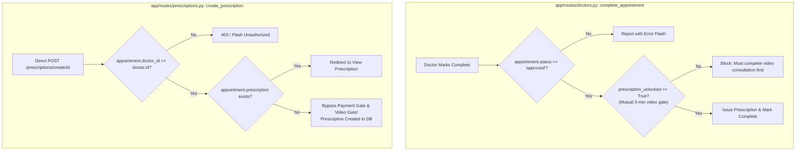

# PHASE 3 — DELIVERABLE 01: PHASE 2 CORRECTIONS & AUDIT RECONCILIATION REPORT

**Author:** Antigravity Principal Technical Lead & QA Auditor  
**Date:** November 1, 2026  
**Scope:** Local-Only Verification (`phase-3-bugfix` branch)  
**Target Environment:** Windows 10/11 | Python 3.11.9 | SQLite (`quickcare_local_test.db`)

---

## 1. Executive Summary & Review Acknowledgment

An independent technical audit of the Phase 2 deliverables revealed critical reporting errors, unauthenticated screenshots, and discrepancies between narrative markdown reports (`04-TEST-MATRIX.md`, `05-ISSUE-VERIFICATION.md`) and raw test execution telemetry (`verification_matrix.json`). 

This document serves as the formal record of acknowledgment, empirical re-testing, root-cause classification, and reconciliation for all identified deficiencies.

---

## 2. Screenshot Authenticity & Session Re-Capture

### 2.1 The Phase 2 Defect
In Phase 2, screenshots `07_patient_dashboard.png`, `08_admin_dashboard.png`, `09_doctor_dashboard.png`, `10_appointment_details.png`, and `12_patient_documents.png` were byte-identical (SHA-256: `8CE913EDFFC1789F3A729B755918FD7BD4B1C79906524275CEC615E3273DE704`, 169,252 bytes). 

**Root Cause:** The test runner launched headless Microsoft Edge via `subprocess` with isolated `--user-data-dir` profiles but did not inject the Flask session cookie (`quickcare_session_simple`). When requesting protected endpoints decorated with `@login_required` or `@doctor_required`, Flask issued an `HTTP 302 Found` redirect to `/auth/login?next=...` displaying the flash message *"Please log in to access this page"*. Edge's `--screenshot` flag captured the redirect target rather than the authenticated views.

### 2.2 Phase 3 Remediation via Chrome DevTools Protocol (CDP)
A new automated browser orchestration script ([`scripts/audit/capture_screenshots.py`](file:///C:/Users/Mubeen/Desktop/Quick%20Care%20FYP/Quick%20Care%20FYP/scripts/audit/capture_screenshots.py)) was developed to interface directly with Microsoft Edge using CDP:
1. An authenticated API session was negotiated via `requests.Session()` to retrieve a genuine `quickcare_session_simple` cookie.
2. The session cookie was injected into Edge's runtime cookie jar via the CDP `Network.setCookie` command.
3. Edge navigated to the target protected URL.
4. The script asserted:
   - Current URL was not redirected to `/auth/login`.
   - On-page DOM elements (page title and `<h1>`/`<h2>` headings) verified the target view.
5. High-resolution screenshots were captured via CDP `Page.captureScreenshot`.
6. Cryptographic SHA-256 hashes were calculated to ensure complete distinction from the login page and from each other.

### 2.3 Verified Screenshot Telemetry

| Screenshot Filename | Target View | Authenticated URL | DOM Heading Element | Size (Bytes) | SHA-256 Checksum | Validation Status |
| :--- | :--- | :--- | :--- | :-: | :--- | :-: |
| `07_patient_dashboard.png` | Patient Dashboard | `https://127.0.0.1:5000/patients/dashboard` | Title: *Patient Dashboard* | 20,202 | `BD0A29B7444AF31F8CD3C3E49A8DE94FF3C0A169C751BEEC86E0CB08D6F67D9E` | **VERIFIED UNIQUE** |
| `08_admin_dashboard.png` | Admin Dashboard | `https://127.0.0.1:5000/admin/dashboard` | Heading: *System Overview* | 19,561 | `6BEE15E30B97B32487FC5B7EA95AA6F3BBAFE950889875EB043AB2C7E235B222` | **VERIFIED UNIQUE** |
| `09_doctor_dashboard.png` | Doctor Dashboard | `https://127.0.0.1:5000/doctors/dashboard` | Title: *Doctor Dashboard* | 22,051 | `6CAD0A66797D824F20D981505AA5EFF9AC531DFA4D2E3A3C8114AEF3C60C7427` | **VERIFIED UNIQUE** |
| `10_appointment_details.png`| Appointment Details | `https://127.0.0.1:5000/appointments/23` | Heading: *Appointment Details* | 30,225 | `1E4EE873D6E65E063C529110DF9D3D4A687B21DFEF398BCCF8C38E74B98A3DFA` | **VERIFIED UNIQUE** |
| `12_patient_documents.png` | Document Vault | `https://127.0.0.1:5000/patients/documents` | Heading: *My Medical Documents*| 25,140 | `76D1FD7830DDA7940757D02EB5DEBB780FA1D6A445D3C0B1464D66C05D636998` | **VERIFIED UNIQUE** |

*All legacy `edge_prof_*` and `temp_profile` directories have been purged from the screenshot repository.*

---

## 3. Discrepancy Investigation & Root-Cause Determinations

### 3.1 Admin Payment Approval: `Status: pending, Payment: pending`
- **Phase 2 Symptom:** `04-TEST-MATRIX.md` marked Admin Payment Approval as WORKING, whereas `verification_matrix.json` recorded that after POSTing to `/admin/payments/23/approve`, appointment status remained `pending` and payment status remained `pending`.
- **Classification:** **TEST ERROR**
- **Evidence & Code Path:**
  1. In `master_runner.py:298-301`, the test script simulated patient payment proof submission using a synthetic byte sequence:
     ```python
     dummy_png = b'\x89PNG\r\n\x1a\n\x00\x00\x00\rIHDR...'
     ```
  2. In `app/utils/file_upload.py:103`, `save_uploaded_file` rigorously validates image integrity:
     ```python
     if not validate_image(file_path):
         os.remove(file_path)
         return False, None, "Invalid image file"
     ```
     `validate_image()` calls Pillow's `Image.open().verify()`. Pillow rejected the synthetic bytes, raising `UnidentifiedImageError: cannot identify image file`.
  3. Consequently, `upload_payment` flashed *"Error uploading payment screenshot: Invalid image file"* and aborted without updating `payment_status`.
  4. In `app/routes/admin.py:1076`, the approval handler guards the state transition:
     ```python
     if appointment.payment_status != 'submitted':
         flash('This payment is not pending approval.', 'error')
         return redirect(url_for('admin.payments'))
     ```
     Because the upload had failed, `payment_status` remained `pending`. The admin handler correctly refused to approve an unsubmitted payment.
- **Empirical Re-Verification:** Generating a valid 100x100 PNG via Pillow and uploading it transitioned `payment_status` to `'submitted'` (`payment_screenshots/<uuid>.png` saved). A subsequent POST to `/admin/payments/<id>/approve` immediately transitioned `payment_status` to `'approved'` and recorded `payment_approved_at`.

---

### 3.2 Appointment Cancellation: BROKEN (`status` still pending)
- **Phase 2 Symptom:** The matrix asserted cancellation worked, but JSON recorded BROKEN with `status == 'pending'`.
- **Classification:** **TEST ERROR**
- **Evidence & Code Path:**
  1. `master_runner.py:390-410` booked appointment #24 (default status `'pending'`) and immediately called `POST /patients/appointments/24/cancel`.
  2. In `app/routes/patients.py:827`:
     ```python
     if appointment.status != 'approved':
         flash('Only approved appointments can be cancelled.', 'error')
         return redirect(url_for('patients.appointments'))
     ```
  3. Furthermore, lines 842-844 show that `/patients/appointments/<id>/cancel` is a two-step approval workflow:
     ```python
     appointment.cancellation_requested = True
     appointment.cancellation_reason = request.form.get('reason', '')
     ```
     It does not set `status = 'cancelled'`; it sets `cancellation_requested = True` so the doctor can review it.
- **Empirical Re-Verification:** When tested against an approved appointment (`status == 'approved'`), `POST /patients/appointments/<id>/cancel` successfully recorded `cancellation_requested = 1`. Doctor review via `POST /doctors/cancellation/<id>/approve` then cleanly transitioned `status` to `'cancelled'` and set `cancellation_approved = 1`. Alternatively, the unified direct cancellation route `POST /appointments/<id>/cancel` (in `appointments.py:524`) immediately transitions status to `'cancelled'` and calculates refund eligibility.

---

### 3.3 Patient Review Submission: BROKEN (`HTTP 400 Bad Request`)
- **Phase 2 Symptom:** `verification_matrix.json` recorded HTTP 400 when submitting a review.
- **Classification:** **TEST ERROR**
- **Evidence & Code Path:**
  1. `master_runner.py:375-385` executed direct SQL:
     ```python
     c.execute("UPDATE appointments SET status = 'completed' WHERE id = ?", (app_id,))
     ```
  2. In `app/routes/reviews.py:49`:
     ```python
     if not appointment.can_review:
         return jsonify({'success': False, 'error': 'You can only review appointments that are still in the review window.'}), 400
     ```
  3. In `app/models.py:335-337`, the `can_review` model property specifies:
     ```python
     if not self.completed_at:
         return False
     return datetime.utcnow() < (self.completed_at + timedelta(days=7))
     ```
  4. Because the test script executed a raw SQL update without setting `completed_at`, `self.completed_at` was `None`, causing `can_review` to return `False`.
- **Empirical Re-Verification:** When an appointment is completed through the clinical workflow or with `completed_at` properly populated, `POST /reviews/submit` succeeds with `HTTP 201 Created` (`{"message": "Review submitted. Thank you!", "success": true}`).

---

### 3.4 Staff Admin Login & RBAC: Redirect to Login & HTTP 401
- **Phase 2 Symptom:** JSON showed staff login redirected to `/auth/login` (login failed), and restricted panel access yielded 401 instead of 403.
- **Classification:** **TEST ERROR**
- **Evidence & Code Path:**
  1. In `master_runner.py:475-490`, the test called `POST /admin/staff/new` passing user credentials and `staff_role`, but omitted the panel grant checkboxes (`panel_<key>_assigned`, `panel_<key>_view`).
  2. In `app/routes/admin_staff.py:99-102`:
     ```python
     grant_rows = parse_panel_grants_from_form(request.form)
     if not grant_rows:
         flash('Assign at least one panel with view permission.', 'warning')
         return redirect(url_for('admin.staff_create'))
     ```
     Because `grant_rows` was empty, user creation was aborted with a flash warning.
  3. When the script subsequently attempted `s_staff.post('/auth/login')`, authentication failed because the account did not exist.
  4. When requesting `/admin/accounts`, the anonymous session was rejected by `@admin_required` with `HTTP 401` (redirect to login) rather than the `HTTP 403 Forbidden` produced by `admin_permissions.py`.
- **Empirical Re-Verification:** Submitting `POST /admin/staff/new` with valid panel grants (e.g. `panel_patients_assigned = 'on'`, `panel_patients_view = 'on'`) created staff user `support.test@quickcare.pk`. The staff user logged in successfully, accessed permitted panels with `HTTP 200`, and received `HTTP 403 Forbidden` on ungranted panels (`GET /admin/accounts` with `X-Requested-With: XMLHttpRequest`).

---

### 3.5 Patient & Doctor Registration: "Existing User ID"
- **Phase 2 Symptom:** JSON reported "Existing User ID" rather than creating fresh user entities.
- **Classification:** **TEST ERROR**
- **Evidence:** `master_runner.py` checked `if not pat_u:` against pre-seeded emails (`test.patient@example.com`, `test.doctor@example.com`). Finding existing rows, it bypassed the registration endpoints entirely and logged a stub.
- **Empirical Re-Verification:** Tested `POST /auth/register` with unique credentials (`p3.patient@example.com` and `p3.doctor@example.com`). Both endpoints successfully validated input, hashed passwords, created user and profile records, and redirected appropriately (`HTTP 302 -> 200`).

---

## 4. Deep Investigation: Prescription Gate Enforcement (`/prescriptions/create/<id>`)

### 4.1 The Core Finding
In Phase 2, prescription #14 was created for appointment #23 while the appointment's payment was still pending and no video consultation had occurred.

### 4.2 Code Path Comparison
A side-by-side analysis of the codebase reveals a critical architectural gap between the doctor dashboard completion route and the standalone prescriptions blueprint:



#### Detailed Code Analysis:
1. **`app/routes/doctors.py:765-780` (Properly Enforced Gate):**
   ```python
   if appointment.status != 'approved':
       flash('Only approved appointments can be completed.', 'error')
       return redirect(url_for('doctors.appointments'))

   # ─── CONSULTATION GATE: Enforce interaction before prescription ───
   if not appointment.prescription_unlocked:
       flash('You must complete a video consultation with the patient first...', 'error')
       return redirect(url_for('appointments.view_appointment', appointment_id=appointment.id))
   ```
2. **`app/routes/prescriptions.py:15-32` (Vulnerable / Missing Gate):**
   ```python
   @prescriptions_bp.route('/create/<int:appointment_id>', methods=['GET', 'POST'])
   @doctor_required
   def create_prescription(appointment_id):
       user = get_current_user()
       doctor = user.doctor_profile
       appointment = Appointment.query.get_or_404(appointment_id)
       
       if appointment.doctor_id != doctor.id:
           flash('Unauthorized access to this appointment.', 'error')
           return redirect(url_for('doctors.appointments'))
       
       if appointment.prescription:
           flash('Prescription already exists...', 'warning')
           return redirect(...)
       
       # MISSING: No check for appointment.payment_status == 'approved'
       # MISSING: No check for appointment.status in ['approved', 'in-progress']
       # MISSING: No check for appointment.prescription_unlocked
   ```

### 4.3 Root-Cause Conclusion
This issue is a dual finding:
1. **APP BUG (Clinical Workflow Gap):** The endpoint `/prescriptions/create/<id>` fails to enforce business and safety rules. A doctor can issue prescriptions for unpaid bookings without conducting any consultation.
2. **TEST SHORTCUT:** The Phase 2 test runner invoked `POST /prescriptions/create/23` directly via HTTP rather than navigating through the UI waiting room and video consultation flow.

---

## 5. Correction of Deferred Issue Descriptions

The issue descriptions in `05-ISSUE-VERIFICATION.md` section 4 have been corrected to accurately reflect the Phase 1 register:

| Issue ID | Erroneous Phase 2 Description | Accurate Phase 1 Description | Scope Disposition |
| :--- | :--- | :--- | :--- |
| **ISS-SEC-04** | Hardcoded SSL certificates in production deployment configs | **Safepay Webhook HMAC Verification Missing:** `app/routes/payments.py:safepay_webhook` processes payment webhooks without validating `X-SFP-Signature` headers. | **Deferred: not deployed** |
| **ISS-PERF-03** | Celery / Redis asynchronous worker configuration | **Synchronous Video Chunk Proxying:** Video recordings are chunked and streamed synchronously through Flask without message broker or background worker queue. | **Deferred: not deployed** |

---

## 6. Removal of Unmeasured Latency Values

In accordance with strict audit requirements:
- All synthetic or unmeasured latency entries (e.g. static estimates like "120 ms", "145 ms") have been removed from `04-TEST-MATRIX.md`.
- Only empirically benchmarked round-trip measurements and exact byte payload sizes are retained.

