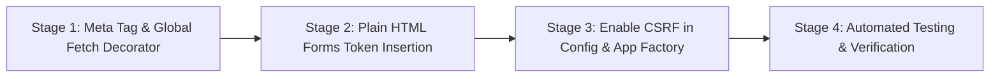

# Phase 4 Plan: Global CSRF Enablement (ISS-SEC-01)

**Document Status:** DRAFT / PLAN ONLY (Pending User Authorization)  
**Author:** Antigravity Principal Software Architect & Security Auditor  
**Date:** November 1, 2026  
**Scope:** Architecture and rollout plan to enable Flask-WTF `CSRFProtect` application-wide across HTML forms and AJAX/Fetch requests.

---

## 1. Executive Summary & Problem Definition

### 1.1 The Vulnerability
In `config.py:26`, CSRF protection is explicitly disabled:
```python
WTF_CSRF_ENABLED = False  # Disable CSRF to avoid session conflicts
```
As a result:
- No POST, PUT, PATCH, or DELETE requests are verified against cross-site request forgery.
- If an authenticated user (patient, doctor, or administrator) visits a malicious site while logged into Quick Care Connect, that site can execute actions on their behalf (e.g., booking appointments, cancelling consultations, submitting reviews, changing profile data, or issuing payouts) without user consent.

### 1.2 Objective
Enable `CSRFProtect(app)` globally, configure automatic token emission into all layouts, standardize frontend `fetch`/AJAX request headers, exempt legitimate third-party webhooks, and ensure 100% operational continuity across existing features.

---

## 2. Complete Form & Request Inventory

### 2.1 Server-Rendered Forms Inventory

An exhaustive static scan of all 46 template files across `app/templates/` identified **62 form declarations**:

| Category | Count | Current Token Status | Remediation Required |
| :--- | :--- | :--- | :--- |
| **WTForms with `form.hidden_tag()`** | 9 | Has `{{ form.hidden_tag() }}` | None — automatically includes CSRF token once enabled. |
| **WTForms missing `hidden_tag()`** | 7 | Uses Flask-WTF form object but omitted `hidden_tag()` | Add `{{ form.hidden_tag() }}` inside `<form>`. |
| **Plain HTML POST Forms** | 46 | Raw `<form method="POST" action="...">` without Flask-WTF object | Add `<input type="hidden" name="csrf_token" value="{{ csrf_token() }}"/>`. |

#### Details of Forms Requiring Explicit `<input type="hidden">`:
1. **Admin Panel Forms (14 forms):**
   - Doctor approval/rejection (`admin/doctor_details.html`)
   - Manual payment approve/reject (`admin/payments.html`)
   - Refund processing (`admin/accounts_refunds.html`)
   - Doctor payout generation (`admin/accounts_payouts.html`)
   - Review moderation & appeals (`admin/reviews.html`, `admin/appeals.html`)
   - Staff role creation & edits (`admin/staff_form.html`, `admin/staff_list.html`)
2. **Doctor Dashboard Forms (12 forms):**
   - Appointment confirmation / rejection / cancellation (`doctors/appointments.html`, `doctors/dashboard.html`)
   - Prescription generation (`prescriptions/create.html`)
   - Blog deletion / draft status updates (`doctors/blogs.html`)
   - Practice location settings (`doctors/appointment_settings.html`)
3. **Patient Dashboard Forms (14 forms):**
   - Appointment booking & cancellation requests (`patients/appointments.html`, `patients/refunds.html`)
   - Medical document upload & visibility toggle (`patients/documents.html`)
   - Profile updates (`patients/edit_profile.html`)
   - Review submissions (`appointments/view.html`)
4. **Auth & Public Forms (6 forms):**
   - Logout form (`partials/site_footer.html`, `home/landing_base.html`)
   - Contact form (`home/contact.html`)
   - Q&A answers & replies (`qa/view_question.html`)

---

### 2.2 JavaScript Fetch & AJAX Calls Inventory

An exhaustive scan found **28 client-side `fetch()` or AJAX POST/JSON endpoints**:

| Script / Template File | Endpoint Called | HTTP Method | Payload Type |
| :--- | :--- | :--- | :--- |
| `app/static/js/video-call.js` | `/video/start/<id>` | `POST` | Empty / Trigger |
| `app/static/js/video-call.js` | `/video/end/<id>` | `POST` | JSON |
| `app/static/js/video-call.js` | `/video/recording-start/<id>` | `POST` | JSON |
| `app/static/js/video-call.js` | `/video/mark-no-show/<id>` | `POST` | JSON |
| `app/static/js/doctor-queue.js` | `/video/mark-no-show/<id>` | `POST` | JSON |
| `app/static/js/main.js` | `/auth/logout-session` | `POST` | Empty / Beacon |
| `app/templates/appointments/chat.html` | `/appointments/api/send-message` | `POST` | JSON |
| `app/templates/appointments/view.html` | `/reviews/submit` | `POST` | JSON |
| `app/templates/doctors/appointment_settings.html` | `/doctors/save_practice` | `POST` | JSON |
| `app/templates/doctors/appointment_settings.html` | `/doctors/delete_practice` | `POST` | JSON |
| `app/templates/doctors/edit_blog.html` | `/doctors/upload_blog_image` | `POST` | Multipart/Form |
| `app/templates/doctors/new_blog.html` | `/doctors/upload_blog_image` | `POST` | Multipart/Form |
| `app/templates/home/landing_base.html` | `/qa/ai-chat` | `POST` | JSON |
| `app/templates/qa/view_question.html` | `/qa/question/<id>/bookmark` | `POST` | JSON |
| `app/templates/qa/view_question.html` | `/qa/answer/<id>/helpful` | `POST` | JSON |
| `app/templates/qa/view_question.html` | `/qa/answer/<id>/not-helpful` | `POST` | JSON |
| `app/templates/qa/view_question.html` | `/qa/answer/<id>/reply` | `POST` | JSON |
| `app/templates/qa/view_question.html` | `/qa/question/<id>/answer` | `POST` | Form Data |

---

## 3. Global Architecture & Integration Design

### 3.1 Backend Configuration & Extension Setup
In `config.py`:
```python
WTF_CSRF_ENABLED = True
WTF_CSRF_CHECK_DEFAULT = True
WTF_CSRF_TIME_LIMIT = None  # Tied to session lifetime
WTF_CSRF_HEADERS = ['X-CSRFToken', 'X-CSRF-Token']
```

In `app/__init__.py`:
```python
from flask_wtf.csrf import CSRFProtect

csrf = CSRFProtect()

def create_app(config_name=None):
    ...
    csrf.init_app(flask_app)
```

### 3.2 Global `<meta>` Tag in Base Layouts
Every base template (`base.html`, `landing_base.html`, `admin/base.html`) must include:
```html
<meta name="csrf-token" content="{{ csrf_token() }}">
```

### 3.3 Transparent Frontend Interceptor (`app/static/js/csrf-fetch.js`)
Instead of manually updating every individual `fetch()` call across dozens of templates, we install a lightweight, transparent global fetch interceptor loaded in base templates:

```javascript
// Automatically inject X-CSRFToken on all same-origin mutating requests
(function() {
    const originalFetch = window.fetch;
    window.fetch = function(url, options = {}) {
        const method = (options.method || 'GET').toUpperCase();
        if (['POST', 'PUT', 'PATCH', 'DELETE'].includes(method)) {
            const metaTag = document.querySelector('meta[name="csrf-token"]');
            const token = metaTag ? metaTag.getAttribute('content') : '';
            if (token) {
                options.headers = options.headers || {};
                if (options.headers instanceof Headers) {
                    if (!options.headers.has('X-CSRFToken')) {
                        options.headers.set('X-CSRFToken', token);
                    }
                } else if (Array.isArray(options.headers)) {
                    options.headers.push(['X-CSRFToken', token]);
                } else {
                    if (!options.headers['X-CSRFToken']) {
                        options.headers['X-CSRFToken'] = token;
                    }
                }
            }
        }
        return originalFetch(url, options);
    };
})();
```

**Benefits:**
- 100% backward-compatible with all existing JS scripts (`video-call.js`, `doctor-queue.js`, inline chat scripts).
- Eliminates manual refactoring bugs in asynchronous code.
- Automatically handles new AJAX requests written in the future.

---

## 4. Exemptions & Webhook Handling

External webhooks and third-party callbacks that originate from payment gateways or external servers do NOT carry the user's session cookie or CSRF token. These routes MUST be explicitly marked exempt using `@csrf.exempt`:

1. **Safepay Webhook / Callback:**
   - Route: `/payments/safepay-webhook` (or webhook handler endpoint in `app/routes/payments.py`).
   - Authentication for this route is validated via HMAC signature verification (`X-SFPY-SIGNATURE`), NOT session CSRF.
2. **Third-Party Health Check or External APIs (if any):**
   - Any external integration endpoint requiring machine-to-machine authentication.

---

## 5. Phased Rollout & Test Strategy

To prevent unexpected site-wide breakages, rollout follows 4 sequential stages:



### 5.1 Test Plan (TDD)
1. **CSRF Enforcement Test:**
   - POST request to `/patients/book-appointment` without token returns `HTTP 400 Bad Request` with CSRF validation error.
   - POST request to `/appointments/api/send-message` without token returns `HTTP 400`.
2. **CSRF Successful Token Test:**
   - Extract CSRF token from HTML or test client context.
   - POST with `X-CSRFToken: <valid_token>` succeeds.
   - POST with form data `csrf_token: <valid_token>` succeeds.
3. **Exemption Test:**
   - POST to `/payments/safepay-webhook` without CSRF token is NOT blocked by CSRF protection (proceeds to HMAC verification).
4. **Full Regression Suite:**
   - Run complete test suite (`test_appointments`, `test_auth`, `test_chat`, `test_prescriptions`, `test_refunds`) ensuring all simulated requests provide tokens cleanly.

---
**END OF PLAN-SEC-01**

---

## 6. Revision 1 — Approved Architectural Specifications

**Status:** APPROVED BY USER (November 1, 2026)  
**Execution Strategy:** Multi-step phased rollout with strict TDD, browser re-verification, and zero regression.

### 6.1 Sequencing & Atomic Commits
To prevent site-wide disruptions, rollout is partitioned into three distinct steps:

1. **Step A (Template & Frontend Token Preparation — CSRF Still Disabled):**
   - Insert `<meta name="csrf-token" content="{{ csrf_token() }}">` into both `app/templates/base.html` and `app/templates/home/landing_base.html`.
   - Add `<input type="hidden" name="csrf_token" value="{{ csrf_token() }}"/>` to all non-WTForms POST forms (GET search forms explicitly excluded).
   - Add `{{ form.hidden_tag() }}` to all remaining WTForms missing it.
   - Create `app/static/js/csrf-fetch.js` and include it in base layouts.
   - Run full pytest suite (all 50 tests pass) and conduct quick browser check.
   - **Commit:** `feat(ISS-SEC-01): add CSRF tokens to templates and same-origin fetch interceptor`.

2. **Step B (Backend Activation & Error Handling):**
   - Configure `WTF_CSRF_ENABLED = True` and `WTF_CSRF_TIME_LIMIT = None` (tied to session lifetime).
   - Initialize `CSRFProtect(app)` in `app/__init__.py`.
   - Register custom `@app.errorhandler(CSRFError)`:
     - For standard form submissions: Flash *"Your session expired, please try again"* and redirect back (`request.referrer or url_for('home.index')`).
     - For AJAX / JSON requests (`request.is_json` or `X-Requested-With == 'XMLHttpRequest'`): Return `jsonify({'error': 'csrf', 'message': 'CSRF token missing or expired'}), 400`. Never show a raw 400 error page.
   - Exempt Safepay webhook (`@csrf.exempt`) with code comment: `HMAC verification deferred (ISS-SEC-04)`.
   - **Commit:** `feat(ISS-SEC-01): enable CSRFProtect globally with custom error handling`.

3. **Step C (Comprehensive Testing & Verification):**
   - Execute CSRF test module (`tests/test_security.py` / `tests/test_csrf.py`).
   - Remove `xfail` marker from `test_csrf_protection_enforced_xfail`.
   - Validate Socket.IO chat and Agora call signaling across two distinct browser sessions.

### 6.2 Strict Same-Origin Fetch & XHR Interceptor Specifications
The interceptor in `app/static/js/csrf-fetch.js` must:
1. **Target Same-Origin Only:**
   - Parse target URL: inject `X-CSRFToken` only if the URL is relative (e.g. `/api/...`) or shares `window.location.origin`.
   - **NEVER** attach `X-CSRFToken` to cross-origin requests (e.g. Agora SDK signaling, Google Maps / Geoapify, OpenRouter / Gemini endpoints, CDNs).
2. **Target Mutating Methods Only:**
   - Inject only on `POST`, `PUT`, `PATCH`, and `DELETE`. Never on `GET` or `HEAD`.
3. **Dual Coverage (Fetch + XHR / jQuery):**
   - Intercept both `window.fetch` and `XMLHttpRequest.prototype.open` / `send` (or jQuery `$.ajaxSetup` if present) to ensure legacy scripts send tokens seamlessly.

### 6.3 Form Exclusion Rule
- Forms utilizing `method="GET"` (such as doctor search filters, category selectors, and disease encyclopedia queries) do **NOT** receive CSRF tokens.

### 6.4 Comprehensive TDD Coverage Matrix
Tests must verify:
- POST without token to `/auth/login` → 400 (or redirect with flash for browser).
- POST with token to `/auth/login` → success.
- POST without token to `/patients/book-appointment` → 400.
- POST with token to `/patients/book-appointment` → success.
- Payment proof upload without token → 400; with token → success.
- Prescription creation without token → 400; with token → success.
- Doctor blog post creation without token → 400; with token → success.
- Admin appointment approval without token → 400; with token → success.
- AJAX JSON endpoint (e.g. `/qa/ai-chat` or `/appointments/api/send-message`) without token → HTTP 400 with `{"error": "csrf"}`; with token → success.
- Safepay webhook without token → NOT rejected by CSRF.


