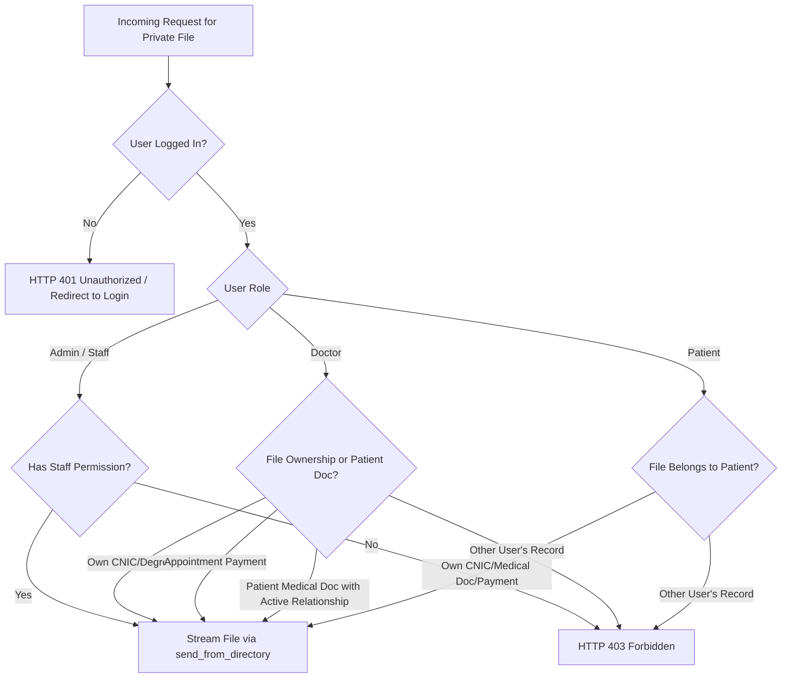

# Phase 4 Plan: Private Uploads Migration (ISS-SEC-03)

**Document Status:** DRAFT / PLAN ONLY (Pending User Authorization)  
**Author:** Antigravity Principal Software Architect & Security Auditor  
**Date:** November 1, 2026  
**Scope:** Remediation architecture for unauthenticated static serving of sensitive identity, medical, and financial documents.

---

## 1. Executive Summary & Problem Definition

### 1.1 The Vulnerability
In the current application architecture, all user uploads are stored inside `app/static/uploads/` and served directly through Flask's static endpoint (`/static/uploads/<filename>`) without any authentication or authorization checks.

Because the web server treats the entire static directory as world-readable, anyone with knowledge or guessing ability of an upload URL can download and view:
- High-resolution scans of Government National Identity Cards (CNIC front and back) for both patients and doctors.
- Verified medical degree certificates and PMDC/PMC registration credentials.
- Proof-of-payment receipts containing bank accounts, transaction numbers, and payer details.
- Sensitive patient health records, diagnostic lab reports, and radiology scans (`MedicalDocument`).

### 1.2 Objective
Isolate private and sensitive clinical/identity files from the public static tree into a secure, non-public directory (`instance/private_uploads/`). Implement an authenticated streaming endpoint that verifies session identity, role-based access controls (RBAC), and appointment/patient relationship gates before streaming file bytes.

---

## 2. Complete Upload Column Inventory & Classification

Across the entire SQLAlchemy database model schema and file processing utilities (`app/models.py`, `app/utils/file_upload.py`, and `app/routes/`), the following columns store file references:

| Model | Column Name | Data Type | Subfolder in `uploads/` | Sensitivity Category | Access Policy |
| :--- | :--- | :--- | :--- | :--- | :--- |
| `User` | `profile_picture` | `db.String(255)` | `profile_pictures/` | **PUBLIC** | Publicly accessible (rendered in directory, navbar, reviews). |
| `Blog` | `featured_image` | `db.String(255)` | `blog_covers/` | **PUBLIC** | Publicly accessible (rendered in blog directory and landing pages). |
| `Doctor` | `cnic_front_image` | `db.String(255)` | `cnic/` | **PRIVATE (Identity)** | Doctor owner + Staff/Admin only. |
| `Doctor` | `cnic_back_image` | `db.String(255)` | `cnic/` | **PRIVATE (Identity)** | Doctor owner + Staff/Admin only. |
| `Doctor` | `degree_documents` | `db.JSON` | `degrees/` | **PRIVATE (Credentials)** | Doctor owner + Staff/Admin only. |
| `Patient` | `cnic_front_image` | `db.String(255)` | `cnic/` | **PRIVATE (Identity)** | Patient owner + Staff/Admin only. |
| `Patient` | `cnic_back_image` | `db.String(255)` | `cnic/` | **PRIVATE (Identity)** | Patient owner + Staff/Admin only. |
| `Appointment` | `payment_screenshot` | `db.String(255)` | `payment_screenshots/` | **PRIVATE (Financial)** | Patient owner + Assigned Doctor + Staff/Admin only. |
| `MedicalDocument` | `file_path` | `db.String(500)` | `medical_documents/<patient_id>/` | **PRIVATE (Clinical)** | Patient owner + Treating Doctor (if `is_visible_to_doctor` and active appointment) + Staff/Admin. |
| `CallRecording` | `file_path` / `file_url` | `db.String(512)` | External / DO Spaces | **PRIVATE (Clinical Media)** | Patient + Doctor of appointment + Admin (already gated via presigned URL). |

---

## 3. Architecture of Authenticated Serving Route

### 3.1 Endpoint Design
We propose a dedicated blueprint `private_uploads_bp` (or within `documents_bp`) registered at `/uploads/private`:

```python
@private_bp.route('/private/<category>/<path:filepath>')
@login_required
def serve_private_file(category: str, filepath: str):
    """Securely stream private PII/medical/financial documents with ownership checks."""
    ...
```

Supported categories:
1. `cnic`: Doctor or Patient CNIC images.
2. `degrees`: Doctor medical credentials and PMDC certificates.
3. `payment_screenshots`: Manual bank transfer receipts for appointments.
4. `medical_documents`: Diagnostic reports and lab files.

### 3.2 Role-Based Access Gate Matrix



Detailed authorization logic per category:
- **`cnic` & `degrees`:**
  - `Admin`: Allowed if staff account has `doctors_view` / `patients_view` permission.
  - `Doctor`: Allowed if `doctor.cnic_front_image == filepath` or `filepath in doctor.degree_documents`.
  - `Patient`: Allowed if `patient.cnic_front_image == filepath` or `patient.cnic_back_image == filepath`.
  - All others: `403 Forbidden`.
- **`payment_screenshots`:**
  - `Admin`: Allowed (`finance_view` or `appointments_view`).
  - `Patient`: Allowed if patient booked the associated appointment.
  - `Doctor`: Allowed if doctor is assigned to the associated appointment.
  - All others: `403 Forbidden`.
- **`medical_documents`:**
  - `Patient`: Allowed if `medical_document.patient_id == current_user.patient_profile.id`.
  - `Doctor`: Allowed if `medical_document.is_visible_to_doctor` is `True` AND doctor has at least one confirmed/approved appointment with this patient.
  - `Admin`: Allowed (`medical_records_view` or superadmin).
  - All others: `403 Forbidden`.

### 3.3 Secure File Streaming Controls
- Path traversal protection using `werkzeug.security.safe_join` or strict UUID matching against database records.
- Enforce strict security response headers:
  - `Content-Disposition: inline; filename="safe_filename.ext"`
  - `X-Content-Type-Options: nosniff`
  - `Cache-Control: private, no-cache, no-store, must-revalidate`
  - `Pragma: no-cache`
  - `Expires: 0`

---

## 4. Storage Location & Physical Migration Plan

### 4.1 Target Directory
Private files will be stored in an instance-level directory outside the web application's static root:
```
instance/private_uploads/
├── cnic/
├── degrees/
├── payment_screenshots/
└── medical_documents/
    └── <patient_id>/
```
`instance/` is already untracked by Git (`.gitignore`), resides on the local server filesystem, and is NOT directly accessible via HTTP.

### 4.2 Migration Tool (`scripts/migrate_private_uploads.py`)
A dedicated Python migration script with three operating modes:

1. **`--dry-run` (Default):**
   - Scans `app/static/uploads/cnic/`, `degrees/`, `payment_screenshots/`, and `medical_documents/`.
   - Compares physical files against database records in `doctors`, `patients`, `appointments`, and `medical_documents`.
   - Flags orphaned files, missing files, and computes total storage footprint.
   - Outputs a migration manifest JSON (`instance/migration_manifest.json`).

2. **`--execute`:**
   - Creates directory structure in `instance/private_uploads/`.
   - Iterates through the manifest:
     - Copies each file to the new destination.
     - Computes SHA-256 of source and destination to verify integrity.
     - Unlinks source file from `app/static/uploads/` only upon successful byte verification.
     - Leaves a placeholder `.gitkeep` in the old folders.

3. **`--rollback`:**
   - Reads `instance/migration_manifest.json`.
   - Reverses the copy: moves files back from `instance/private_uploads/` to `app/static/uploads/`.
   - Verifies hashes and restores original state.

---

## 5. Backward Compatibility & Template Transition

### 5.1 Route & URL Resolution Transition
Currently, templates build URLs using:
- `url_for('static', filename='uploads/' + doctor.cnic_front_image)`
- `/static/uploads/{{ appointment.payment_screenshot }}`
- `url_for('static', filename=doc.file_path)`

To transition seamlessly:
1. Introduce a helper and Jinja global function `private_file_url(category, filename_or_path)`:
   ```jinja
   
   <a href="{{ private_file_url('payment_screenshot', appointment.payment_screenshot) }}">View Receipt</a>
   <a href="{{ private_file_url('medical_documents', doc.file_path) }}">Download Report</a>
   ```
2. Database Column Values:
   - The stored values in database columns (e.g., `unique_id.jpg` or `medical_documents/1/unique_id.pdf`) do NOT need destructive batch rewrites. The helper resolves them relative to the private root.

### 5.2 Legacy URL Interceptor
To protect against bookmarks, cached URLs, or third-party web crawlers attempting to access old static URLs:
- Configure a Flask before-request handler or route interceptor for `/static/uploads/cnic/<path>`, `/static/uploads/degrees/<path>`, `/static/uploads/payment_screenshots/<path>`, and `/static/uploads/medical_documents/<path>`.
- Any request to these legacy static paths will immediately return `HTTP 404 Not Found` or issue a secure redirect (`HTTP 302`) to the authenticated `/uploads/private/...` route.

---

## 6. Implementation Stages & Verification Checklist

1. [ ] **Stage 1 (Code Preparation):**
   - Implement `app/routes/documents.py` blueprint with `serve_private_file` and full RBAC checks.
   - Register `private_file_url` Jinja template helper in `create_app()`.
2. [ ] **Stage 2 (Unit & Integration Tests):**
   - Anonymous access to `/uploads/private/...` → 401.
   - Unauthorized user (Patient B accessing Patient A's lab result) → 403.
   - Authorized user (Patient A accessing own lab result) → 200 with matching bytes and `nosniff` header.
   - Assigned Doctor accessing permitted patient document → 200.
   - Unassigned Doctor accessing same document → 403.
3. [ ] **Stage 3 (Template Refactoring):**
   - Update 7 affected templates (`admin/doctor_details.html`, `admin/payments.html`, `doctors/edit_registration.html`, `patients/edit_profile.html`, `appointments/view.html`, `patients/documents.html`, `patients/medical_history.html`).
4. [ ] **Stage 4 (Physical File Migration):**
   - Run `python scripts/migrate_private_uploads.py --dry-run`.
   - Inspect manifest.
   - Run `python scripts/migrate_private_uploads.py --execute`.
   - Verify zero private files remain under `app/static/uploads/`.
5. [ ] **Stage 5 (Regression Verification):**
   - Run full pytest test suite (appointments, chat, auth, refunds).

---
**END OF PLAN-SEC-03**

---

## 7. Revision 1 — Approved Architectural Specifications

**Status:** APPROVED BY USER (November 1, 2026)  
**Execution Strategy:** Full implementation with TDD loop, verified via unit/integration tests and browser screenshots.

### 7.1 Copy Strategy (Zero Destruction of Static Originals)
- The migration must **COPY** files from `app/static/uploads/` to `instance/private_uploads/` without deleting originals.
- Original files in `app/static/uploads/` remain untouched because the untouched baseline database `instance/quickcare_dev.db` continues to reference them.
- Only the **working test database copy** (`instance/quickcare_local_test.db` / `DEV_DATABASE_URL`) will be updated to point to the new paths or serve through the ID-based routes.

### 7.2 Comprehensive File Inventory & Classification (Expanded)

| File Type / Purpose | DB Model & Column | Storage Location (Current) | Target Private Location | Access Classification |
| :--- | :--- | :--- | :--- | :--- |
| **Patient CNIC (Front & Back)** | `Patient.cnic_front_image`, `cnic_back_image` | `app/static/uploads/` | `instance/private_uploads/cnic/` | **PRIVATE (PII)** |
| **Doctor CNIC (Front & Back)** | `Doctor.cnic_front_image`, `cnic_back_image` | `app/static/uploads/` | `instance/private_uploads/cnic/` | **PRIVATE (PII)** |
| **Doctor Degrees & PMDC Credentials** | `Doctor.degree_documents` (JSON array) | `app/static/uploads/` | `instance/private_uploads/degrees/` | **PRIVATE (Credentials)** |
| **Appointment Payment Proof** | `Appointment.payment_screenshot` | `app/static/uploads/payment_screenshots/` | `instance/private_uploads/payment_screenshots/` | **PRIVATE (Financial)** |
| **Medical Documents / Diagnostics** | `MedicalDocument.file_path` | `app/static/uploads/medical_documents/<patient_id>/` | `instance/private_uploads/medical_documents/<patient_id>/` | **PRIVATE (Clinical)** |
| **Prescription Generated PDFs** | `Prescription.pdf_path` | `app/static/prescriptions/` | `instance/private_uploads/prescriptions/` | **PRIVATE (Clinical)** |
| **Doctor Payout Details** | `DoctorPayoutRequest` | Text fields (`account_number`, `iban`, etc.) | No files (DB columns only) | **PRIVATE (Financial)** |
| **Refund Payout Details** | `RefundPayoutDetail` | Text fields (`account_number`, `iban`, etc.) | No files (DB columns only) | **PRIVATE (Financial)** |
| **Q&A Reply Attachment** | `AnswerReply.photo_path` | `app/static/uploads/qa_replies/` | `app/static/uploads/qa_replies/` | **PUBLIC (Community Forum)** |
| **User Profile Pictures / Avatars** | `User.profile_picture` | `app/static/uploads/` or `profile_pictures/` | `app/static/uploads/profile_pictures/` | **PUBLIC (Directory)** |
| **Blog Featured Covers** | `Blog.featured_image` | `app/static/uploads/blogs/` or `blog_covers/` | `app/static/uploads/blog_covers/` | **PUBLIC (Editorial)** |
| **Video Call Recordings** | `CallRecording.file_path` / `file_url` | External (DigitalOcean Spaces / S3) | External Spaces / Presigned URL | **PRIVATE (Gated via S3 presign)** |

### 7.3 ID-Based Serving Endpoints (No Raw Paths in URLs)

To eliminate directory traversal vulnerabilities and hide server file layouts, files are served strictly by **Record ID**:

1. `/files/identity/<int:user_id>/<string:side>`
   - `side`: `'front'` or `'back'`.
   - Resolves via `User.query.get(user_id)` -> `patient_profile` or `doctor_profile`.
2. `/files/degree/<int:doctor_id>/<int:index>`
   - Resolves via `Doctor.query.get(doctor_id)` -> `degree_documents[index]`.
3. `/files/payment-proof/<int:appointment_id>`
   - Resolves via `Appointment.query.get(appointment_id)` -> `payment_screenshot`.
4. `/files/medical-document/<int:doc_id>`
   - Resolves via `MedicalDocument.query.get(doc_id)` -> `file_path`.
5. `/files/prescription-pdf/<int:prescription_id>`
   - Resolves via `Prescription.query.get(prescription_id)` -> `pdf_path` (generating on demand if ungenerated).

**Streaming & Security Requirements:**
- File path is retrieved from verified database records; URL arguments never accept filesystem paths.
- Physical streaming uses `flask.send_from_directory(directory, filename)` with `werkzeug.security.safe_join`.
- Tests must explicitly prove that directory traversal attempts (e.g. `../../etc/passwd` or `..\..\config.py`) fail.
- Headers:
  - `Cache-Control: private, no-store`
  - `X-Content-Type-Options: nosniff`
- Content Disposition:
  - Images (`image/jpeg`, `image/png`): `as_attachment=False` (served inline for browser display).
  - PDFs / documents: served as attachments or viewable PDF with `inline`.

### 7.4 Detailed Access Control Matrix & Admin Panel Mapping

For any unauthorized access, the endpoints **MUST return HTTP 404 Not Found** (NOT 401 or 403) so that unauthorized callers cannot distinguish whether a document ID exists.

| File Type | Owner | Related Doctor | Admin / Staff RBAC Panel Requirement (`admin_permissions.py`) | Other Users / Anonymous |
| :--- | :--- | :--- | :--- | :--- |
| **Patient CNIC** | Allowed (`current_user.id == user_id`) | **404 (Blocked)** | Allowed ONLY with `patients` panel view permission (`has_panel_permission(user, 'patients', 'view')`) | **404** |
| **Doctor CNIC / Degree** | Allowed (`current_user.id == doctor.user_id`) | **404 (Blocked)** | Allowed ONLY with `doctors` panel view permission (`has_panel_permission(user, 'doctors', 'view')`) | **404** |
| **Payment Screenshot** | Allowed (Patient who booked: `current_user.patient_profile.id == appt.patient_id`) | **404 (Blocked)** | Allowed ONLY with `payments` panel view permission (`has_panel_permission(user, 'payments', 'view')`) | **404** |
| **Medical Document** | Allowed (`current_user.patient_profile.id == doc.patient_id`) | **Allowed ONLY if linked to doctor's appointment** (see note below) | Allowed ONLY with `patients` panel view permission (`has_panel_permission(user, 'patients', 'view')`) | **404** |
| **Prescription PDF** | Allowed (`current_user.patient_profile.id == prescription.patient_id`) | Allowed ONLY to issuing doctor (`current_user.doctor_profile.id == prescription.doctor_id`) | Allowed ONLY with `appointments` panel view permission (`has_panel_permission(user, 'appointments', 'view')`) | **404** |

*Note on Doctor Medical Document Access:*
Current product behavior in `appointments.py:653` and `doctors.py:169` allows a doctor to view a patient's documents if `is_visible_to_doctor == True` and there is a recorded appointment between them. Under the hardened rule:
- A doctor may view `/files/medical-document/<id>` **only** if:
  1. `doc.is_visible_to_doctor == True`, AND
  2. The doctor has an existing non-cancelled appointment with that patient (or `doc.appointment_id == appt.id` where `appt.doctor_id == doctor.id`).
- An unrelated doctor gets **404**.

*Super Admin Privilege:* A Super Administrator (`is_super_admin(user) == True`) possesses universal access to all files.

### 7.5 Legacy Static URL Protection
- Requests to legacy private paths:
  - `/static/uploads/cnic/<filename>`
  - `/static/uploads/degrees/<filename>`
  - `/static/uploads/payment_screenshots/<filename>`
  - `/static/uploads/medical_documents/<path>`
  - `/static/prescriptions/<filename>`
  MUST return **HTTP 404 Not Found** without redirection.
- Public paths:
  - `/static/uploads/profile_pictures/<filename>`
  - `/static/uploads/blog_covers/<filename>`
  - `/static/uploads/blogs/<filename>`
  - Static CSS/JS/vendor assets
  Continue to serve normally with HTTP 200.

### 7.6 Migration Utility (`scripts/migrate_private_uploads.py`)
- Supported flags:
  - `--dry-run`: Scans `app/static/uploads/` and reports file count, destination paths, database references, and SHA-256 hashes without modifying files.
  - `--execute`: Copies files from `app/static/uploads/` to `instance/private_uploads/`, verifies byte-for-byte SHA-256 parity, and updates file paths in the active test database. Idempotent.
  - `--rollback`: Reverts database paths if executed.
- `.gitignore` includes `instance/private_uploads/`.
- New runtime uploads immediately write to `instance/private_uploads/`.


