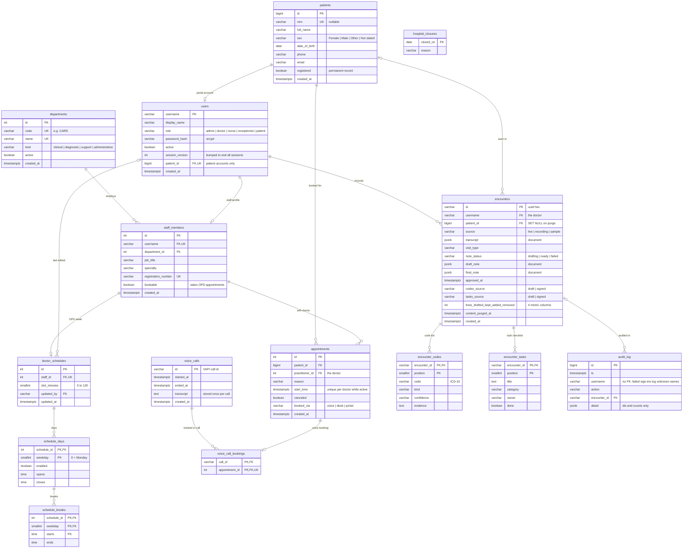
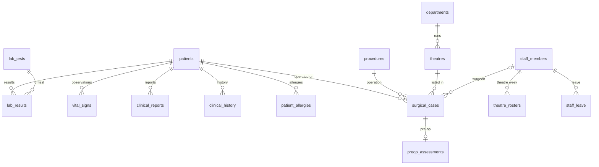
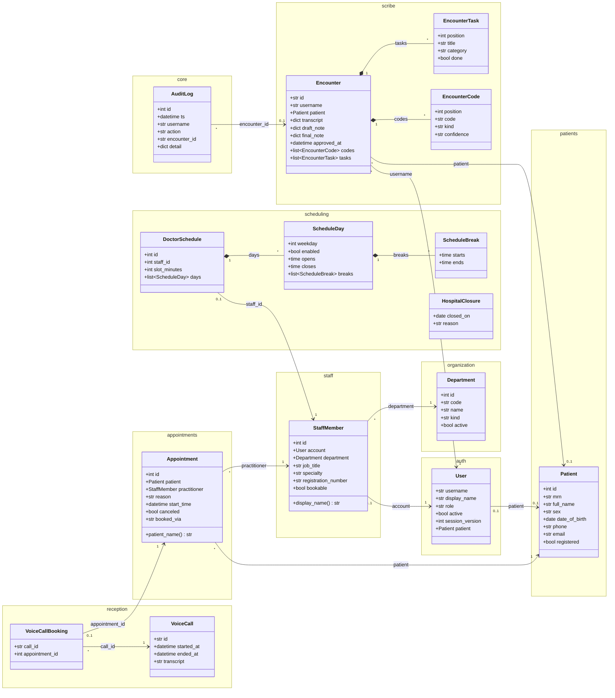

# Database: schema and class diagram

PostgreSQL 17 (Docker, `compose.yaml`), normalised to third normal form, managed by Alembic migrations
(`backend/migrations`, currently at revision `0005`, operating theatres). Each backend module owns its tables
in its own `models.py`; `backend/app/models.py` registers them all. Design decisions are in the sections below.

## Tables by module

| Module | Tables |
|---|---|
| core | `audit_log` |
| auth | `users` |
| organization | `departments` |
| staff | `staff_members` |
| patients | `patients` |
| scheduling | `doctor_schedules`, `schedule_days`, `schedule_breaks`, `hospital_closures` |
| appointments | `appointments` |
| reception (voice) | `voice_calls`, `voice_call_bookings` |
| scribe | `encounters`, `encounter_codes`, `encounter_tasks` |
| clinical | `lab_tests`, `lab_results`, `vital_signs`, `clinical_reports`, `clinical_history`, `patient_allergies` |
| theatre | `theatres`, `procedures`, `surgical_cases`, `preop_assessments`, `theatre_rosters`, `staff_leave` |

## Entity–relationship diagram (tables)

PK = primary key, FK = foreign key, UK = unique.

### Clinical data and operating theatres (migrations 0004, 0005)

Models: `backend/app/modules/clinical/models.py`, `backend/app/modules/theatre/models.py`. Clinical rows are
deleted with their patient; a theatre case is not (it is cancelled instead). Lab flags are computed when a result
is stored; vital-sign reference ranges are constants (`clinical/service.py`, `VITAL_RANGES`), not rows.

| Table | Key | Columns |
|---|---|---|
| lab_tests | id | code (HGB, WBC, PLT, NA, K, CREA, GLU, ALB, INR; seeded by the migration), name, unit, ref_low, ref_high, category |
| lab_results | id | patient, test, value, flag, collected_at, source (seed/manual/import), entered_by |
| vital_signs | id | patient, recorded_at, heart_rate, systolic/diastolic BP, spo2, temperature_c, resp_rate (each nullable) |
| clinical_reports | id | patient, kind (ultrasound, ECG, X-ray, CT, MRI, echo, …), title, reported_on, body, author |
| clinical_history | id | patient, kind (indication/condition/surgery), noted_on, text |
| patient_allergies | id | patient, substance, reaction, severity |
| theatres | id | code ("OR 1"), name, department, specialty, cleaning_minutes |
| procedures | code (OPS) | title, specialty, minutes per phase (induction, lead-in, incision, lead-out, emergence), variance, risk model (VitalDB / EuroSCORE II), source of the duration |
| surgical_cases | id | patient, procedure, theatre, scheduled_on (NULL = waiting list), seq, urgency, surgeon, overrun_minutes, deferred, canceled |
| preop_assessments | case | ASA, weight, height, EuroSCORE II inputs (LVEF, NYHA, PA pressure, risk flags) |
| theatre_rosters | (staff, weekday) | session start and end |
| staff_leave | id | staff, starts_on, ends_on, reason |

The demo seed (`python -m app seed demo-theatre`) converts the theatre POC's data: its surgeons become doctor accounts
with staff profiles, rosters and leave; its patients become registered patients (MRN `DEMO-Pxx`) with their
labs, vitals (one row per day), history, reports and allergies; its dates are replayed on the current week.

## Class diagram (SQLAlchemy models, by module)

Arrows are relationships the code navigates; `*--` means the parts are owned and deleted with the whole.

## Constraints the database enforces

| Table | Rule |
|---|---|
| users | role in the five roles; `(role = 'patient') = (patient_id IS NOT NULL)`; one account per patient |
| departments | code (`^[A-Z0-9_-]{2,16}$`) and name unique; kind in its list |
| staff_members | one profile per account; registration number unique |
| patients | MRN unique; name not blank; sex in its list |
| appointments | **one active appointment per doctor per start time** (partial unique index); `booked_via` in its list |
| voice_call_bookings | an appointment belongs to at most one call |
| doctor_schedules | one per doctor; slot 5–120 minutes |
| schedule_days / breaks | weekday 0–6; an open day closes after it opens; a break ends after it starts |
| encounters, codes, tasks | statuses and enumerations in their lists; codes and tasks deleted with their encounter |
| lab_tests / lab_results | test code unique; `ref_low < ref_high`; flag in low/normal/high |
| vital_signs | each measurement nullable but within physiological bounds (e.g. SpO2 50–100) |
| clinical_reports / history / allergies | kind and severity in their lists |
| surgical_cases | urgency in the four NCEPOD categories; `overrun_minutes >= 0`; waiting list = `scheduled_on IS NULL` |
| preop_assessments | one per case; ASA 1–6, LVEF 5–90, NYHA 1–4 |
| theatre_rosters / staff_leave | one roster row per surgeon per weekday, start before end; leave ends on or after it starts |

## Why it is in 3NF

- **One fact, one place.** Patient demographics live only in `patients`; a call transcript only in `voice_calls`;
  a staff member's department only in `staff_members`.
- **Derived, not stored.** An appointment's department is its doctor's department, so `appointments` has no
  `department_id`.
- **Link facts are their own rows.** "This appointment was booked in that call" is `voice_call_bookings`, owned by
  the voice module, so `appointments` does not depend on any booking channel.
- **No repeating groups.** Weeks, breaks, closed dates, code lists and task checklists are rows.
- **Deliberate documents.** `transcript`, `draft_note`, `final_note` (written and read whole, cited by segment id)
  and `audit_log.detail` (free-form metadata) are JSONB.

## Retention

After `RETENTION_DAYS` the purge clears an encounter's transcript, notes, code and task rows and its patient link
(metrics columns stay). A **provisional** patient row (created by the scribe form or a phone booking, not
registered) is deleted once nothing references it. Registered patients are permanent hospital records.

## Adding a hospital module's tables

Create `app/modules/<name>/models.py`, import its classes in `backend/app/models.py`, run
`alembic revision --autogenerate -m "add <name>"`, review the file (CHECK constraints and data moves are written by
hand), and run the tests: `test_migrations_match_the_models` fails if the migration and the models disagree.
