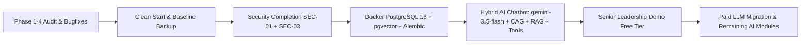

# Quick Care V2 — Master Architectural Plan: Executive Summary

**Project:** Quick Care Connect (Telehealth & Healthcare Platform, Pakistan)  
**Document Status:** Complete Architectural Specification (Updated with Client Corrections)  
**Authors:** Principal Architect + AI/RAG Engineer + Security Lead  
**Date:** November 2, 2026  

---

## 1. Vision & Strategic Pivot
Quick Care Connect has transitioned from an academic Final Year Project (FYP) into a commercial-grade, market-ready telehealth platform. The immediate milestone is a high-impact, reliable **Prototype Demo for Senior Leadership** powered entirely by the **Gemini Free Tier** (`gemini-3.5-flash`), followed by an orderly migration to a paid LLM infrastructure.

---

## 2. Nine Foundational Pillars

| Pillar | Deliverable | Core Architectural Decision |
| :--- | :--- | :--- |
| **1. Clean Start** | `01-CLEAN-START.md` | Create timestamped full backup zip outside workspace; wipe dummy SQLite rows, test uploads, and executable clutter (`mkcert.exe.exe`); preserve core codebase; generate fresh Pakistani demo dataset with SVG placeholder avatars (no stock photos). |
| **2. Security Completion** | `02-SECURITY-COMPLETION.md` | Finalize SEC-03 (record-ID based private upload streaming with RBAC) and SEC-01 (global CSRF, same-origin fetch headers, `WTF_CSRF_TIME_LIMIT=None`, friendly error handler). Zero file migration required due to clean start. |
| **3. Database Migration** | `03-POSTGRES-MIGRATION.md` | Run **PostgreSQL 16 + pgvector in Docker** (`pgvector/pgvector:pg16`); replace ad-hoc startup `ALTER TABLE` scripts with formal **Flask-Migrate (Alembic)**; add missing FK indexes; adapt JSON to JSONB and Python doctor loops to SQL. |
| **4. AI Chatbot Architecture** | `04-AI-CHATBOT-ARCHITECTURE.md` | Multi-stage pipeline: **Deterministic Red-Flag Check** (Rescue 1122 / Edhi 115) $\rightarrow$ **Router** (Rules first, LLM fallback) $\rightarrow$ **CAG** (Platform rules) / **RAG** (pgvector HNSW on `gemini-embedding-001`) / **Live DB Tools** $\rightarrow$ **SSE Streamed Answer via `gemini-3.5-flash`**. Zero OpenRouter dependency; clean busy message on 429. |
| **5. Knowledge Sources** | `05-KNOWLEDGE-SOURCES.md` | Website knowledge extracted from actual templates/routes; Medical knowledge sourced strictly from **MedlinePlus** (Public Domain) and **MedQuAD** (CC BY 4.0); reject forum-scraped sets; idempotent ingestion pipeline. |
| **6. Cost & Limits** | `06-COST-AND-LIMITS.md` | Operates within verified `gemini-3.5-flash` Free-Tier boundaries (15–30 RPM, 1,500 RPD, 1M TPM); token budget 3,300 in / 600 out per message; verified paid projections for `gemini-3.5-flash` ($1.50 in / $9.00 out), `gemini-3.5-flash-lite` ($0.30 in / $2.50 out), and `claude-3-7-sonnet` ($3.00 in / $15.00 out). |
| **7. Testing & Evaluation** | `07-TESTING-AND-EVAL.md` | **$\ge 40$ Gold Red-Flag Emergency Cases** across English, Urdu script, and Roman Urdu; **100% recall release gate (0 misses)**; zero hallucination on doctor/slot recommendations; comprehensive browser checklist. |
| **8. Senior Demo Plan** | `08-DEMO-PLAN.md` | 10-minute senior walk-through: FAQ $\rightarrow$ Medical Citation $\rightarrow$ Live Slot Booking $\rightarrow$ Roman Urdu $\rightarrow$ 1122 Emergency Intercept $\rightarrow$ Admin AI Usage Dashboard. If mock fallback is triggered, it is prominently labeled **"Demo cached answer"** (never presented as live AI). |
| **9. Phased Roadmap** | `09-ROADMAP.md` | 9-phase sequence with strict dependencies; Phases 1–5 comprise the **Demo Milestone**; Payment screenshot OCR kept strictly out of demo (scheduled for Phase 6 post-demo). |

---

## 3. Top Architectural Guarantees
1. **Zero Medical Hallucination on Platform Entities:** Doctors, slots, fees, and ratings are **never** embedded or generated by LLM weights; they are fetched exclusively via real-time parameterized database tool queries.
2. **Deterministic Emergency Bypass:** Life-threatening emergencies never touch an LLM; regex and keyword gates instantly emit Pakistani emergency dispatch cards (Rescue 1122, Edhi 115).
3. **No Third-Party Data Leaks (Zero OpenRouter):** OpenRouter is completely removed. Direct connection to Google Gemini API only; quota exhaustion returns a clean user-facing status message (*"AI is busy, please try again shortly"*).
4. **Zero-PHI AI Audit Logging:** Every LLM execution records tokens, latency, prompt version, and cost in `ai_runs` with zero storage of user health inquiries or personal identifiers.
