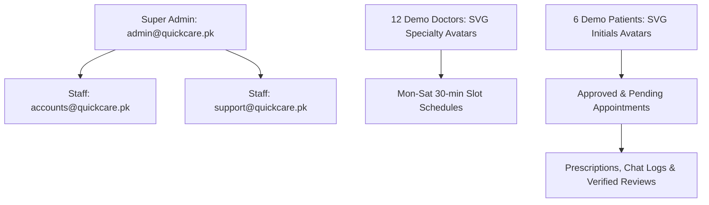

# Quick Care V2 — Deliverable 01: Clean Start & Seed Specification

**Document:** `docs/v2-plan/01-CLEAN-START.md`  
**Purpose:** Define exact backup protocols, filesystem deletion manifests, preserved code assets, and a fresh Pakistani demo dataset generator using clean SVG placeholder avatars.

---

## 1. Pre-Deletion Full Backup Plan

Before executing any deletion or schema modifications, an automated, timestamped, compressed archive of the entire repository state must be generated outside the project directory.

### Backup Protocol
- **Target Archive Directory:** Dedicated backup location outside project folder (e.g. `C:\Users\Mubeen\Desktop\QuickCare-Backups\quickcare_backup_pre_clean_YYYYMMDD_HHMMSS.zip`).
- **Exclusions:** `venv/`, `.pytest_cache/`, and `**/__pycache__/` are excluded to keep the archive clean and avoid bundling platform-specific Python virtual environment binaries.
- **Verification Assertions:** The script computes and prints:
  1. Full destination path.
  2. Total file count contained in the archive.
  3. Total archive size in bytes.
  4. SHA-256 cryptographic checksum of the resulting `.zip` file.

```bash
# Executed via PowerShell / Python script prior to Phase 1 cleanup
python -c "
import os, zipfile, datetime, hashlib

backup_dir = r'C:\Users\Mubeen\Desktop\QuickCare-Backups'
os.makedirs(backup_dir, exist_ok=True)
ts = datetime.datetime.now().strftime('%Y%m%d_%H%M%S')
target = os.path.join(backup_dir, f'quickcare_backup_pre_clean_{ts}.zip')

exclude_dirs = {'.git', 'venv', '__pycache__', '.pytest_cache'}
file_count = 0

with zipfile.ZipFile(target, 'w', zipfile.ZIP_DEFLATED) as zf:
    for root, dirs, files in os.walk('.'):
        dirs[:] = [d for d in dirs if d not in exclude_dirs]
        for f in files:
            path = os.path.join(root, f)
            zf.write(path, os.path.relpath(path, '.'))
            file_count += 1

hasher = hashlib.sha256()
with open(target, 'rb') as f:
    while chunk := f.read(65536):
        hasher.update(chunk)

print(f'Archive created: {target}')
print(f'Files archived:  {file_count}')
print(f'Archive size:    {os.path.getsize(target):,} bytes')
print(f'SHA-256:         {hasher.hexdigest()}')
"
```

---

## 2. Exhaustive Deletion & Retention Inventory

### 2.1 Files and Directories to Delete (Clean Slate Manifest)

| Category | Exact Path / Pattern | Disk Footprint | Justification |
| :--- | :--- | :--- | :--- |
| **Old Databases** | `instance/quickcare_dev.db`<br>`instance/quickcare_local_test.db`<br>`instance/quickcare.db`<br>`instance/quick_care.db` | ~800 KB | Wipes legacy FYP test data, corrupt test records, and untracked SQLite tables. |
| **Legacy Uploads** | `app/static/uploads/*`<br>*(Keep `.gitkeep` & `app/static/images/`)* | ~25 MB | Purges publicly exposed test CNIC scans, dummy degree certificates, and test receipts. |
| **Private Uploads** | `instance/private_uploads/*`<br>`instance/private_uploads_manifest.json`<br>`instance/backups/*` | ~10 MB | Purges previous migration dry-run artifacts and dummy files. |
| **Binary Clutter** | `mkcert.exe.exe` | 4.89 MB | Unnecessary Windows executable checked into git root; security risk. |
| **Local TLS Keys** | `localhost+3.pem`<br>`localhost+3-key.pem` | ~3.2 KB | Ephemeral self-signed local certs. |
| **One-Off Scripts** | `_push_clean.py`<br>`scripts/migrate_private_uploads.py` | ~17 KB | Temporary push helper and old file migration script (obsolete in clean start). |
| **Caches & Artifacts**| `.pytest_cache/`<br>`**/__pycache__/`<br>`audit-output/phase2.zip` | ~9.2 MB | Build artifacts and redundant 8.8MB screenshot archive. |
| **Outdated Docs** | `README.md` (legacy student sections) | — | Replaced with modern Quick Care V2 architecture reference. |

### 2.2 Assets Strictly Preserved (Keep Manifest)
- `app/` (all models, routes, forms, static styles/scripts, base templates, services, utils; ONLY test uploads under `static/uploads/` are purged).
- `tests/` (all 64 existing test cases, `pytest.ini`).
- `config.py`, `.env`, `.env.example`.
- `deploy/` (`gunicorn.conf.py`, `nginx-quickcare.conf`, systemd unit).
- `audit-output/` (all markdown reports preserved).
- `docs/v2-plan/` (all architectural plan specifications).
- `scripts/` (audit scripts and route inspect tools).

---

## 3. Fresh Demo Seed Plan (`scripts/seed_demo.py`)

A fresh, fully normalized, realistic Pakistani healthcare dataset will be seeded. **All user and doctor avatars use clean, professional SVG placeholder icons (initials / medical specialty glyphs); NO stock photos of real people are used.**

### 3.1 Role & Account Hierarchy



### 3.2 12 Verified Pakistani Doctors (Across All Primary Specialties)
All doctors are initialized with `is_approved=True`, `is_verified=True`, realistic PMC numbers (`XXXXX-P-DEMO`), clean medical SVG placeholder avatars, and structured weekly schedules in `time_slots`:

| Doctor Name | Category | Hospital Affiliation | City | Exp. | Fee (PKR) | Rating | Weekly Slots | Avatar Style |
| :--- | :--- | :--- | :--- | :--- | :--- | :--- | :--- | :--- |
| **Dr. Tariq Mahmood** | Cardiology | Doctors Hospital | Lahore | 18 yrs | 2,500 | 4.9 (42) | Mon, Wed, Fri (09:00–13:00) | SVG Cardiology Glyph |
| **Dr. Ayesha Siddiqui** | Neurology | Shifa International | Islamabad | 14 yrs | 3,000 | 4.8 (31) | Tue, Thu, Sat (14:00–18:00) | SVG Neurology Glyph |
| **Dr. Muhammad Bilal** | Pediatrics | Children's Hospital | Lahore | 11 yrs | 1,800 | 4.9 (54) | Mon–Fri (10:00–14:00) | SVG Pediatrics Glyph |
| **Dr. Fatima Zahra** | Dermatology | Aga Khan University Hosp. | Karachi | 9 yrs | 2,200 | 4.7 (28) | Mon, Wed, Sat (15:00–19:00) | SVG Dermatology Glyph |
| **Dr. Zainab Raza** | Gynecology | Lady Reading Hospital | Peshawar | 16 yrs | 2,500 | 4.9 (60) | Tue, Thu, Fri (09:00–13:00) | SVG Gynecology Glyph |
| **Dr. Hamza Tariq** | Orthopedics | Ghurki Trust Teaching Hosp.| Lahore | 12 yrs | 2,000 | 4.8 (22) | Mon, Thu, Sat (11:00–15:00) | SVG Orthopedics Glyph |
| **Dr. Usman Farooq** | ENT | Services Hospital | Lahore | 10 yrs | 1,500 | 4.6 (19) | Tue, Wed, Fri (16:00–20:00) | SVG ENT Glyph |
| **Dr. Sana Mir** | Psychiatry | Mind Care Clinic | Karachi | 8 yrs | 3,000 | 4.9 (35) | Mon, Tue, Thu (14:00–17:00) | SVG Psychiatry Glyph |
| **Dr. Kamran Akmal** | Gastroenterology | PIMS Hospital | Islamabad | 15 yrs | 2,800 | 4.8 (26) | Wed, Fri, Sat (10:00–14:00) | SVG Gastro Glyph |
| **Dr. Hina Altaf** | Ophthalmology | Al-Shifa Trust Eye Hosp. | Rawalpindi | 13 yrs | 2,000 | 4.7 (33) | Mon, Wed, Thu (09:00–12:30) | SVG Ophthalmology Glyph |
| **Dr. Noman Ali** | Dentistry | Fatima Memorial Hospital | Lahore | 7 yrs | 1,500 | 4.6 (18) | Mon–Thu (15:00–19:00) | SVG Dentistry Glyph |
| **Dr. Rashid Latif** | General Medicine | Mayo Hospital | Lahore | 20 yrs | 1,500 | 4.8 (85) | Mon–Sat (09:00–13:00) | SVG Stethoscope Glyph |

### 3.3 6 Realistic Demo Patients (SVG Initials)
- Authentic Pakistani identities: `ahmed.raza@demo.quickcare.pk` (`AR` SVG avatar), `mariam.khan@demo.quickcare.pk` (`MK` SVG avatar), `omar.sheikh@demo.quickcare.pk` (`OS` SVG avatar), `sidra.amin@demo.quickcare.pk` (`SA` SVG avatar), `bilal.hassan@demo.quickcare.pk` (`BH` SVG avatar), `rabia.tahir@demo.quickcare.pk` (`RT` SVG avatar).
- Complete profiles: Valid blood groups (A+, B+, O+, AB+), allergies, chronic condition notes, and emergency contacts (`+92 300 XXXXXXX`).

---

## 4. Execution Checkpoints

1. [ ] Generate verified backup zip in `C:\Users\Mubeen\Desktop\QuickCare-Backups\` (exclude `venv/`).
2. [ ] Display final deletion list with exact paths, item counts, and byte sizes for user confirmation.
3. [ ] WAIT for user explicit confirmation before deleting any file.
4. [ ] After confirmation, execute deletion and initialize clean directory structure under `instance/private_uploads/`.
5. [ ] Execute full pytest suite and boot app once to verify clean startup.
