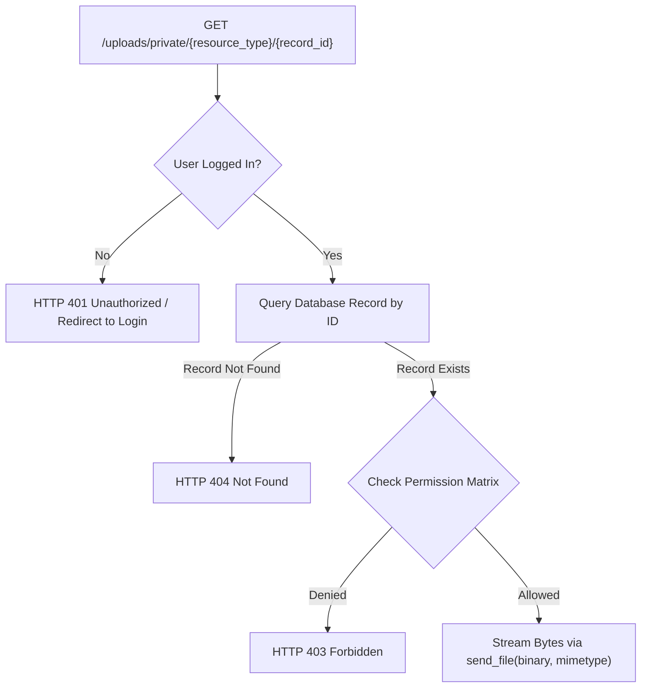

# Quick Care V2 — Deliverable 02: Security Completion Architecture

**Document:** `docs/v2-plan/02-SECURITY-COMPLETION.md`  
**Purpose:** Revised specifications for SEC-03 (Private Uploads RBAC & ID-Based Serving) and SEC-01 (Global CSRF Protection) adapted specifically for a clean start.

---

## 1. Clean Start Context & Elimination of Migration Complexity

In the original drafts (`PLAN-SEC-03.md` and `PLAN-SEC-01.md`), considerable complexity was dedicated to scanning 100+ legacy files on disk, querying SQLite string columns, moving files from public to private trees, and generating audit reports.

**Clean Start Architectural Decision:**
1. **Zero Legacy File Migration:** All legacy dummy uploads and test database records are wiped during the clean start.
2. **Native Direct Ingestion:** All new file uploads (identity CNICs, degree credentials, bank transfer proofs, patient lab documents, prescription PDFs) are written directly into `instance/private_uploads/<category>/<uuid4>.<ext>`.
3. **No Filepath URLs:** Endpoints never accept arbitrary filesystem paths or filenames. All file downloads and previews operate strictly on **Record IDs** (`/uploads/private/<resource_type>/<int:id>`), completely eliminating path traversal vulnerabilities (`../../`).

---

## 2. SEC-03: Record-ID-Based Private Upload Serving & RBAC

### 2.1 Endpoint Architecture (`app/routes/files.py`)

A dedicated Blueprint `files_bp` registered at `/uploads/private` exposes strictly typed, ID-based streaming routes:



### 2.2 Complete Resource-Type & RBAC Permission Matrix

| Resource Type | Endpoint Pattern | Model Queried | Role Access & Relationship Verification Gate |
| :--- | :--- | :--- | :--- |
| **`cnic-doctor`** | `/uploads/private/cnic-doctor/<int:doctor_id>/<side>` | `Doctor` | - **Super Admin:** Allowed.<br>- **Staff Admin:** Allowed if `admin_panel_grants` contains `doctors:view`.<br>- **Doctor:** Allowed if `current_user.doctor_profile.id == doctor_id`.<br>- **Others:** `403 Forbidden`. |
| **`cnic-patient`** | `/uploads/private/cnic-patient/<int:patient_id>/<side>` | `Patient` | - **Super Admin:** Allowed.<br>- **Staff Admin:** Allowed if `admin_panel_grants` contains `patients:view`.<br>- **Patient:** Allowed if `current_user.patient_profile.id == patient_id`.<br>- **Others:** `403 Forbidden`. |
| **`degree`** | `/uploads/private/degree/<int:doctor_id>/<int:doc_index>` | `Doctor` | - **Super Admin:** Allowed.<br>- **Staff Admin:** Allowed if `doctors:view` or `doctors:approve`.<br>- **Doctor:** Allowed if `current_user.doctor_profile.id == doctor_id`.<br>- **Others:** `403 Forbidden`. |
| **`payment-receipt`** | `/uploads/private/payment-receipt/<int:appointment_id>` | `Appointment` | - **Super Admin:** Allowed.<br>- **Staff Admin:** Allowed if `payments:view` or `accounts:view`.<br>- **Patient:** Allowed if `appointment.patient_id == current_user.patient_profile.id`.<br>- **Doctor:** Allowed if `appointment.doctor_id == current_user.doctor_profile.id`.<br>- **Others:** `403 Forbidden`. |
| **`medical-doc`** | `/uploads/private/medical-doc/<int:doc_id>` | `MedicalDocument` | - **Super Admin:** Allowed.<br>- **Staff Admin:** Allowed if `patients:view`.<br>- **Patient:** Allowed if `doc.patient_id == current_user.patient_profile.id`.<br>- **Doctor:** Allowed ONLY IF `doc.is_visible_to_doctor == True` **AND** doctor has $\ge 1$ approved/completed appointment with `doc.patient_id`.<br>- **Others:** `403 Forbidden`. |
| **`prescription-pdf`**| `/uploads/private/prescription-pdf/<int:prescription_id>`| `Prescription` | - **Super Admin:** Allowed.<br>- **Staff Admin:** Allowed if `patients:view` or `doctors:view`.<br>- **Doctor:** Allowed if `prescription.appointment.doctor_id == current_user.doctor_profile.id`.<br>- **Patient:** Allowed if `prescription.appointment.patient_id == current_user.patient_profile.id`.<br>- **Others:** `403 Forbidden`. |

### 2.3 Legacy Static Blockade
In `app/__init__.py`, any direct HTTP request matching `/static/uploads/cnic/*`, `/static/uploads/degrees/*`, `/static/uploads/payment_screenshots/*`, or `/static/uploads/medical_documents/*` returns an immediate `404 Not Found` (never 302 or file contents), preventing static directory leakage.

---

## 3. SEC-01: Global CSRF Protection Architecture

### 3.1 Flask-WTF Configuration (`config.py`)
```python
# CSRF Global Configuration
WTF_CSRF_ENABLED = True
WTF_CSRF_CHECK_DEFAULT = True
WTF_CSRF_TIME_LIMIT = None  # None = tied directly to user session lifetime
WTF_CSRF_HEADERS = ['X-CSRFToken', 'X-CSRF-Token']
```
*Rationale for `WTF_CSRF_TIME_LIMIT = None`:* Healthcare consultations and clinical form drafting often take 20–40 minutes. Expiring tokens after an arbitrary 3,600 seconds causes mid-consultation submission errors. Setting `None` safely ties token validity to the active authenticated session lifetime.

### 3.2 HTML Form Token Emission
1. **Flask-WTF Forms (16 forms):** Include `{{ form.hidden_tag() }}` inside the `<form>` element.
2. **Plain HTML POST Forms (46 forms):** Include `<input type="hidden" name="csrf_token" value="{{ csrf_token() }}"/>`.
3. **Master Base Layouts (`base.html` & `landing_base.html`):** Meta tag emitted in `<head>`:
   ```html
   <meta name="csrf-token" content="{{ csrf_token() }}">
   ```

### 3.3 Frontend Fetch & AJAX Interceptor (`app/static/js/csrf-fetch.js`)
All mutating client-side requests (`fetch`, `XMLHttpRequest`, jQuery AJAX) automatically inherit the CSRF token, strictly restricted to same-origin destinations:

```javascript
(function () {
    const metaTag = document.querySelector('meta[name="csrf-token"]');
    if (!metaTag) return;
    const csrfToken = metaTag.getAttribute('content');

    const originalFetch = window.fetch;
    window.fetch = function (url, options = {}) {
        options = options || {};
        const method = (options.method || 'GET').toUpperCase();

        if (['POST', 'PUT', 'DELETE', 'PATCH'].includes(method)) {
            // Strict same-origin verification
            let isSameOrigin = true;
            try {
                const targetUrl = new URL(url, window.location.href);
                isSameOrigin = (targetUrl.origin === window.location.origin);
            } catch (e) {
                isSameOrigin = true; // Relative paths are same-origin
            }

            if (isSameOrigin) {
                options.headers = options.headers || {};
                if (options.headers instanceof Headers) {
                    if (!options.headers.has('X-CSRFToken')) {
                        options.headers.append('X-CSRFToken', csrfToken);
                    }
                } else if (Array.isArray(options.headers)) {
                    options.headers.push(['X-CSRFToken', csrfToken]);
                } else {
                    options.headers['X-CSRFToken'] = csrfToken;
                }
            }
        }
        return originalFetch(url, options);
    };
})();
```

### 3.4 Webhook Exemption & Friendly CSRF Error Handler

#### Webhook Exemption
The Safepay server-to-server webhook route (`/safepay/webhook`) is explicitly decorated with `@csrf.exempt`. Its authenticity is verified separately using `HMAC-SHA256` signature validation on the raw request body against `SAFEPAY_SECRET_KEY`.

#### Friendly CSRF Error Handler (`app/__init__.py`)
Raw 400 Bad Request error screens degrade user trust. The global handler differentiates between programmatic API requests and browser form posts:

```python
@flask_app.errorhandler(CSRFError)
def handle_csrf_error(e):
    # Programmatic / AJAX requests receive standard JSON error payload
    if request.is_json or request.headers.get('X-Requested-With') == 'XMLHttpRequest':
        return jsonify({
            'ok': False,
            'error': 'CSRF verification failed or session expired. Please refresh the page.',
            'code': 'CSRF_INVALID'
        }), 400

    # Browser navigations flash friendly feedback and redirect back
    flash('Your security session was refreshed. Please re-submit your form.', 'warning')
    referrer = request.referrer
    if referrer and referrer.startswith(request.host_url):
        return redirect(referrer)
    return redirect(url_for('home.index'))
```

---

## 4. Verification & Testing Deliverables
1. **RBAC ID-based Access Tests (`tests/test_files.py`):**
   - Asserts unauthorized patient receives 403 trying to view another patient's medical doc by ID.
   - Asserts unassigned doctor receives 403 trying to view appointment payment receipt.
   - Asserts assigned doctor with completed visit can view patient's medical document.
2. **CSRF Enforcement Tests (`tests/test_csrf.py`):**
   - Asserts POST without token returns 400 JSON on AJAX.
   - Asserts browser POST without token flashes friendly warning and redirects.
   - Asserts Safepay webhook succeeds without CSRF token.

