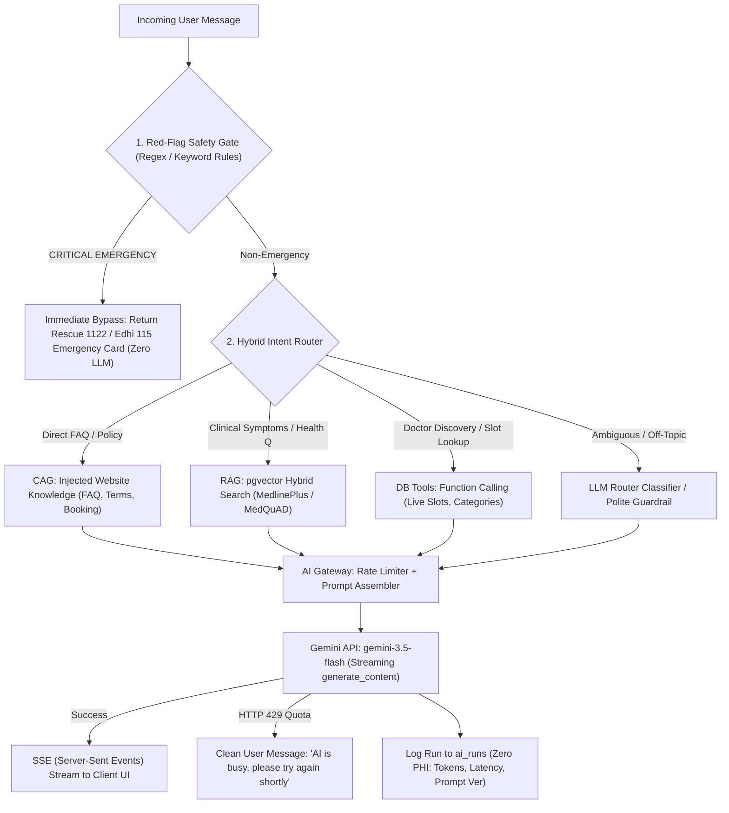
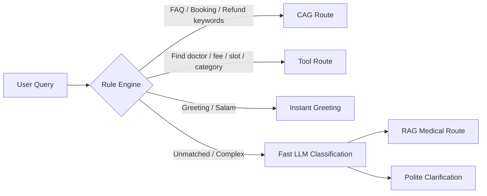
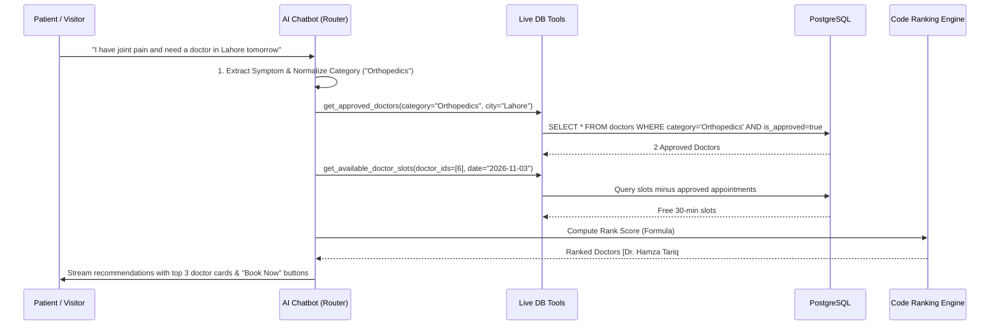
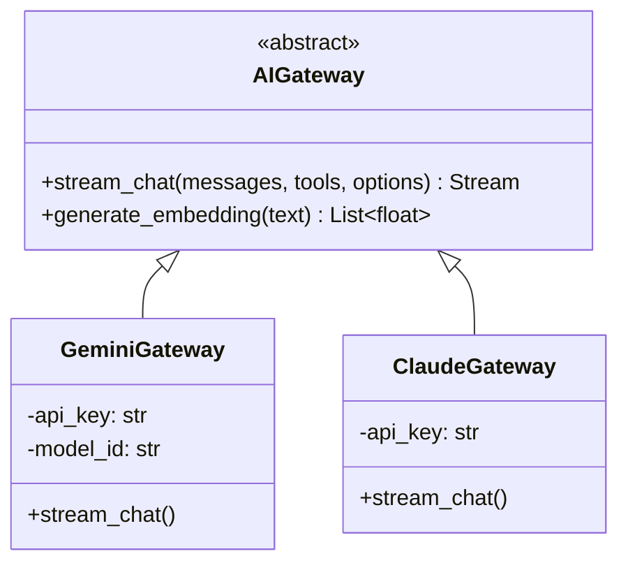

# Quick Care V2 — Deliverable 04: AI Chatbot Architecture

**Document:** `docs/v2-plan/04-AI-CHATBOT-ARCHITECTURE.md`  
**Purpose:** End-to-end technical specification of the Quick Care V2 Hybrid AI Assistant, featuring deterministic safety gates, intelligent routing, CAG, pgvector RAG, live database tools, ChatGPT-style persistence, SSE streaming, and an AI gateway using `gemini-3.5-flash`.

---

## 1. End-to-End Architectural Pipeline

The chatbot architecture strictly decouples safety, intent routing, knowledge retrieval, and live data execution before passing prompt context to Google Gemini.



---

## 2. Red-Flag Safety Gate (Deterministic Emergency Intercept)

### 2.1 The Requirement
Under no circumstances may life-threatening acute medical emergencies depend on an LLM response or be delayed by token streaming. 

### 2.2 Trigger Catalog (English + Roman Urdu + Urdu Script)
The deterministic gate evaluates against three linguistic patterns before reaching the router:

| Category | High-Risk Keywords & Phrasings | Action |
| :--- | :--- | :--- |
| **Cardiovascular** | `chest pain`, `heart attack`, `left arm pain`, `dil ka dora`, `seene me dard`, `chhati me dard`, `سینے میں درد`, `دل کا دورہ` | Intercept |
| **Respiratory** | `cannot breathe`, `shortness of breath`, `choking`, `saans nahi aa rahi`, `dam ghut raha`, `سانس بند ہو رہی ہے` | Intercept |
| **Neurological / Stroke** | `facial droop`, `slurred speech`, `sudden paralysis`, `paralysis`, `stroke`, `falij`, `lakwa`, `فالج`, `لقوہ` | Intercept |
| **Trauma & Hemorrhage** | `severe bleeding`, `unconscious`, `head trauma`, `khoon beh raha`, `behosh`, `بے ہوش`, `خون بہہ رہا ہے` | Intercept |
| **Self-Harm / Crisis** | `suicide`, `kill myself`, `end my life`, `khudkushi`, `jaan dena`, `خودکشی` | Intercept |

### 2.3 Emergency Dispatch Response (Direct Return)
When triggered, the system returns immediately (`latency < 2ms`) with structured UI cards:
- **Primary Ambulance Dispatch:** **Rescue 1122** (Emergency button: `tel:1122`).
- **Secondary Welfare Dispatch:** **Edhi Foundation 115** (Emergency button: `tel:115`).
- **Urgent Action Directive:** Explicit localized instructions to seek the nearest tertiary hospital emergency department immediately. Zero doctor recommendations, zero booking links.

---

## 3. Hybrid Intent Router

The router determines whether to engage CAG, RAG, DB Tools, or direct fallback:



1. **Layer 1: Deterministic Rule Classifier (Fast & Cost-Free):**
   - **Platform FAQs:** Matches terms like `"how to book"`, `"refund policy"`, `"cancel appointment"`, `"fees"`, `"prescription download"` $\rightarrow$ **Route: CAG**.
   - **Live Doctor Lookups:** Matches terms like `"cardiologist"`, `"doctor in lahore"`, `"available tomorrow"`, `"book appointment with"` $\rightarrow$ **Route: DB Tools**.
   - **Greetings / Chit-chat:** Matches `"hi"`, `"salam"`, `"assalam o alaikum"` $\rightarrow$ Returns instant pre-cached greeting.
2. **Layer 2: Fast LLM Intent Classifier (Only for ambiguous inputs):**
   - If Layer 1 is inconclusive, an ultra-compact prompt with `temperature=0.0` and `max_tokens=10` classifies the intent into `[MEDICAL_KNOWLEDGE, DOCTOR_SEARCH, WEBSITE_GUIDE, OFF_TOPIC]`.

---

## 4. Conversations & Sidebar State Management

### 4.1 Relational Schema (`conversations` and `messages`)

```sql
CREATE TABLE conversations (
    id SERIAL PRIMARY KEY,
    user_id INT REFERENCES users(id) ON DELETE CASCADE, -- NULL for anonymous guest sessions
    guest_session_id VARCHAR(64),                        -- Cookie UUID for guest users
    title VARCHAR(120) NOT NULL DEFAULT 'New Consultation',
    summary TEXT,                                        -- Rolling historical summary for turns > 10
    is_pinned BOOLEAN DEFAULT FALSE,
    created_at TIMESTAMP WITH TIME ZONE DEFAULT NOW(),
    updated_at TIMESTAMP WITH TIME ZONE DEFAULT NOW()
);

CREATE TABLE messages (
    id SERIAL PRIMARY KEY,
    conversation_id INT NOT NULL REFERENCES conversations(id) ON DELETE CASCADE,
    role VARCHAR(20) NOT NULL CHECK (role IN ('user', 'assistant', 'system', 'tool')),
    content TEXT NOT NULL,
    route_used VARCHAR(30),                              -- 'cag', 'rag', 'tools', 'emergency'
    tool_calls JSONB,                                    -- Parameters & results of live DB queries
    sources JSONB,                                       -- Array of citations: [{title, url, chunk_id}]
    created_at TIMESTAMP WITH TIME ZONE DEFAULT NOW()
);

CREATE INDEX idx_conversations_user ON conversations(user_id, updated_at DESC);
CREATE INDEX idx_messages_conversation ON messages(conversation_id, created_at ASC);
```

### 4.2 Sidebar UX & Session Policy
- **Authenticated Users (Patient / Doctor / Admin):**
  - Full ChatGPT-style sidebar: List conversations sorted by `updated_at`, rename title, delete conversation.
  - Multi-device persistent sync.
- **Guest / Anonymous Users:**
  - Scoped to active browser session cookie (`guest_session_id`).
  - Max 1 active conversation retained in `localStorage` + session cookie. Prompted to register/login to save history.
- **Context Window Management (10-Message Sliding Window + Rolling Summary):**
  - Messages 1 through $N-10$ are periodically summarized into `conversations.summary` via a background prompt.
  - LLM context receives: `System Prompt` + `Rolling Summary (if exists)` + `Last 10 Messages verbatim` + `Current Query`.

---

## 5. Streaming Protocol: SSE (Server-Sent Events)

### 5.1 Recommendation & Design
SSE is selected for the AI Chatbot streaming, while preserving Socket.IO strictly for live consultation video signaling and doctor-patient room chat.
- **Why SSE:** Standard HTTP `text/event-stream`, stateless, 100% compatible with multi-worker Gunicorn (no Redis message queue requirement for streaming), and passes standard HTTP status codes.

#### SSE Event Protocol (`POST /api/ai/chat/stream`):
```http
HTTP/1.1 200 OK
Content-Type: text/event-stream
Cache-Control: no-cache
Connection: keep-alive
X-Accel-Buffering: no

event: tool_start
data: {"tool": "get_available_doctor_slots", "args": {"doctor_id": 1, "date": "2026-11-03"}}

event: tool_done
data: {"slots_found": 4}

event: token
data: {"delta": "Dr. Tariq Mahmood has "}

event: sources
data: [{"title": "MedlinePlus: Hypertension", "url": "https://medlineplus.gov/..."}]

event: done
data: {"conversation_id": 14, "message_id": 89}
```

---

## 6. Doctor Recommendation Flow & Live DB Tools

The AI assistant **never** invents doctors, specializations, consultation fees, or available timeslots. The LLM acts purely as a conversational concierge that queries live relational tables.



### 6.1 Transparent Code Ranking Formula
Doctors are sorted deterministically in Python code:

$$\text{Score} = (0.35 \times E) + (0.35 \times R) + (0.15 \times C) + (0.15 \times A)$$

Where:
- $E = \min(\text{experience\_years} / 25.0, 1.0)$ *(Normalized experience)*
- $R = \text{rating} / 5.0$ *(Normalized star rating, e.g. 4.9 / 5.0 = 0.98)*
- $C = \min(\ln(\text{review\_count} + 1) / \ln(101), 1.0)$ *(Log-dampened review credibility)*
- $A = 1.0 \text{ if free slot exists today/tomorrow else } 0.6$ *(Immediate availability boost)*

### 6.2 Tools Catalog & Granular RBAC Permissions

| Tool Name | Input Parameters | Output Payload | Role Authorization Gate |
| :--- | :--- | :--- | :--- |
| `get_approved_doctors` | `category: str`, `city: str`, `max_fee: float` | `List[DoctorSummaryDict]` | **Public** (All roles & guests). |
| `get_available_doctor_slots` | `doctor_id: int`, `date: str (YYYY-MM-DD)` | `List[str]` (Free 30-min slots) | **Public** (All roles & guests). |
| `get_doctor_profile_details` | `doctor_id: int` | Bio, education, hospitals, reviews | **Public** (All roles & guests). |
| `get_user_upcoming_appointments`| `user_id: int` | Upcoming appointment cards | **Authenticated User Only** (Must match `current_user.id`). |
| `get_appointment_details` | `appointment_id: int` | Status, payment state, timings | **Participant Only** (Patient, assigned Doctor, or Admin). |

---

## 7. CAG (Context-Augmented Generation) Architecture

- **Scope of CAG Content:** Static platform documentation (~1,200 tokens compressed markdown):
  1. Patient & Doctor Registration workflows.
  2. Appointment booking & 30-minute payment expiration rules.
  3. Manual bank transfer (EasyPaisa/JazzCash) screenshot upload requirements.
  4. Video consultation punctuality rules & 3-minute prescription clinical gate.
  5. Cancellation, dispute, and refund policies.
- **Context Injection:** Injected directly as a structured markdown block in the system prompt prefix on each request.
- **Cache Invalidation Trigger:** An application event hook rebuilds the cached knowledge block whenever an Administrator updates website FAQs, terms, or platform settings.

---

## 8. RAG Architecture (pgvector + `gemini-embedding-001`)

### 8.1 Chunking Strategy & Document Schema
- **Chunking Algorithm:** Recursive character splitting with `chunk_size = 500` tokens and `chunk_overlap = 50` tokens.
- **Embedding Model:** Google `gemini-embedding-001`, producing **768-dimensional** dense vectors via Matryoshka Representation Learning (MRL).

```sql
CREATE TABLE medical_knowledge_chunks (
    id SERIAL PRIMARY KEY,
    source_name VARCHAR(100) NOT NULL,              -- e.g. 'MedlinePlus', 'MedQuAD'
    source_url TEXT NOT NULL,
    topic_title VARCHAR(255) NOT NULL,
    chunk_index INT NOT NULL,
    content TEXT NOT NULL,
    metadata_json JSONB NOT NULL,                   -- category, reviewed_by, license
    embedding vector(768) NOT NULL,
    embedding_model VARCHAR(50) NOT NULL,           -- 'gemini-embedding-001-768'
    index_version VARCHAR(20) NOT NULL,             -- 'v1.0'
    created_at TIMESTAMP WITH TIME ZONE DEFAULT NOW()
);

-- HNSW Vector Index with Cosine Distance
CREATE INDEX idx_medical_chunks_hnsw 
ON medical_knowledge_chunks 
USING hnsw (embedding vector_cosine_ops)
WITH (m = 16, ef_construction = 64);

-- Full-Text Search GIN Index for Hybrid Search
ALTER TABLE medical_knowledge_chunks ADD COLUMN search_vector tsvector 
GENERATED ALWAYS AS (to_tsvector('english', content)) STORED;

CREATE INDEX idx_medical_chunks_fts ON medical_knowledge_chunks USING GIN(search_vector);
CREATE INDEX idx_medical_chunks_version ON medical_knowledge_chunks(embedding_model, index_version);
```

### 8.2 Hybrid Search & Reciprocal Rank Fusion (RRF)
Queries run concurrently across Vector Cosine Distance and PostgreSQL Full-Text Search:

$$\text{RRF\_Score}(d) = \frac{1}{60 + \text{Rank}_{\text{dense}}(d)} + \frac{1}{60 + \text{Rank}_{\text{sparse}}(d)}$$

- **Abstention Gate:** If top similarity $< 0.68$, system abstains:
  > *"I do not have verified clinical guidelines in my knowledge base regarding this specific topic. Please consult a qualified Quick Care specialist for professional evaluation."*
- **Strict Grounding:** Numbered citations `[1]` render direct links to MedlinePlus / MedQuAD source articles.

---

## 9. Versioned Prompt Management

System prompts are maintained in version-controlled markdown files under `app/ai/prompts/`:
- `patient_v1.0.md` (Empathetic triage, non-prescriptive, doctor discovery guidance)
- `doctor_v1.0.md` (Clinical phrasing, differential lookup, dosage references)
- `admin_v1.0.md` (Concise platform operations, audit metrics, policy definitions)
- `router_v1.0.md` (Intent classification instruction)

---

## 10. Provider-Neutral AI Gateway & Quota Protection



- **Zero Third-Party Fallback (No OpenRouter):** OpenRouter is completely removed due to expired credentials and third-party data transmission risks. All requests connect directly to Google Gemini.
- **Clean Quota Handling:** If Gemini returns HTTP 429 (`RESOURCE_EXHAUSTED`), the gateway retries once with exponential backoff (1.5s). If quota remains exhausted, the user receives a clean, reassuring UI notice:
  > *"Our AI assistant is temporarily busy with high request volume. Please wait a moment and try again."*
- **Per-User Rate Limits:** Sliding window in Redis / memory enforces 15 requests per minute and 50 requests per day per user/IP.
- **Output Token Caps:** Strict `max_output_tokens = 800` for conversational chat, `1200` for RAG clinical summaries.

---

## 11. Zero-PHI `ai_runs` Audit Logging & Admin Dashboard

### 11.1 Schema Definition
Zero patient health queries, symptoms, or chat logs are written to the audit log:

```sql
CREATE TABLE ai_runs (
    id SERIAL PRIMARY KEY,
    user_id INT REFERENCES users(id) ON DELETE SET NULL, -- Nullable for visitors
    user_role VARCHAR(20) NOT NULL,                      -- 'guest', 'patient', 'doctor', 'admin'
    module_name VARCHAR(50) NOT NULL,                    -- 'chatbot', etc.
    route_used VARCHAR(30) NOT NULL,                     -- 'cag', 'rag', 'tools', 'emergency'
    provider VARCHAR(30) NOT NULL,                       -- 'gemini'
    model_id VARCHAR(50) NOT NULL,                       -- 'gemini-3.5-flash'
    prompt_version VARCHAR(20) NOT NULL,                 -- 'patient_v1.0'
    input_tokens INT NOT NULL,
    output_tokens INT NOT NULL,
    latency_ms INT NOT NULL,
    status VARCHAR(20) NOT NULL,                         -- 'success', 'rate_limited', 'error'
    error_code VARCHAR(50),
    created_at TIMESTAMP WITH TIME ZONE DEFAULT NOW()
);

CREATE INDEX idx_ai_runs_created ON ai_runs(created_at DESC);
CREATE INDEX idx_ai_runs_module ON ai_runs(module_name, status);
```

### 11.2 Admin Usage Page (`/admin/ai-usage`)
Displays daily token volume, estimated cost tracking, latency percentiles (p50/p95), and 429 rate monitoring.
