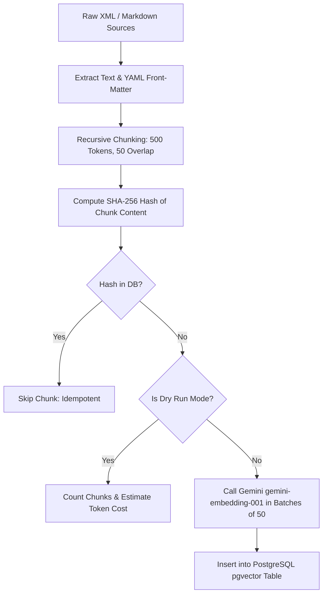

# Quick Care V2 — Deliverable 05: Knowledge Sources & Ingestion Pipeline

**Document:** `docs/v2-plan/05-KNOWLEDGE-SOURCES.md`  
**Purpose:** Curate authoritative website knowledge from live templates/routes, evaluate medical datasets against licensing and clinical quality standards, define front-matter standards, and design an idempotent ingestion pipeline using `gemini-embedding-001`.

---

## 1. Website Knowledge Corpus (Extracted from Real Templates & Routes)

Website knowledge is compiled directly from the application's Jinja templates (`app/templates/home/`), route handlers (`app/routes/`), and business logic utilities (`app/utils/`):

### 1.1 Core Platform Modules

```
docs/knowledge/website/
├── 01_platform_overview.md       # Extracted from home.index & landing_base.html
├── 02_how_it_works.md            # Extracted from how_it_works.html (Patient 5-step journey)
├── 03_booking_and_slots.md       # Extracted from slots.py & patients.book_appointment
├── 04_payments_and_screens.md    # Extracted from payments.py & admin.payments
├── 05_telehealth_and_video.md    # Extracted from video.py (3-minute clinical unlock gate)
├── 06_prescriptions_records.md   # Extracted from prescriptions.py & files.py
├── 07_cancellation_refunds.md    # Extracted from refunds.py & appointment_workflow.py (3-hour rule)
├── 08_terms_and_conduct.md       # Extracted from terms.html
├── 09_privacy_and_security.md    # Extracted from privacy.html & SEC-03/01 policies
└── 10_emergency_disclaimers.md   # Extracted from legal disclaimers & Rescue 1122 protocols
```

### 1.2 Reconciliation of Outdated Legacy Text
*Critical Finding:* Legacy `faq.html:28` states: *"Once the doctor approves, complete payment to confirm your slot."*  
However, the verified production workflow requires **payment before doctor approval** (to prevent slot hoards and unpaid doctor queue clutter).  
*Resolution:* The V2 knowledge corpus reconciles this discrepancy: **Patient Books $\rightarrow$ Patient Pays (Safepay or Screenshot) $\rightarrow$ Admin Confirms Manual Payment $\rightarrow$ Doctor Approves/Rejects Slot $\rightarrow$ Consultation Unlocks.**

---

## 2. Evaluation & Selection of Medical Knowledge Sources

We conducted a structured clinical and legal audit of candidate healthcare datasets:

### 2.1 Dataset Evaluation Matrix

| Source / Dataset | Source Type & Authority | Primary License | Approximate Size | Clinical Quality & Tone | Suitability for V2 | Final Decision |
| :--- | :--- | :--- | :--- | :--- | :--- | :--- |
| **MedlinePlus** (U.S. National Library of Medicine / NIH) | Official Federal Health Portal | **U.S. Federal Public Domain** (Free for commercial & non-commercial use with attribution) | ~1,000 health topic summaries, ~4,000 disease & drug articles (~35MB XML) | **Gold Standard.** Written specifically for patients and families in clear, accessible language. | **Highest.** Covers all primary medical categories in Pakistan. | **ACCEPTED (Primary Knowledge Base)** |
| **MedQuAD** (Ben Abacha et al., NIH / NLM) | Curated Medical Q&A from 12 NIH institutes | **Creative Commons Attribution 4.0 (CC BY 4.0)** | 47,457 question-answer pairs (~50MB XML/JSON) | **High.** Answers curated from Cancer.gov, GARD, MedlinePlus, and CDC. | **High.** Perfect for symptom exploration and Q&A triage. | **ACCEPTED (Triage Knowledge Base)** |
| **WHO (World Health Organization) Fact Sheets** | Global Health Organization | **WHO Copyright** (Free for educational / non-commercial; commercial license required) | ~350 disease & outbreak fact sheets (~8MB text) | **Authoritative.** Global focus, excellent epidemiology and preventative guidelines. | **Moderate.** Commercial restrictions pose future licensing overhead. | **SECONDARY (Selected Fact Sheets Only)** |
| **NHS inform / NHS England API** | UK National Health Service | **Open Government Licence v3.0 (OGL)** | Comprehensive conditions & symptoms directory | **Very High.** Patient-centric, clinically reviewed by NHS doctors. | **High.** Free for UK/Commonwealth contexts; requires attribution. | **ACCEPTED (Fallback Reference)** |
| **PubMedQA / BioASQ** | Biomedical Research Papers | **MIT / CC BY** | ~250k academic biomedical research abstracts | **Scientific / Academic.** Written for medical researchers, dense with clinical jargon. | **Low.** Inappropriate for consumer patients seeking practical telehealth guidance. | **REJECTED (Too Academic)** |
| **Forum-Scraped Datasets** (ChatDoctor, HealthTap, WebMD scrapers) | Scrapings from public internet medical forums | **Ambiguous / Unlicensed** (Violates site ToS, CC-BY-NC) | 100k+ conversational threads | **Unreliable / Dangerous.** Contains unverified advice, layperson speculation, and hallucinated dosages. | **Zero.** Extreme clinical liability and legal risk. | **STRICTLY REJECTED** |

### 2.2 Recommendation Summary
Quick Care V2 adopts **MedlinePlus XML Health Topics** as the primary knowledge backbone, supplemented by **MedQuAD** for conversational symptom Q&A. Both provide unassailable public domain / CC BY 4.0 licensing, verified clinical accuracy, and zero patient forum noise.

---

## 3. Document Front-Matter Standard

Every medical and platform markdown document ingested into the RAG vector store must include strict, machine-readable YAML front-matter:

```yaml
---
source_name: "MedlinePlus"
source_url: "https://medlineplus.gov/diabetes.html"
license: "U.S. Federal Public Domain"
is_demo: false
reviewed_by: "Medical Knowledge Lead"
version: "1.0.0"
category: "Diabetology"
last_verified: "2026-11-02"
language: "en"
tags: ["blood sugar", "insulin", "diabetes type 2", "glucose"]
---
```

---

## 4. Ingestion Pipeline Architecture (`scripts/ingest_knowledge.py`)

The knowledge ingestion script processes both website documentation and medical topic XMLs into `medical_knowledge_chunks`:



### 4.1 Key Pipeline Features
1. **Strict Idempotency:** Each chunk's unique `content_hash = sha256(content)` is stored in chunk metadata. Re-running the script updates modified topics and skips unchanged documents without duplicating vectors.
2. **Dry-Run Mode (`--dry-run`):** Validates all XML/Markdown structures, reports chunk counts, flags missing front-matter fields, and computes total token volume without calling the embedding API.
3. **Batching & Rate-Limit Safeguard:** Embeddings are dispatched via `gemini-embedding-001` in batches of 50 items with automated 2-second sleep intervals to respect Gemini Free-Tier RPM caps.
4. **Embedding Space Tagging:** Inserts `embedding_model = 'gemini-embedding-001-768'` and `index_version = 'v1.0'` alongside every vector row.
