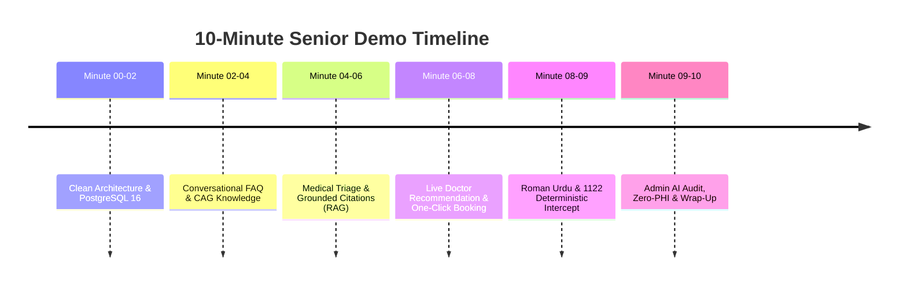
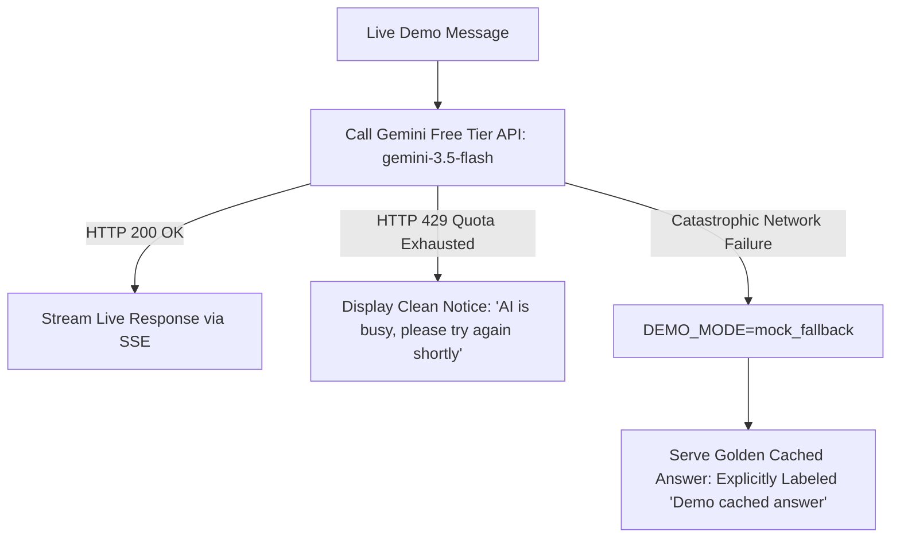

# Quick Care V2 — Deliverable 08: 10-Minute Senior Leadership Demo Script

**Document:** `docs/v2-plan/08-DEMO-PLAN.md`  
**Purpose:** Provide a step-by-step presentation script and contingency fallback protocol to demonstrate Quick Care V2 to senior leadership using `gemini-3.5-flash` under Google AI Studio Free Tier.

---

## 1. Demo Objectives & Narrative Arc

**Core Message to Seniors:**  
*"Quick Care Connect is no longer an academic exercise. Today you are seeing a production-grade, highly secure telehealth platform backed by PostgreSQL with an intelligent AI concierge that combines deterministic emergency safety, grounded medical intelligence, and live doctor slot bookings—built on zero-cost free-tier AI infrastructure."*

---

## 2. 10-Minute Step-by-Step Presentation Script

---

### Step 1: Platform Foundation & Clean Architecture (00:00 – 02:00)
- **Action:** Open browser at `https://quickcares.me` (or `http://localhost:5000`). Display the clean, modern landing page with clean SVG avatars.
- **Presenter Script:**  
  *"We have completed a full architectural reset. The legacy test clutter is gone, our database is running PostgreSQL 16 in Docker with pgvector for native embeddings, and our security layer enforces global CSRF and ID-based RBAC on all private medical uploads. Now, let’s explore our new AI Healthcare Assistant."*
- **Action:** Click the floating emerald **AI Health Assistant** widget in the bottom right.

---

### Step 2: Conversational Platform FAQ via CAG (02:00 – 04:00)
- **Action:** In the chat input, type:  
  `"How does payment verification work if I use Easypaisa?"`
- **What Happens:** The assistant streams a clear response detailing:
  1. Transferring funds to the official Quick Care bank account.
  2. Uploading the transfer screenshot within the 30-minute reservation window.
  3. Waiting for admin approval, which immediately confirms the doctor's appointment.
- **Presenter Script:**  
  *"Notice the instant response. This is Context-Augmented Generation (CAG). It pulls directly from our real platform business logic—not generic internet guesswork. It knows our exact 30-minute payment expiration window and Easypaisa workflow."*

---

### Step 3: Medical Inquiry with Grounded Citations via RAG (04:00 – 06:00)
- **Action:** In the chat input, type:  
  `"What are early signs of Type 2 Diabetes and what lifestyle changes help?"`
- **What Happens:** `gemini-3.5-flash` streams an explanation divided into Symptoms and Lifestyle Interventions. At the bottom, a clickable citation card appears: `[1] MedlinePlus: Type 2 Diabetes`.
- **Presenter Script:**  
  *"Here is our Retrieval-Augmented Generation (RAG) running on PostgreSQL pgvector with gemini-embedding-001. It retrieves verified clinical topics from the U.S. National Library of Medicine (MedlinePlus). Notice the source citation: the model is grounded in clinical literature and cannot hallucinate treatments."*

---

### Step 4: Live Doctor Recommendation & Real-Time Booking (06:00 – 08:00)
- **Action:** In the chat input, type:  
  `"I have frequent severe chest palpitations and want to see a heart specialist in Lahore tomorrow."`
- **What Happens:** 
  1. The assistant classifies the symptom into `Cardiology`.
  2. The backend executes `get_approved_doctors(category='Cardiology', city='Lahore')`.
  3. The ranking engine scores available specialists based on experience, rating, and availability.
  4. The chat displays a rich card for **Dr. Tariq Mahmood** (18 yrs exp, 4.9 rating, PKR 2,500 fee) showing free 30-minute slots for tomorrow, with an emerald **"Book Now"** button.
- **Action:** Click the **"Book Now"** button. The browser immediately loads the pre-filled booking modal for Dr. Tariq Mahmood.
- **Presenter Script:**  
  *"This is the core commercial value. The AI did not make up this doctor or invent random timings. It queried our live database, verified Dr. Tariq’s schedule minus already booked slots, ran our transparent ranking formula, and presented a direct booking pathway in under two seconds."*

---

### Step 5: Roman Urdu & Deterministic Red-Flag Intercept (08:00 – 09:00)
- **Action:** Return to chat, click **"New Chat"**, and enter:  
  `"Mere seene me shadeed dard hai aur baazu me ja raha hai, bohat ghabrahat ho rahi hai"`
- **What Happens:** Instantly ($< 5\text{ ms}$), a prominent, flashing red Emergency Card appears:
  - **EMERGENCY DETECTED: SEEK IMMEDIATE MEDICAL CARE**
  - Direct call button: **Rescue 1122 (Ambulance)**
  - Direct call button: **Edhi Foundation 115**
  - Explicit warning: Do not wait for online consultations during acute emergencies.
- **Presenter Script:**  
  *"Notice two vital things: First, full comprehension of Roman Urdu. Second, this response completely bypassed the LLM. Our deterministic safety gate caught the cardiovascular red flag and triggered an immediate Rescue 1122 dispatch card. In healthcare, safety must be 100% deterministic."*

---

### Step 6: Admin AI Usage Dashboard & Zero-PHI Privacy (09:00 – 10:00)
- **Action:** In a second tab, open the Admin Panel at `/admin/ai-usage`.
- **What Happens:** Show the live analytics dashboard displaying:
  - Total tokens consumed across today's session.
  - Zero-PHI audit log showing `timestamp`, `module: chatbot`, `model: gemini-3.5-flash`, `prompt_version: patient_v1.0`, `input_tokens: 3,240`, `latency: 1,120ms`, `status: success`.
- **Presenter Script:**  
  *"Finally, here is our operational command center. Every run is audited for latency, token consumption, and cost. Most importantly, look at the log: zero patient names, zero health queries, and zero symptoms are stored in this table. We maintain clinical privacy by design."*
- **Action:** Conclude and invite questions.

---

## 3. Contingency Fallback Plan (Free-Tier Quota & Outage Protocol)

To maintain absolute professional integrity, the system enforces two contingency tiers:

1. **Transient 429 Rate Limit Handling:**  
   If the Gemini free tier experiences a temporary rate limit spike, the gateway catches the 429 error and the UI displays a clean, reassuring notice: *"AI is temporarily busy, please try again shortly."* The presenter briefly explains free-tier quotas and proceeds to the next demo step.
2. **Offline Demo Fallback Mode (`DEMO_MODE=mock_fallback`):**  
   If internet connectivity is completely lost, `DEMO_MODE=mock_fallback` serves answers directly from the 50-case Gold Evaluation dataset.  
   **Ethical Labeling Requirement:** Every answer served under this mode is prominently tagged in the chat bubble with a visible yellow badge:  
   `[Demo cached answer]`  
   It is **never** presented as live AI.
