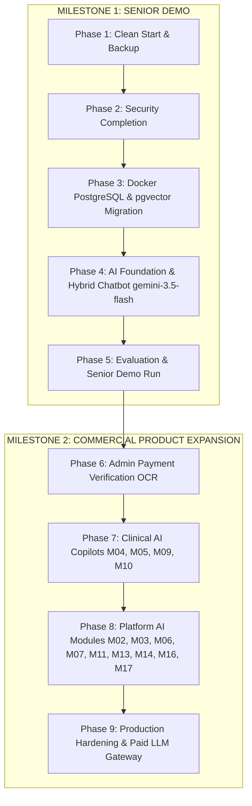

# Quick Care V2 — Deliverable 09: Master Phased Roadmap

**Document:** `docs/v2-plan/09-ROADMAP.md`  
**Purpose:** Establish an authoritative, dependency-mapped development roadmap spanning clean start, security completion, Docker PostgreSQL setup, AI foundation with `gemini-3.5-flash`, senior demo delivery, and subsequent production modules.

---

## 1. Roadmap Architecture & Milestone Overview

---

## 2. Phase-by-Phase Technical Specifications

### Phase 1: Clean Start & Baseline Archival (Demo Pre-requisite)
- **Scope:** Create verified zip backup outside workspace (`C:\Users\Mubeen\Desktop\QuickCare-Backups\quickcare_backup_pre_clean_<timestamp>.zip`); present deletion list and wait for user confirmation; wipe dummy SQLite databases, legacy test uploads, `mkcert.exe.exe`, and temporary scripts; preserve core codebase (`app/`, `tests/`, `.env`, `deploy/`, `audit-output/`, `docs/v2-plan/`, `scripts/`).
- **Rough Effort:** 0.5 Day.
- **Dependencies:** None (First Action).
- **Acceptance Criteria:**
  - [ ] Backup zip created, verified, and SHA-256 checksum recorded.
  - [ ] Working tree clean of binary clutter (`mkcert.exe.exe` removed).
  - [ ] Fresh directory structure created under `instance/private_uploads/`.
  - [ ] Full pytest suite passes and app boots cleanly.

---

### Phase 2: Security Completion: SEC-01 & SEC-03 (Demo Pre-requisite)
- **Scope:** Finalize SEC-03 private upload isolation (record-ID based serving, zero filename exposure, complete RBAC matrix); finalize SEC-01 CSRF protection (`CSRFProtect(app)`, same-origin fetch interceptor, `WTF_CSRF_TIME_LIMIT=None`, friendly error handler, Safepay webhook exemption). Zero file migration needed due to clean start.
- **Rough Effort:** 1.0 Day.
- **Dependencies:** Phase 1.
- **Acceptance Criteria:**
  - [ ] Direct `/static/uploads/*` access to private documents returns HTTP 404.
  - [ ] Record-ID endpoints enforce doctor-patient appointment relationship gates.
  - [ ] Mutating POST/PUT/DELETE forms and fetch requests reject missing CSRF tokens with friendly feedback.
  - [ ] All 64 existing pytest cases pass.

---

### Phase 3: PostgreSQL & pgvector Migration via Docker (Demo Pre-requisite)
- **Scope:** Configure root `docker-compose.yml` with `pgvector/pgvector:pg16` bound to `127.0.0.1:5432`; initialize Flask-Migrate with clean baseline migration (`0001_initial_postgres_baseline.py`); remove procedural startup `ALTER TABLE` scripts; add missing foreign key indexes; adapt JSON columns to `JSONB` and full-text search to `tsvector`; seed fresh Pakistani demo dataset with SVG placeholder avatars (`scripts/seed_demo.py`).
- **Rough Effort:** 1.5 Days.
- **Dependencies:** Phase 2.
- **Acceptance Criteria:**
  - [ ] Docker container `quickcare_postgres` running with `vector` extension active.
  - [ ] `flask db upgrade` executes cleanly from cold start.
  - [ ] Seed script successfully populates 12 demo doctors (SVG avatars), 6 patients, and appointments.
  - [ ] Pytest suite executes against PostgreSQL test database.

---

### Phase 4: Core Doctor–Patient Workflow & Platform Enhancements (PostgreSQL) — COMPLETED
- **Branch:** `v2-phase4-core-flows`
- **Scope:** Complete end-to-end audit of core clinical and transactional workflows on PostgreSQL; resolve approved doctor directory visibility bug; implement database-driven admin-managed clinical departments; enable segregated physical vs. online consultation availability and pricing with double-booking prevention; build comprehensive multi-filter search and Haversine geolocation "Near Me" ranking; build admin user lifecycle management (patient/doctor active toggle, detailed activity summary); implement dual-consent consultation voice transcription prototype with zero-audio retention policy.
- **Status:** COMPLETED & VERIFIED (74 tests passing on PostgreSQL 16, 12 verified collision-free browser audit screenshots).
- **Deliverables & Acceptance Criteria:**
  - [x] **Doctor Visibility Fix:** Newly approved doctors without initial schedules appear immediately in department directories with "Consultation schedule opening soon" badge.
  - [x] **Admin-Managed Departments:** Dynamic `departments` table, Alembic migration, admin CRUD (`/admin/departments`), doctor FK association, and 30 backfilled specialties.
  - [x] **Physical vs. Online Segregation:** Separate fee and schedule management, lat/lng coordinates for physical practices, cross-mode double-booking prevention.
  - [x] **Find Doctors Ranking & Geolocation:** Multi-criteria filtering (department, consultation type, fee range, city, gender, availability) + sorting (rating, experience, fee, soonest) + Haversine geolocation "Near Me" distance calculation.
  - [x] **Admin User Lifecycle Management:** Instant activate/deactivate toggle for patients and doctors, patient lifetime spend/appointment profile view (`/admin/patients/<id>/details`).
  - [x] **Voice Transcription Prototype:** Dual-consent handshake UI in video consultation room, client MediaRecorder recording loop, transcription engine integration, guaranteed immediate raw audio unlinking (`os.remove`) in `finally` block.

---

### Phase 5: AI Foundation & Hybrid Chatbot Core (Demo Pre-requisite)
- **Scope:** Implement deterministic red-flag safety check (Rescue 1122 / Edhi 115); hybrid intent router; CAG prompt injection with verified platform knowledge; pgvector hybrid RAG (`gemini-embedding-001` with HNSW cosine index); live DB tools (`get_approved_doctors`, `get_available_doctor_slots`) with transparent code ranking formula; ChatGPT-style sidebar conversation persistence (`conversations`, `messages`); SSE streaming endpoint (`/api/ai/chat/stream`) powered by `gemini-3.5-flash`; clean quota handling on 429; zero-PHI `ai_runs` usage logging and admin analytics page.
- **Rough Effort:** 3.0 Days.
- **Dependencies:** Phase 3.
- **Acceptance Criteria:**
  - [ ] Red-flag symptoms trigger immediate 1122 emergency dispatch card ($< 5\text{ ms}$).
  - [ ] Chatbot streams tokens via SSE over HTTP without socket framing bottlenecks.
  - [ ] Doctor recommendations return real, non-conflicting slots from live database.
  - [ ] Zero PHI stored in `ai_runs` audit table.

---

### Phase 5: Testing, Evaluation & Senior Demo Delivery (Demo Milestone)
- **Scope:** Run 40+ case Gold Benchmark Red-Flag Evaluation set (100% recall mandatory); verify Roman Urdu comprehension; conduct browser verification checklist; execute 10-minute presentation dry run with contingency fallback testing (`[Demo cached answer]` labeling).
- **Rough Effort:** 1.0 Day.
- **Dependencies:** Phase 4.
- **Acceptance Criteria:**
  - [ ] 40+/40+ emergency test cases intercepted (100% Recall release gate met).
  - [ ] 0 doctor or slot hallucinations observed.
  - [ ] Successful demo presentation to senior leadership.

---

### Phase 6: Admin Payment Verification Assistant (Post-Demo)
- **Scope:** Multimodal OCR module for EasyPaisa / JazzCash / Bank transfer receipts. Extracts transaction ID (TID), timestamp, and amount; matches against appointment fee; detects duplicate screenshots and flags altered images for admin review.
- **Rough Effort:** 1.5 Days.
- **Dependencies:** Phase 5 (Demo completed).
- **Acceptance Criteria:**
  - [ ] Automated extraction of TID and amount with $> 92\%$ accuracy on clean screenshots.
  - [ ] Flags duplicate TIDs across previous appointments to prevent receipt fraud.

---

### Phase 7: Clinical AI Copilots (Post-Demo)
- **Scope:** Implement clinical consultation assistance modules:
  - **M04 (Prescription Explanation):** Generates patient-friendly explanations, dosage reminders, and dietary precautions from completed prescriptions.
  - **M05 (Patient Lab Report OCR & Explainer):** Interprets blood counts, lipid panels, and radiology impressions in accessible terms with safety disclaimers.
  - **M09 (Clinical Prescription Assistant):** Doctor copilot suggesting standard drug dosages, contraindications, and drug-drug interaction warnings during prescription creation.
  - **M10 (Differential Diagnosis Assistant):** Evidence-based differential suggestions mapped to ICD-10 categories based on entered vitals and complaints.
- **Rough Effort:** 4.0 Days.
- **Dependencies:** Phase 6.
- **Acceptance Criteria:**
  - [ ] All suggestions carry explicit clinical disclaimers and require doctor confirmation.
  - [ ] Zero autonomous prescription generation without licensed doctor sign-off.

---

### Phase 8: Platform Operations AI Modules (Post-Demo)
- **Scope:** Roll out remaining non-clinical platform AI modules:
  - **M02 (Q&A Draft Assistant):** Drafts preliminary answers for doctors in community Q&A.
  - **M03 (Medical History Timeline Summarizer):** Compiles multi-visit clinical summaries.
  - **M06 (Post-Consultation Care Plan):** Formulates follow-up lifestyle and recovery checklists.
  - **M07 (Preventative Health Risk Checklist):** Generates wellness recommendations based on age/lifestyle.
  - **M11 (Doctor Blog Generator & Assistant):** Assists doctors in drafting educational health articles.
  - **M13 (Doctor Q&A Inbox Triage):** Prioritizes urgent patient questions in doctor queues.
  - **M14 (Doctor Credential & PMC Verification OCR):** Compares PMDC/PMC certificates against doctor registration data.
  - **M16 (Blog Moderation & Clinical Accuracy Checker):** Automated screening of doctor articles for medical accuracy and policy compliance prior to admin approval.
  - **M17 (Review Fraud & Sentiment Analysis):** Flags suspicious or abusive patient review submissions.
  *(Note: Modules M08, M12, and M15 remain explicitly excluded/dropped from scope).*
- **Rough Effort:** 5.0 Days.
- **Dependencies:** Phase 7.

---

### Phase 9: Production Hardening & Paid LLM Migration Gateway (Post-Demo)
- **Scope:** Configure Gunicorn multi-worker concurrency (`workers=4, threads=2`); transition `AIGateway` to paid Gemini Flash or Anthropic Claude; finalize production CDN and SSL termination.
- **Rough Effort:** 2.0 Days.
- **Dependencies:** Phase 8.
- **Acceptance Criteria:**
  - [ ] Gunicorn runs stably under multi-worker configuration with zero database locking.
  - [ ] Paid API keys configured with automated spending limits and alerting.
