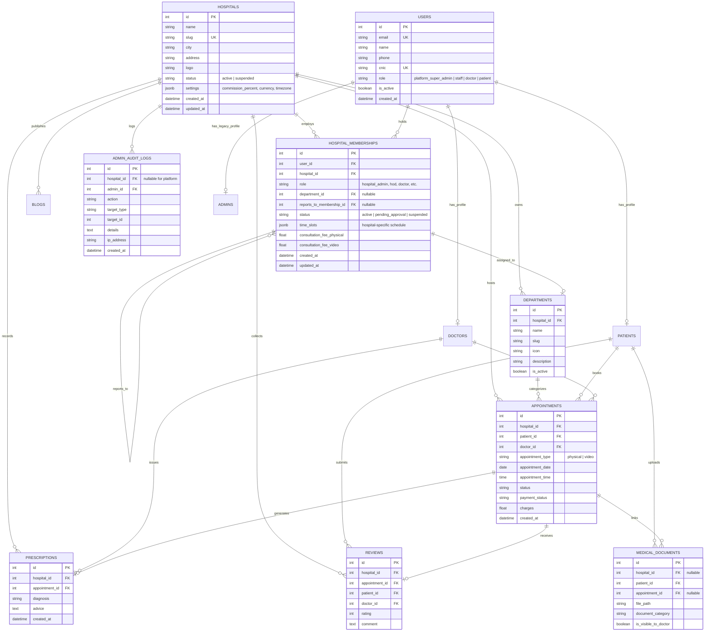
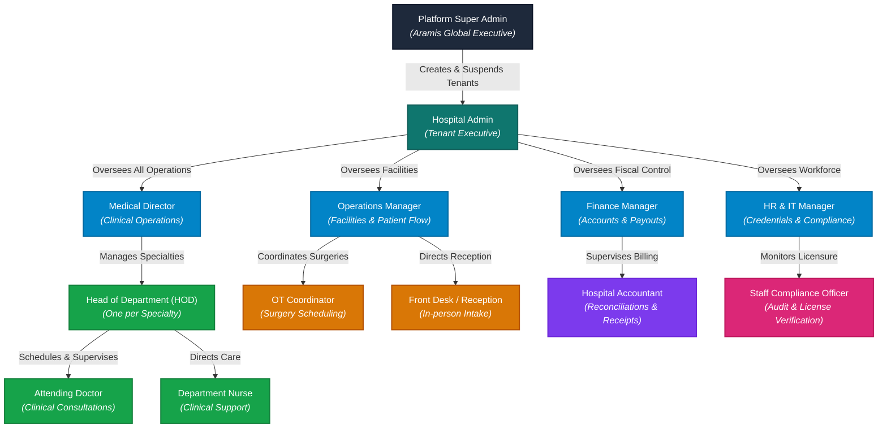
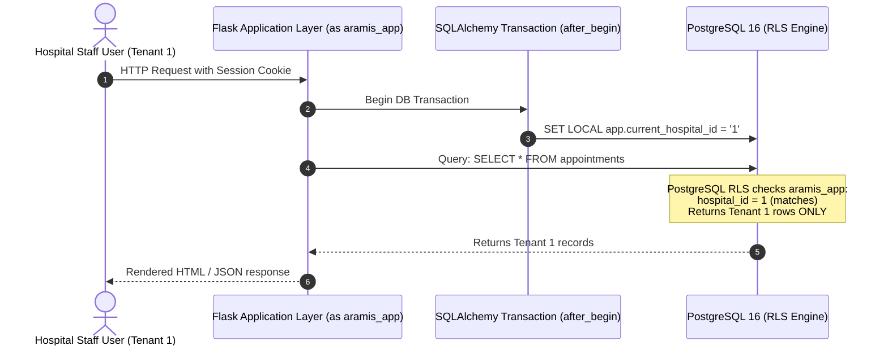

# Aramis AI Healthcare Solutions: Multi-Tenancy & Hospital Hierarchy Design Specification

**Document:** `docs/v2-plan/13-MULTITENANCY-DESIGN.md`  
**Brand Identity:** Aramis AI Healthcare Solutions ("Aramis Health")  
**Target Architecture:** Multi-Tenant Healthcare Enterprise Platform  
**Target Release:** Quick Care 2.0 / Aramis Health Phase 5  

---

## 1. Executive Summary & Architecture Goals

**Aramis AI Healthcare Solutions** transforms the platform from a single-facility clinic directory into a modern, multi-tenant enterprise hospital operating system.

In this architecture:
1. **Multi-Tenancy:** Each hospital or healthcare network operates as an isolated tenant (`hospitals`) with its own departments, clinical staff, schedules, fees, clinical records, financials, and audit trails.
2. **Global Identity with Local Memberships:** Users maintain a single global account (`users`). Their authority within a hospital is governed strictly by `hospital_memberships`. A doctor or executive can belong to multiple hospitals with distinct roles and reporting structures in each.
3. **Global Patients:** Patients have a single unified identity across the ecosystem. A patient can book appointments, consult specialists, and receive prescriptions at any hospital on the platform. Patients view their consolidated health history across all hospitals, while hospital staff only access clinical data for visits conducted at their own hospital.
4. **Two-Layer Data Isolation:** Data isolation is enforced at both the **application layer** (mandatory tenant scoping helper on every query) and the **database layer** (PostgreSQL Row-Level Security with transaction-level `SET LOCAL app.current_hospital_id` and non-superuser `aramis_app` connection).
5. **Hierarchical RBAC & Anti-Escalation:** An explicit administrative reporting hierarchy governs who can assign roles and manage personnel. Users can only manage roles strictly subordinate to their own within their authorized scope. Finance personnel are segregated from clinical content via strict permission-based separation.
6. **Future Extensibility:** Aramis Health serves as the identity and operational hub for teammate products (DocAssist voice receptionist, Med-Care clinical scribe, OR surgical scheduling, and Knowledge Assistant).

---

## 2. Multi-Tenancy Domain Model & ER Diagram



---

## 3. Hospital Organizational Hierarchy

The platform defines a strict reporting hierarchy within each hospital tenant. No user may assign or alter roles equal to or above their own level, or outside their department scope.



---

## 4. Role Capabilities & Permission Matrix

| Role | Hierarchy Level | Allowed Scope | Clinical Record Access | Financial / Payout Access | Staff Management Capability | Doctor Approval Authority |
| :--- | :--- | :--- | :---: | :---: | :--- | :---: |
| **`platform_super_admin`** | 0 (Global) | All Tenants | Audit Only | Platform Commission Only | Can onboard / suspend `hospital_admin` | Global Platform Override |
| **`hospital_admin`** | 1 (Executive) | Whole Hospital | Summary Only | Full Hospital Financials | Can invite/edit/remove all roles below Level 1 | Yes (All Departments) |
| **`medical_director`** | 2 (Manager) | Whole Hospital | Full (Consultations, EHR) | View Only (Consultation charges) | Can manage HODs, Doctors, Nurses | Yes (All Departments) |
| **`operations_manager`** | 2 (Manager) | Whole Hospital | Appointments Only | View Only (Appointment status) | Can manage OT Coordinators, Front Desk | No |
| **`finance_manager`** | 2 (Manager) | Whole Hospital | **BLOCKED (Zero Clinical Access)** | Full (Payouts, Refunds, Ledger) | Can manage Accountants | No |
| **`hr_it_manager`** | 2 (Manager) | Whole Hospital | No (Audit Only) | No | Can manage Staff Compliance officers | No (Verifies Credentials) |
| **`hod`** | 3 (Supervisor) | Own Department | Full for Own Department | View Department Consultation Fees | Can manage Doctors & Nurses in own dept | Yes (Own Department Only) |
| **`doctor`** | 4 (Staff) | Assigned Patients | Full for Assigned Consultations | View Own Earnings & Payouts | None | No |
| **`nurse`** | 4 (Staff) | Own Department | Vitals & Notes in Own Dept | None | None | No |
| **`ot_coordinator`** | 4 (Staff) | Operations | Surgical Slots & Queue Only | None | None | No |
| **`front_desk`** | 4 (Staff) | Operations | Patient Check-in, Queue Only | Collect In-person Payments | None | No |
| **`accountant`** | 4 (Staff) | Finance | **BLOCKED (Zero Clinical Access)** | Verify Receipts & Batch Payouts | None | No |
| **`staff_compliance`**| 4 (Staff) | HR / IT | License & Credentials Verification | None | None | No |

---

## 5. Security & Isolation Rules

### 5.1 Two-Layer Tenant Isolation & Role Architecture



#### A. PostgreSQL Roles & Privilege Architecture
1. **Migration / Schema Owner Role (`quickcare_user` / `postgres`):**
   - Superuser / table owner.
   - Used **exclusively** for running Alembic migrations, creating tables, managing indexes, and provisioning RLS policies.
   - **Never used by normal application runtime routes.**
2. **Application Runtime Role (`aramis_app`):**
   - Non-superuser, non-owner (`NOSUPERUSER`, `NOCREATEDB`, `NOBYPASSRLS`).
   - Granted only needed privileges on application tables (`SELECT, INSERT, UPDATE, DELETE`) and sequences (`USAGE, SELECT, UPDATE`).
   - Normal application requests and standard test suites connect exclusively as `aramis_app`.
   - **PostgreSQL Row-Level Security strictly enforces tenant boundaries on this role.**
3. **Platform Super Admin Role (`aramis_platform`):**
   - Dedicated role with PostgreSQL native `BYPASSRLS` attribute (`ALTER ROLE aramis_platform BYPASSRLS;`).
   - Used **exclusively** by platform super admin operations (e.g. cross-tenant health metrics, onboarding new hospitals, system auditing) through a separate, dedicated SQLAlchemy engine/connection pool.
   - Every usage of this engine is audited. Normal requests and hospital staff can never reach or invoke this connection.

#### B. Fail-Closed RLS Policy
- No magic `'bypass'` string in GUC or SQL policies.
- RLS policy definition across all tenant tables:
  ```sql
  CREATE POLICY tenant_isolation_policy ON <tenant_table>
  FOR ALL
  TO aramis_app
  USING (
      hospital_id = NULLIF(current_setting('app.current_hospital_id', true), '')::integer
  );
  ```
- **Fail-Closed Guarantee:**
  - If `app.current_hospital_id` is set to `'1'`, only rows with `hospital_id = 1` are visible/modifiable.
  - If `app.current_hospital_id` is unset, empty, or invalid, `NULLIF('', '')` evaluates to `NULL`. The condition `hospital_id = NULL` evaluates to `UNKNOWN` (falsy in SQL boolean logic). **Zero rows are returned, preventing any accidental data leakage.**

#### C. Transaction-Level Tenant Context (`after_begin`)
- `SET LOCAL` is transaction-scoped in PostgreSQL.
- To prevent transaction pooling leakage and handle multi-query transactions, SQLAlchemy's `after_begin` event hook executes `SET LOCAL app.current_hospital_id = :hid;` at the start of every transaction whenever a tenant context is active.

#### D. Real RLS Verification Tests
- Direct raw SQL tests connecting as `aramis_app` to verify:
  1. Hospital A context can SELECT, UPDATE, DELETE Hospital A rows.
  2. Hospital A context receives 0 rows when attempting to SELECT, UPDATE, or DELETE Hospital B rows.
  3. A connection with no `app.current_hospital_id` set returns 0 rows (fail-closed).
  4. Platform super-admin engine (`aramis_platform`) can read cross-tenant summary metrics.

### 5.2 Strict Anti-Privilege Escalation Rules
1. **Reporting Line Invariant:** A user can only create, update, or deactivate a membership whose role is ranked **strictly below** their own role in the hierarchy tree.
2. **Department Scope Invariant:** An `hod` or department supervisor can only manage members assigned to their **exact department** (`department_id`).
3. **No Self-Promotion:** A user cannot edit their own membership, role, reporting line, or status.
4. **Immutable Audit Trail:** Every membership creation, promotion, role adjustment, and deactivation is written to `admin_audit_logs` with actor ID, target user ID, role changes, and IP address.

### 5.3 Finance-Clinical Separation Rule
- Finance accounts (`finance_manager`, `accountant`) have access to appointment financial metadata: `charges`, `payment_status`, `platform_commission_amount`, `doctor_transactions`, `refunds`, and `payout_details`.
- Finance accounts are **explicitly blocked** from accessing clinical payload fields:
  - `Appointment.symptoms`, `Appointment.disease_category`, `Appointment.notes`
  - `Appointment.consultation_transcript`
  - `Prescription` and `PrescriptionMedicine`
  - `MedicalHistory` and `MedicalDocument`
- Access attempts return HTTP 404 (or censored view) and trigger an audit warning.

---

## 6. Global Patient & Multi-Hospital Doctor Lifecycle

### 6.1 Global Patient Experience
1. A patient registers once at `aramishealth.com/auth/register`.
2. On `Find Doctors`, the patient can browse specialists across all active hospitals, or filter by specific hospital (e.g. "Aramis Demo Hospital" in Lahore vs. "Aramis City Clinic" in Islamabad).
3. The patient dashboard displays all appointments across hospitals, clearly badged with the hospital name.
4. When visiting Hospital A, staff at Hospital A only see the patient's records related to Hospital A visits unless the patient explicitly links prior medical records to the appointment.

### 6.2 Doctor Multi-Hospital Affiliation & Approval
1. A doctor registers a global profile (qualifications, PMC license, education, bio).
2. The doctor applies for affiliation with Hospital A (Department: Cardiology) and Hospital B (Department: Internal Medicine).
3. In Hospital A, the Medical Director or Cardiology HOD approves the doctor. The doctor is now active in Hospital A with custom Hospital A consultation fees and slots.
4. In Hospital B, the application is pending until reviewed by Hospital B's leadership.
5. In public search, the doctor appears under Hospital A's cardiology listing, but will not appear under Hospital B until approved there.

