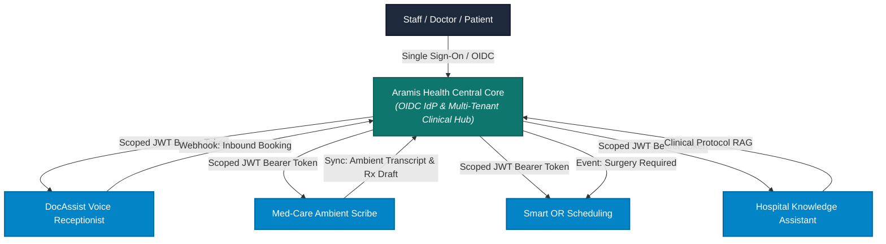

# Aramis AI Healthcare Solutions — Integration Contract & Unified Platform Architecture
**Document Reference:** `docs/v2-plan/14-INTEGRATION-CONTRACT.md`  
**Author:** DeepMind Agentic Pair Programmer & Aramis Core Engineering Team  
**System Version:** Aramis Health 2.0 (Multi-Tenant Hospital OS)  
**Status:** Approved Standard Integration Specification  

---

## 1. Executive Overview

Aramis AI Healthcare Solutions ("Aramis Health") serves as the centralized identity provider, hospital organization registry, and clinical transaction hub for an integrated suite of specialized healthcare micro-products:
1. **DocAssist Voice Receptionist:** Autonomous AI phone & conversational receptionist for incoming patient inquiries, queue routing, and automated booking.
2. **Med-Care Ambient AI Scribe:** Real-time conversational ambient clinical scribe generating structured SOAP notes, diagnostic codes, and draft prescriptions during consultations.
3. **Smart OR Scheduling:** Autonomous operating theater schedule optimizer, equipment allocator, and surgical team coordinator.
4. **Knowledge Assistant:** Hospital-specific clinical protocol, pharmacopeia, and compliance RAG (Retrieval-Augmented Generation) assistant.

This contract defines the canonical authentication protocols, JWT claims structure, tenant scoping invariants, role capability mappings, REST/Webhook schemas, and backward-compatible migration paths.



---

## 2. Authentication & Identity Architecture (SSO / OIDC)

### 2.1 Protocol Specification
- **Standard:** OpenID Connect Core 1.0 / OAuth 2.0 with Authorization Code Flow + PKCE (`RFC 7636`) for interactive clients, and Client Credentials Flow for server-to-server microservice communication.
- **Issuer URI:** `https://auth.aramis.health` (or `http://localhost:5000/auth/oidc` in local dev).
- **Token Format:** Signed JSON Web Tokens (`RFC 7519`) using asymmetric RSA-SHA256 (`RS256`).

### 2.2 Canonical JWT Access Token Claims
Every JWT emitted by Aramis Health encodes the user's global identity along with their granular tenant memberships:

```json
{
  "iss": "https://auth.aramis.health",
  "sub": "usr_941029",
  "aud": ["aramis_docassist", "aramis_medcare", "aramis_or", "aramis_knowledge"],
  "exp": 1793708400,
  "iat": 1793672400,
  "jti": "jwt_b5a1c9e8-7821-4f12-9cbb-842f1a91e0a2",
  "user": {
    "name": "Dr. Tariq Mahmood",
    "email": "dr.tariq@example.com",
    "phone": "+923007100006",
    "cnic": "35201-7100006-1",
    "global_role": "doctor"
  },
  "active_tenant": {
    "hospital_id": 1,
    "hospital_name": "Aramis Demo Hospital",
    "hospital_slug": "aramis-demo",
    "city": "Lahore"
  },
  "memberships": [
    {
      "hospital_id": 1,
      "hospital_slug": "aramis-demo",
      "role": "hod",
      "level": 3,
      "department_id": 1,
      "department_name": "Cardiology",
      "reports_to_membership_id": 2
    },
    {
      "hospital_id": 1,
      "hospital_slug": "aramis-demo",
      "role": "doctor",
      "level": 4,
      "department_id": 1,
      "department_name": "Cardiology",
      "reports_to_membership_id": 6
    },
    {
      "hospital_id": 2,
      "hospital_slug": "aramis-city-clinic",
      "role": "doctor",
      "level": 4,
      "department_id": 31,
      "department_name": "Cardiology",
      "reports_to_membership_id": 18
    }
  ],
  "scopes": [
    "clinical:read",
    "clinical:write",
    "prescriptions:write",
    "or:schedule_view",
    "scribe:execute"
  ]
}
```

---

## 3. Cross-Product Tenant Scoping & Isolation

### 3.1 Tenant Isolation Invariant
1. Every external tool request **MUST** supply a valid bearer JWT containing `active_tenant.hospital_id`.
2. All tables created by integrated micro-products (e.g. `or_theaters`, `or_reservations`, `scribe_sessions`, `voice_call_logs`, `knowledge_documents`) **MUST** contain a non-nullable `hospital_id integer` foreign key referencing `hospitals(id)`.
3. In PostgreSQL databases, every micro-product must enable Row-Level Security:
   ```sql
   ALTER TABLE <micro_product_table> ENABLE ROW LEVEL SECURITY;
   CREATE POLICY tenant_isolation_policy ON <micro_product_table>
   FOR ALL TO aramis_app
   USING (hospital_id = NULLIF(current_setting('app.current_hospital_id', true), '')::integer);
   ```

---

## 4. Hierarchy Mapping & Capability Matrix

Each integrating product enforces permissions derived from the user's `HospitalMembership.role`:

| Hospital Role | Level | DocAssist (Voice Receptionist) | Med-Care (Ambient Scribe) | Smart OR Scheduling | Knowledge Assistant |
| :--- | :---: | :--- | :--- | :--- | :--- |
| **`platform_super_admin`** | 0 | Global system analytics & telephony configuration | Global model telemetry & benchmark audits | Global surgical facility metrics | Platform compliance & protocol provisioning |
| **`hospital_admin`** | 1 | Configure hospital phone lines, IVR tree, and voice personality | Review ambient AI audit logs and consent compliance | Oversee all surgical theaters, block times, and emergency overrides | Upload & enforce hospital-wide SOPs and clinical guidelines |
| **`medical_director`** | 2 | Review clinical escalation recordings | Ambient transcription quality assurance & diagnostic code review | Prioritize elective vs emergency surgeries across departments | Approve clinical decision support & medication formularies |
| **`operations_manager`** | 2 | Staff shift scheduling & call center metrics | Telephony bandwidth & server health monitoring | Theater cleaning, turnover time, and equipment maintenance | Operational manuals & disaster recovery workflows |
| **`finance_manager`** | 2 | Call billing & telecom charge reconciliation | **BLOCKED (Zero clinical or audio access)** | Track OR cost-per-hour and consumable utilization | Audit financial and tariff schedules |
| **`hr_it_manager`** | 2 | Telephony agent extensions & SIP routing | Hardware integration & ambient mic provisioning | Manage surgical technician credentialing | Maintain employee handbooks & onboarding documentation |
| **`hod` (Dept Head)** | 3 | Review department patient routing rules | Review department-wide clinical transcripts & SOAP summaries | Approve department surgical block allocations | Curate department clinical guidelines & standard drug orders |
| **`doctor` (Attending)** | 4 | Receive caller notifications for appointment requests | **Full execution:** start ambient recording, review transcript, approve draft SOAP / Rx | Request OR slots, assign surgical team, confirm preoperative checklist | Query drug interactions, diagnostic protocols, and dosing guidelines |
| **`nurse`** | 4 | View scheduled arrivals & triage notifications | Pre-consultation vitals entry & patient ambient consent validation | Post-anesthesia care unit (PACU) recovery updates | Review nursing care plans and clinical checklists |
| **`ot_coordinator`** | 4 | Read-only check-in status | **BLOCKED (Zero transcript access)** | **Full operational control:** assign OR rooms, resolve scheduling conflicts | View surgical equipment manuals and sterility guidelines |
| **`front_desk`** | 4 | **Full access:** live inbound call monitor, caller transfer, manual check-in | **BLOCKED (Zero clinical access)** | View patient surgical admission dates | View hospital visiting hours, fee tariffs, and doctor schedules |
| **`accountant`** | 4 | Reconcile OPD consultation fees | **BLOCKED (Zero clinical access)** | Verify surgeon and anesthetist procedural billings | View tariff sheets |
| **`staff_compliance`**| 4 | Audit call recording retention compliance | Verify patient HIPAA / PECA consent logs | Audit surgical safety checklists & sterilization certs | Verify mandatory regulatory documentation |

---

## 5. Standard APIs & Webhooks

### 5.1 Endpoints Exposed by Aramis Health Core

#### A. Inbound Appointment from DocAssist Voice Receptionist
```http
POST /api/v1/integrations/appointments/inbound-voice
Authorization: Bearer <JWT>
Content-Type: application/json
```
**Request Payload:**
```json
{
  "hospital_id": 1,
  "patient_phone": "+923001234567",
  "patient_name": "Hamza Abbasi",
  "patient_cnic": "35201-9988776-1",
  "preferred_doctor_id": 1,
  "appointment_type": "physical",
  "requested_date": "2026-11-05",
  "requested_time": "14:30:00",
  "disease_category": "Cardiology",
  "symptoms_summary": "Experiencing recurring palpitations and chest tightness after mild exertion.",
  "call_recording_id": "rec_da_889123",
  "call_duration_seconds": 185
}
```
**Response (201 Created):**
```json
{
  "status": "success",
  "appointment_id": 402,
  "hospital_id": 1,
  "payment_deadline": "2026-11-03T14:45:00+05:00",
  "message": "Appointment provisionally booked. Payment reservation held for 15 minutes."
}
```

#### B. Ambient Consultation Sync from Med-Care Ambient Scribe
```http
POST /api/v1/integrations/consultations/{appointment_id}/sync-scribe
Authorization: Bearer <JWT>
Content-Type: application/json
```
**Request Payload:**
```json
{
  "hospital_id": 1,
  "doctor_id": 1,
  "patient_id": 1,
  "dual_consent_verified": true,
  "consultation_transcript": "Doctor: Good afternoon Ahmed. How are your headaches?\nPatient: Much better since starting the beta blocker, doctor.",
  "soap_note": {
    "subjective": "Patient reports significant reduction in morning tension headaches.",
    "objective": "BP: 125/82 mmHg, Pulse: 72 bpm, regular.",
    "assessment": "Essential hypertension under excellent pharmacological control.",
    "plan": "Continue current regimen. Repeat lipid profile in 3 months."
  },
  "suggested_medicines": [
    {
      "medicine_name": "Bisoprolol (Concor)",
      "dosage": "5mg",
      "frequency": "Once daily",
      "duration": "30 days",
      "instructions": "Take after breakfast"
    }
  ],
  "audio_purged_at": "2026-11-03T12:30:00+05:00"
}
```
**Response (200 OK):**
```json
{
  "status": "success",
  "appointment_id": 14,
  "prescription_unlocked": true,
  "draft_prescription_id": 28,
  "message": "Ambient notes and draft prescription synchronized successfully."
}
```

### 5.2 Outbound Webhook Events Published by Aramis Health

Integrated systems subscribe to events published via HMAC-SHA256 signed webhooks (`X-Aramis-Signature` header):

| Event Name | Trigger Condition | Primary Consumers | Payload Summary |
| :--- | :--- | :--- | :--- |
| `appointment.booked` | Patient reserves slot | DocAssist, Front Desk | `appointment_id`, `patient_id`, `hospital_id`, `doctor_id`, `datetime` |
| `appointment.payment_approved` | Payment marked approved | Med-Care Scribe, DocAssist | `appointment_id`, `amount`, `payment_method`, `video_unlocked` |
| `patient.checked_in` | Patient arrives at facility | Smart OR, Med-Care Scribe | `patient_id`, `appointment_id`, `queue_number`, `vitals` |
| `consultation.completed` | Doctor finalizes review | Billing, Knowledge Assistant | `appointment_id`, `diagnosis_code`, `prescription_id`, `charges` |
| `surgery.recommended` | Doctor orders surgical procedure | Smart OR Scheduling | `patient_id`, `surgeon_id`, `procedure_code`, `urgency_level` |

---

## 6. Single-Hospital to Multi-Tenant Migration Roadmap

1. **Phase 1: Shared Core Deployment:**
   - Deploy Aramis Health Core with PostgreSQL RLS and multi-tenant schema migrations.
   - Run `scripts/migrate_tenant_data.py` to move existing unassigned records to Hospital Tenant 1 (`Aramis Demo Hospital`).
2. **Phase 2: Micro-Product Adapter Configuration:**
   - Configure DocAssist, Med-Care, OR Scheduling, and Knowledge Assistant to consume JWTs from `auth.aramis.health`.
   - Update client DB connections to use non-superuser role `aramis_app`.
3. **Phase 3: Tenant Gateway Routing:**
   - Enable the Hospital Switcher navbar component across client UIs.
   - Route telephone DID trunks by `hospital_id` in DocAssist voice gateways.
4. **Phase 4: Full Network Rollout:**
   - Onboard external hospital tenants (e.g. `aramis-city-clinic`) via the Platform Super Admin Console.

